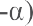

# CAPITULO 3.3

> **DISPOSICIONES ESPECIALES APLICABLES A UNA MATERIA O A UN OBJETO
> PARTICULAR**

3.3.1 Dentro de este capítulo se encuentran las disposiciones especiales
que corresponden a los números indicados en la columna (6) de la tabla A
del capítulo 3.2 referente a las materias u objetos a los cuales se
aplican estas disposiciones. Cuando una disposición especial comprenda
una disposición en materia de marcado de los embalajes/envases, se
aplicarán las disposiciones enunciadas en 5.2.1.2 a) y b). Si la marca
exigida es un texto específico indicado entre comillas, por ejemplo
\"PILAS DE LITIO PARA ELIMINACIÓN\", el tamaño mínimo de la marca será
de 12 mm salvo que se especifique otra cosa en la disposición especial o
en otra parte del ADR.

16 Las muestras de materias u objetos explosivos nuevos o existentes,
transportadas conforme a las instrucciones de las autoridades
competentes (véase el 2.2.1.1.3), a fines, entre otros, de ensayo,
clasificación, investigación y desarrollo, de control de calidad o como
muestras comerciales. La masa de muestras explosivas sin mojar ni
desensibilizar queda limitado a 10 kg en pequeños bultos, según lo
disponga la autoridad competente. La masa de muestras explosivas mojadas
o desensibilizadas queda limitado a 25 kg.

23 Aunque esta materia presenta peligro de inflamación, éste sólo existe
en caso de incendio violento en un lugar cerrado.

28 Esta sustancia puede transportarse conforme a las disposiciones de la
clase 3 o la clase 4.1 solo si está embalada/envasada de modo que el
porcentaje del diluyente no descienda por debajo del indicado, en ningún
momento durante el transporte (véanse 2.2.3.1.1 y 2.2.41.1.18). Cuando
no se indique la cantidad del diluyente, la sustancia se
embalará/envasará de modo que la cantidad de sustancia explosiva no
supere el valor indicado

32 Esta materia no estará sometida a las prescripciones del ADR cuando
esté bajo alguna otra forma.

37 Esta materia no estará sometida a las prescripciones del ADR cuando
esté recubierta.

38 Esta materia no estará sometida a las prescripciones del ADR cuando
contenga un máximo del 0,1% de carburo de calcio.

39 Esta materia no estará sometida a las prescripciones del ADR cuando
contenga menos del 30% o un mínimo del 90% de silicio.

43 Cuando se presenten para su transporte como plaguicidas, estas
materias se transportarán conforme al epígrafe de plaguicidas
correspondiente y con arreglo a las disposiciones correspondientes sobre
los plaguicidas (véase 2.2.61.1.10 al 2.2.61.1.11.2).

45 El sulfuro y los óxidos de antimonio, cuyo contenido de arsénico no
excede del 0,5% en relación con la masa total, no están sometidos a las
disposiciones del ADR.

47. Los ferricianuros y los ferrocianuros no están sometidos a las
    disposiciones del ADR.

48. Esta materia no se admitirá al transporte si contiene más de un 20%
    de ácido cianhídrico.

```{=html}
<!-- -->
```
59. Esta materia no estará sometida a las prescripciones del ADR cuando
    no contenga más del 50% de magnesio.

60. Esta materia no se admitirá al transporte cuando su concentración es
    superior al 72%.

61. El nombre técnico que complementará la designación oficial de
    transporte será el nombre común aprobado por la ISO (véase ISO
    1750:1981, en su versión modificada *\"Productos fitosanitarios y
    similares - Nombres comunes\"*) los otros nombres que figuren en las
    *"Líneas directrices para la clasificación de los pesticidas por
    peligro, recomendadas por la OMS*\" (The WHO Recommended
    Classification of Pesticides by Hazard and Guidelines to
    Classification) o el nombre de la materia activa (véase también
    3.1.2.8.1 y 3.1.2.8.1.1).

62. Esta materia no estará sometida a las prescripciones del ADR cuando
    no contiene más del 4% de hidróxido de sodio.

65 El peróxido de hidrógeno en solución acuosa con menos del 8% de
peróxido de hidrógeno no está sometido a las prescripciones del ADR.

66 El cinabrio no está sujeto a los requisitos del ADR.

103 El nitrito amónico y sus soluciones acuosas y las mezclas de un
nitrito inorgánico con una sal de amonio no se admiten al transporte.

105 La nitrocelulosa correspondiente a las descripciones de los Nos. ONU
2556 y 2557 puede clasificarse en la clase 4.1.

113 No se permite el transporte de las mezclas químicamente inestables.

119 Las máquinas refrigeradoras comprenden las máquinas u otros aparatos
diseñados con el fin concreto de mantener alimentos u otros artículos a
una temperatura baja en un compartimento interno, y las unidades de
acondicionamiento de aire. Se considera que las máquinas refrigeradoras
y los elementos de máquinas refrigeradoras no estarán sometidas a las
disposiciones del ADR si contienen menos de 12 kg de un gas de la clase
2, grupo A u O según 2.2.2.1.3, o si contiene menos de 12 litros de
solución de amoníaco (N.º ONU 2672).

> ***NOTA:** A los efectos del transporte, las bombas de calor podrán
> considerarse máquinas refrigeradoras.*

122 Los peligros secundarios, si los hubiere, la temperatura de
regulación y la temperatura crítica, así como los Nos. ONU (número de
epígrafe genérico) para cada uno de los preparados de peróxidos
orgánicos que resulten afectados, se indican en 2.2.52.4, en la
instrucción de embalaje IBC 520 del 4.1.4.2 y en la instrucción de
transporte en cisternas portátiles T23 del 4.2.5.2.6.

> 123 *(Reservado).*

127 Se pueden utilizar otras materias inertes u otras mezclas de
materias inertes, siempre que esas materias inertes tengan propiedades
flemadoras idénticas.

131 La materia flegmatizada deberá ser claramente menos sensible que el
TNPE seco.

135 La sal sódica dihidratada del ácido dicloroisocianúrico no satisface
los criterios para su inclusión en la clase 5.1 y no está sujeta al ADR,
a menos que cumpla los criterios para su inclusión en otra clase.

138 El cianuro de p-bromobencilo no está sujeto a las disposiciones del
ADR.

141. Las materias que, habiendo experimentado un tratamiento térmico
     suficiente, no representen peligro alguno durante el transporte, no
     están sometidas a las disposiciones del ADR.

142. La harina de semillas de soja extraída mediante un disolvente, que
     contenga el 1,5% de aceite y el 11% de humedad, como máximo, y no
     contenga prácticamente ningún disolvente inflamable, no está sujeta
     a las disposiciones del ADR.

```{=html}
<!-- -->
```
144. No están sujetas a las disposiciones del ADR las soluciones acuosas
     que contienen un máximo del 24%, en volumen, de alcohol.

145. Las bebidas alcohólicas del grupo de embalaje III que se
     transportan en envases de 250 litros o menos no estarán sujetas a
     las disposiciones del ADR.

     152. La clasificación de esta materia variará según la
          granulometría y el envase o embalaje, pero no se han
          determinado experimentalmente las condiciones límite. Se
          efectuará la clasificación apropiada según se prescribe en
          2.2.1.

     153. Este epígrafe se utiliza solamente si, mediante ensayos, se
          demuestra que las materias, cuando se ponen en contacto con el
          agua, no son combustibles ni tienen tendencia a inflamarse
          espontáneamente, y que la mezcla de los gases que se
          desprenden no es inflamable.

```{=html}
<!-- -->
```
162. *(Suprimida)*

163. Una materia expresamente mencionada en la tabla A del capítulo 3.2
     no se transportará al amparo de este epígrafe. Las materias que se
     transporten conforme a éste podrán tener hasta un 20% de
     nitrocelulosa, a condición de que ésta no contenga más de un 12,6%
     de nitrógeno (masa seca).

```{=html}
<!-- -->
```
168. El amianto sumergido o fijado en un material maleable natural o
     artificial (como cemento, plástico, asfalto, resina o minerales),
     de manera que durante el transporte no puedan liberarse cantidades
     peligrosas de fibras y de amianto respirables, no estarán sometidos
     a las disposiciones del ADR. Los artículos manufacturados que
     contengan amianto no estarán sometidos a las disposiciones del ADR
     para el transporte, cuando estén embalados de tal manera que
     durante el transporte no puedan liberarse cantidades peligrosas de
     fibras de amianto respirables.

169. El anhídrido ftálico en estado sólido y los anhídridos
     tetrahidroftálicos con un máximo de 0,05% de anhídrido maleico no
     están sometidos a las disposiciones del ADR. El anhídrido ftálico
     fundido a una temperatura superior a su punto de inflamación, con
     un máximo de 0,05% de anhídrido maleico, se considera una materia
     con N.º ONU 3256.

172 Cuando una materia radiactiva presente un peligro secundario:

a)  La materia se adscribirá al grupo de embalaje I, II o III, según
    > proceda, conforme a los criterios de clasificación en los grupos
    > de embalaje previstos en la Parte 2, correspondiente a la
    > naturaleza del peligro secundario preponderante.

b)  Los bultos llevarán las etiquetas del peligro secundario presentado
    > por el material; las placas- etiquetas correspondientes se fijarán
    > sobre las unidades de transporte de acuerdo con las disposiciones
    > correspondientes del 5.3.1;

c)  A los efectos de la documentación y el marcado de los bultos, la
    > designación oficial de transporte se complementará con el nombre,
    > entre paréntesis, de los componentes que contribuyen de manera
    > preponderante a este o estos peligros subsidiarios

d)  El documento de transporte indicará, después del número de la clase
    > 7 y entre paréntesis, el o los números del modelo de etiqueta
    > correspondiente a cada riesgo subsidiario y, en su caso, el grupo
    > de embalaje al que está afectada la materia conforme al
    > 5.4.1.1.1.d)

> Para el embalaje/envase, véase también 4.1.9.1.5.

+---+-------------------------------------------------------------------+
| 1 | > El sulfato de bario no está sujeto a las prescripciones del     |
| 7 | > ADR.                                                            |
| 7 |                                                                   |
+===+===================================================================+
| 1 | > Esta denominación se empleará únicamente cuando no haya en la   |
| 7 | > tabla A del capítulo 3.2 ninguna otra que sea apropiada, y sólo |
| 8 | > con la aprobación de la autoridad competente del país de origen |
|   | > (véase 2.2.1.1.3).                                              |
+---+-------------------------------------------------------------------+
| 1 | > Los bultos que contengan esta materia deben llevar una etiqueta |
| 8 | > conforme al modelo N.º 1 (véase 5.2.2.2.2), a menos que la      |
| 1 | > autoridad competente del país de origen no acuerde una          |
|   | > derogación para un envase o embalaje específico, porque juzgue  |
|   | > que, una vez realizadas las pruebas, la materia en este envase  |
|   | > o embalaje no tiene un comportamiento explosivo (véase          |
|   | > 5.2.2.1.9).                                                     |
+---+-------------------------------------------------------------------+
| 1 | > El grupo de \"metales alcalinos\" comprende los elementos       |
| 8 | > litio, sodio, potasio, rubidio y cesio.                         |
| 2 |                                                                   |
+---+-------------------------------------------------------------------+
| 1 | > El grupo de \"metales alcalinotérreos\" comprende los elementos |
| 8 | > magnesio, calcio, estroncio y bario.                            |
| 3 |                                                                   |
+---+-------------------------------------------------------------------+
| 1 | > *(Suprimido)*.                                                  |
| 8 |                                                                   |
| 6 |                                                                   |
+---+-------------------------------------------------------------------+

188 Las pilas y las baterías presentadas para el transporte no están
sujetas a las otras disposiciones del ADR si se cumplen las condiciones
siguientes:

a)  en cada pila de metal litio o de aleación de litio, el contenido de
    > litio no es superior a 1 gramo, y en una pila de ion litio, la
    > capacidad nominal en vatios hora no supera los 20Wh;

> *NOTA: Cuando, de conformidad con 2.2.9.1.7.1, se transporten baterías
> con arreglo a esta disposición especial, la cantidad total de litio de
> todas las pilas de metal litio contenidas en la batería no sobrepasará
> los 1,5 g y la capacidad total de todas las pilas de ion litio
> contenidas en la batería no sobrepasarán los 10Wh (véase la
> disposición especial 387).*

b)  en cada batería de metal litio o de aleación de litio, el contenido
    > total de litio no es superior a 2 gramos, y en una batería de ion
    > litio o ion sodio, la capacidad nominal en vatios hora no supera
    > los 100 Wh. Las baterías de ion litio y de ion sodio sujetas a
    > esta disposición, llevarán impresa la capacidad nominal, en vatios
    > hora en la envolvente exterior, salvo las baterías de ion litio
    > fabricadas antes del 1 de enero del 2009;

> *NOTA: Cuando, de conformidad con 2.2.9.1.7.1, se transporten baterías
> con arreglo a esta disposición especial, la cantidad total de litio de
> todas las pilas de metal litio contenidas en la batería no sobrepasará
> los 1,5 g y la capacidad total de todas las pilas de ion litio
> contenidas en la batería no sobrepasarán los 10 Wh (véase la
> disposición especial 387).*

c)  cada pila o batería de litio cumplen las disposiciones del
    > 2.2.9.1.7.1 a), e), f) si procede y g) o, en el caso de las pilas
    > o baterías de ión sodio, serán aplicables las disposiciones de
    > 2.2.9.1.7.2 a), e) y f);

d)  las pilas y las baterías, salvo en el caso de que estén instaladas
    > en equipos, deberán colocarse en embalajes/envases interiores que
    > las contengan por completo. Las pilas y baterías se protegerán
    > para evitar cortocircuitos. Eso incluye la protección frente al
    > contacto con materiales conductores de la electricidad presentes
    > en el mismo bulto que pudieran provocar un cortocircuito. Los
    > envases interiores se colocarán en un embalaje exterior resistente
    > que satisfaga lo dispuesto en 4.1.1.1, 4.1.1.2, y 4.1.1.5;

e)  las pilas y baterías instaladas en equipos irán protegidas frente a
    > los daños y cortocircuitos, y los equipos estarán dotados de un
    > medio eficaz para prevenir su activación accidental. Este
    > requisito no se aplicará a los dispositivos que se mantengan
    > intencionalmente activos durante el transporte (transmisores de
    > identificación por radiofrecuencia, relojes, sensores, etc.) y que
    > no sean capaces de generar un desprendimiento de calor peligroso.
    > Cuando en un equipo se instalen baterías, éste se colocará en un
    > embalaje exterior resistente construido con materiales apropiados
    > y con la resistencia y el diseño adecuados en relación con la
    > capacidad y el uso a que esté destinado, a menos que la batería
    > quede protegida de forma equivalente por el equipo en el que esté
    > instalada;

f)  cada bulto llevará la marca para la batería apropiada, como se
    > indica en 5.2.1.9. Esta disposición no se aplica a:

    i.  Los bultos que contengan sólo pilas de botón instaladas en
        > equipos (incluidas las placas de circuito impreso); y

    ii. Los bultos que contengan no más de cuatro pilas o dos baterías
        > instaladas en un equipo, cuando no haya más de dos bultos en
        > el envío.

Cuando los bultos se coloquen en un sobreembalaje, la marca de la
batería deberá ser claramente visible o reproducirse claramente en el
exterior del sobreembalaje y este deberá estar marcado con la palabra
\"SOBREEMBALAJE\". Las letras de la marca \"SOBREEMBALAJE\" deberán
medir, por lo menos, 12 mm de altura.

> *NOTA: Se considerará que los bultos que contengan baterías de litio
> embalados de conformidad con las disposiciones de la parte 4, capítulo
> 11, instrucciones de embalaje 965 o 968, sección IB de las
> Instrucciones Técnicas para el Transporte sin Riesgos de Mercancías
> Peligrosas por Vía Aérea de la Organización de Aviación Civil
> Internacional que lleven la marca que se muestra en 5.2.1.9 (marca de
> batería) y la etiqueta que se indica en 5.2.2.2.2., modelo número 9A,
> satisfacen todos los requisitos de la presente disposición especial.*

g)  Salvo cuando las pilas o baterías estén instaladas en equipos, cada
    > bulto será capaz de resistir un ensayo de caída de 1,2 m en todas
    > las posiciones posibles sin que se dañen las pilas o las baterías
    > que contiene, sin que se produzca desplazamiento del contenido, de
    > forma que pudieran producirse contactos entre baterías (o entre
    > pilas), y sin pérdida de contenido; y

h)  Salvo cuando las pilas o baterías estén instaladas o embaladas con
    > equipos, la masa bruta total de los bultos no excederá de 30 kg.
    > Según se utiliza en esta disposición especial, por \"equipo\" se
    > entenderá los aparatos cuya energía de funcionamiento sea
    > suministrada por las pilas o baterías de litio.

En los párrafos anteriores y en otros párrafos del ADR, la expresión
\"cantidad de litio\" designa la masa de litio presente en el ánodo de
una pila de metal litio o de aleación de litio.

Existen epígrafes separados para las baterías de metal litio y para las
baterías de ion litio con el fin de facilitar el transporte de esas
baterías en modos de transporte específicos y facilitar la aplicación de
diferentes medidas de intervención en caso de accidente.

Una batería de una sola pila tal como se define en la subsección
38.3.2.3 de la Parte III del *Manual de Pruebas y Criterios* se
considera una \"pila\" y se transportará con arreglo a las
prescripciones relativas a las \"pilas\" a los efectos de la presente
disposición especial.

190. Los aerosoles estarán provistos de un elemento protector que impida
     su descarga accidental. No estarán sometidos a las disposiciones
     del ADR los aerosoles cuya capacidad no exceda de 50 ml. y que sólo
     contienen ingredientes no tóxicos.

191. Los recipientes de pequeña capacidad cuyo contenido no sobrepase
     50 ml. y que contengan sólo materias no tóxicas no estarán
     sometidos a las disposiciones del ADR.

193 Este epígrafe podrá utilizarse solamente para los abonos compuestos
a base de nitrato amónico, que se clasificarán de conformidad con el
procedimiento establecido en el Manual de Pruebas y Criterios, parte
III, sección 39. Los abonos que cumplan los criterios de este N.º ONU no
estarán sujetos a las prescripciones del ADR.

194 La temperatura de regulación y la de emergencia, si es procedente,
así como el N.º ONU (apartado genérico) de cada una de las materias
autorreactivas catalogadas figuran en 2.2.41.4.

196 En este epígrafe se autoriza el transporte de los preparados que en
los ensayos de laboratorio no detonen en estado cavitario ni deflagren,
que no muestren ningún efecto después de calentados en confinamiento y
que no muestren potencia explosiva. Además, el preparado ha de ser
termoestable (es decir, tener una temperatura de descomposición auto
acelerada (TDAA) mayor o igual a 60 ºC para un bulto de 50 kg). Los
preparados que no cumplan tales criterios se transportarán conforme a
las disposiciones correspondientes de la clase 5.2 (véase 2.2.52.4).

198 La nitrocelulosa en solución en proporción máxima del 20% puede
transportarse como pintura, como productos de perfumería o como tinta de
imprenta, según sea el caso (véase los Nos. ONU 1210; 1263; 3066; 3469 y
3470).

> 199 Se consideran insolubles los compuestos de plomo que, mezclados al
> 1:1000 con ácido clorhídrico 0\'07 M y agitados durante una hora a una
> temperatura de 23 ºC [+]{.underline} 2 ºC, tienen una solubilidad del
> 5 % como máximo (ver norma ISO 3711:1990 *"Pigmentos a base de cromato
> y de cromomolibdato de plomo -- Especificaciones y métodos de
> ensayo")* y no estarán sujetos al ADR, a menos que cumplan los
> criterios para su inclusión en otra clase o división de riesgo*.*

201 Los encendedores y las recargas para éstos se ajustarán a las
disposiciones en vigor del país en que se hayan llenado. Estarán
provistos de algún medio de protección que impida la descarga
accidental. La parte líquida del gas no rebasará el 85% de la capacidad
del recipiente a 15 °C. Los recipientes, incluidos los cierres,

resistirán una presión interna igual al doble de la presión del gas
licuado de petróleo a 55 °C. Los mecanismos de válvula y los
dispositivos de encendido irán herméticamente cerrados o sujetos con
cinta adhesiva o de otro modo, o estarán diseñados de manera que no
funcionen ni se produzca fuga alguna del contenido durante el
transporte. Los encendedores no contendrán más de 10 gramos de gas
licuado de petróleo, y las recargas, no más de 65 gramos

> ***NOTA:** Para los residuos de encendedores recogidos individualmente
> ver el Capítulo 3.3, disposición especial 654.*

203. No entran en este epígrafe los difenilos policlorados líquidos (N.º
     ONU 2315) ni los difenilos policlorados sólidos (N.º ONU 3432).

204. *(Suprimida)*

205. No entra en este epígrafe el PENTACLOROFENOL, N.º ONU 3155.

```{=html}
<!-- -->
```
207. Las materias para moldeado podrán ser de poliestireno, poli
     (metacrilato de metilo) o de otro material polímero.

208. La calidad comercial de los abonos con nitrato cálcico constituida
     esencialmente por una doble sal (nitrato cálcico y nitrato amónico)
     y con el 10% como máximo de nitrato amónico y al menos el 12% de
     agua de cristalización, no está sujeta a las disposiciones del ADR.

210 Las toxinas de origen vegetal, animal o bacteriano que contengan
materias infecciosas o las toxinas que estén contenidas en materias
infecciosas se clasificarán en la división 6.2.

215. Esta disposición sólo se aplica a la materia técnicamente pura o a
     preparados derivados de ella cuya TDAA no es superior a 75 ºC y,
     por tanto, no se aplica a los preparados que son materias
     autorreactivas, las materias autorreactivas figuran en 2.2.41.4.
     Las mezclas homogéneas que no contengan más del 35% en masa de
     azodicarbonamida y al menos 65% de materia inerte no están sujetas
     al ADR a menos que se cumplan los criterios de otras clases o
     divisiones.

216. Las mezclas de materias sólidas que no estén sometidas a las
     disposiciones del ADR y los líquidos inflamables podrán ser
     transportadas con arreglo a este apartado sin aplicación de los
     criterios de clasificación de la clase 4.1, a condición de que
     ningún líquido excedente sea visible en el momento de cargar la
     mercancía o del cierre del embalaje/envase o de la unidad de
     transporte. Los paquetes y los objetos sellados que contengan menos
     de 10 ml. de un líquido inflamable de los grupos de embalaje II o
     III absorbido en un material sólido no están sometidos a las
     disposiciones del ADR siempre que en el paquete o en el objeto no
     haya líquido libre.

217. Las mezclas de materias sólidas que no están sometidas a las
     disposiciones del ADR, así como las de líquidos tóxicos, podrán ser
     transportadas bajo el título de este epígrafe, sin que los
     criterios de clasificación de la clase 6.1 les sean aplicados en
     principio, a condición de que no se haga visible ningún líquido
     excedente en el momento de carga de la mercancía o de cierre del
     embalaje/envase o de la unidad de transporte. Este apartado no debe
     ser utilizado por los sólidos que contengan un líquido del grupo de
     embalaje I.

218. Las mezclas de materias sólidas no sometidas a las disposiciones
     del ADR y de líquidos corrosivos podrán ser transportadas bajo el
     título de este epígrafe, sin aplicación previa de los criterios de
     clasificación de la clase 8, siempre y cuando ningún líquido libre
     aparezca en el momento de la carga de la materia o del cierre del
     embalaje/envase o de la unidad de transporte.

219. Los microorganismos modificados genéticamente (MOMG) y organismos
     modificados genéticamente (OMG) que hayan sido envasados/embalados
     y marcados de conformidad con la instrucción de embalaje P904 no
     estarán sujetos a ninguna otra disposición del ADR.

Si los MOMG o los OMG responden a los criterios para su inclusión en la
clase 6.1 ó 6.2 (véase 2.2.61.1 y 2.2.62.1), estarán sujetos a las
disposiciones del ADR para el transporte de materias tóxicas o de
materias infecciosas.

220. A continuación de la designación oficial de transporte figurará
     únicamente, entre paréntesis, el nombre técnico del componente
     líquido inflamable de esta solución o mezcla.

221. Las substancias incluidas bajo este epígrafe no serán del grupo de
     embalaje I.

```{=html}
<!-- -->
```
224. A menos que se pueda demostrar por los correspondientes ensayos que
     no sea más sensible en estado congelado que en estado líquido, el
     propulsante deberá permanecer en estado líquido en condiciones
     normales de transporte y no congelarse a temperaturas superiores a
     -15° C.

225. Los extintores de incendios de este epígrafe pueden llevar
     instalados cartuchos que aseguren el funcionamiento (cartuchos de
     accionamiento con el código de clasificación 1.4 C o 1.4 S), sin
     cambio de clasificación en la clase 2, grupo A u O según 2.2.2.1.3,
     siempre que la cantidad total de explosivos deflagrantes
     (propulsantes) no exceda de 3,2 gramos por unidad extintora. Los
     extintores de incendios se fabricarán, ensayarán, aprobarán y
     etiquetarán de conformidad con las disposiciones aplicables en el
     país de fabricación.

> ***NOTA:** Se entiende por "disposiciones aplicables en el país de
> fabricación" las disposiciones aplicables en el país de fabricación o
> las aplicables en el país de utilización.*

Los extintores de incendios de este epígrafe comprenden los extintores
siguientes:

a.  Extintores de incendios portátiles, de manipulación y activación
    > manual;

> ***NOTA**: Este apartado abarca los extintores de incendios
> portátiles, incluidos aquellos en los que algunos componentes
> necesarios para su correcto funcionamiento (por ejemplo, mangueras y
> boquillas) pueden desmontarse, siempre que no se vea mermada la
> seguridad de los recipientes de los agentes extintores presurizados y
> los extintores de incendios sigan identificándose como extintores de
> incendios portátiles.*

b.  Extintores de incendio destinados a ser instalados en aeronaves;

c.  Extintores de incendios sobre ruedas y de manipulación manual;

d.  Equipos o aparatos de lucha contra incendios montados sobre ruedas o
    > en plataformas con ruedas o en unidades transportadas como
    > (pequeños) remolques; y

e.  Extintores de incendios compuestos por un bidón a presión y un
    > equipo no provisto de ruedas y que se manejan, por ejemplo, con
    > una horquilla elevadora o una grúa para su carga o descarga.

> ***NOTA:** Los recipientes a presión conteniendo gases destinados a
> ser utilizados en los extintores anteriormente mencionados o en
> instalaciones de extinción de incendios fijas deben ser conformes a
> las prescripciones del capítulo 6.2 y a todas las prescripciones
> aplicables a las mercancías peligrosas que contengan cuando estos
> recipientes sean transportados separadamente.*

226. No están sujetos a las disposiciones del ADR los preparados de esta
     materia que contienen, como mínimo, un 30% de flemador no volátil y
     no inflamable.

227. Cuando esté flematizada con agua y una materia inorgánica inerte,
     la proporción de nitrato de urea no podrá exceder del 75% en masa y
     la mezcla no deberá poder detonar con la prueba de tipo a) de la
     serie 1 de la primera parte del *Manual de Pruebas y Criterios*.

228. Las mezclas que no cumplan los criterios de los gases inflamables
     (véase 2.2.2.1.5) deben ser transportadas al amparo del N.º ONU
     3163.

230 Las pilas y las baterías de litio podrán transportarse con arreglo a
este epígrafe si cumplen las disposiciones del 2.2.9.1.7 1. Las pilas y
baterías de ion sodio podrán transportarse con arreglo a este epígrafe
si cumplen las disposiciones enunciadas en 2.2.9.1.7.2.

235. Este epígrafe se aplica a los objetos que contengan materias
     explosivas de la clase 1 y que además puedan contener mercancías
     peligrosas de otras clases. Estos objetos se utilizan para aumentar
     la seguridad en vehículos, embarcaciones o aeronaves, por ejemplo,
     generadores de gas para bolsas inflables, módulos de bolsas
     inflables, pretensores de cinturones de seguridad y dispositivos
     piromecánicos.

236. Las bolsas de resina poliestérica tienen dos componentes: un
     producto de base (de la clase 3 o de la clase 4.1, grupo de
     embalaje II o III) y un activador (peróxido orgánico). El peróxido
     orgánico será de los tipos D, E o F y no requerirán regulación de
     temperatura. El grupo de embalaje será el II o el III, según los
     criterios de la clase 3 o de la clase 4.1, según corresponda,
     aplicados al producto de base- El límite de cantidad consignado en
     la columna (7a), de la tabla A, del capítulo 3.2 se aplicará al
     producto de base.

237. Las membranas filtrantes, que sean presentadas para el transporte
     (por ejemplo, los intercaladores de papel, los revestimientos o los
     materiales de refuerzo), no deberá transmitir una detonación cuando
     se someta al Manual de Pruebas y Criterios, primera parte, serie 1,
     de tipo a).

Además, en base a los resultados de la prueba conveniente de velocidad
de combustión teniendo en cuenta las pruebas normalizadas de la
subsección 33.2 de la III parte del *Manual de Pruebas y Criterios*, la
autoridad competente puede decidir que las membranas filtrantes de
nitrocelulosa, cuando se presentan al transporte, no se someten a las
disposiciones aplicables a los sólidos inflamables de la clase 4.1.

238. a\) Los acumuladores podrán considerarse como no derramables si son
     capaces de resistir a las pruebas de vibración y de presión
     indicadas a continuación, sin pérdida de su líquido.

**Prueba de vibración:** Se sujetará rígidamente el acumulador a la
plataforma de una máquina de vibración a la que se aplica un movimiento
sinusoidal de 0,8 mm de amplitud (1,6 mm de desplazamiento total). Se
hace variar la frecuencia, a razón de 1 Hz/min entre 10 Hz y 55 Hz. Se
recorre toda la gama de frecuencias, en ambos sentidos, en 95 ± 5
minutos para cada posición del acumulador (es decir, para cada dirección
de las vibraciones). Se realizan las pruebas en un acumulador colocado
en tres posiciones perpendiculares las unas con respecto a las otras (y
en particular, en una posición en que las aberturas de llenado y los
respiraderos, en el caso de tenerlos el acumulador, están en posición
invertida) durante períodos de igual duración.

**Pruebas de presión:** Tras las pruebas de vibración, se someterá al
acumulador a una presión diferencial de al menos 88 kPa durante 6 horas
a 24 °C ± 4 °C. Se realizarán las pruebas en un acumulador colocado en
tres posiciones perpendiculares las unas con respecto a las otras (y en
particular, en una posición en que las aberturas de llenado y los
respiraderos, en el caso de tenerlos el acumulador, estén en posición
invertida) y mantenido durante al menos 6 horas en cada posición.

b\) Los acumuladores no derramables no estarán sujetos a las
disposiciones del ADR, si cumplen que, a una temperatura de 55° C el
electrolito no se derrame en caso de ruptura o fisura de la cubeta y no
hay líquido que pueda derramarse y, por otra parte, se protejan los
bornes contra los cortocircuitos cuando se embalan los acumuladores para
su transporte.

239. Las baterías o elementos de baterías no deberán contener materia
     peligrosa alguna, a excepción del sodio, del azufre o de los
     compuestos de sodio (por ejemplo, los polisulfuros de sodio y el
     tetracloroaluminato de sodio). Las baterías o elementos de baterías
     no deberán ser entregados al transporte a una temperatura tal que
     el sodio elemental que contengan pueda licuarse, a no ser previa
     aprobación y según las condiciones prescritas por la autoridad
     competente del país de origen. Si el país de origen no fuera un
     Estado Parte en el ADR, la aprobación y las condiciones de
     transporte deberán ser reconocidas por la autoridad competente del
     primer Estado Parte en el ADR a donde llegue el transporte.

Los elementos deberán estar compuestos por cubetas metálicas selladas
herméticamente, que encierren totalmente a las mercancías peligrosas, y
estar construidos y cerrados de modo que se impida el escape de esas
materias en condiciones normales de transporte.

Las baterías estarán compuestas por elementos perfectamente cerrados y
sujetos en una cubeta metálica, construida y cerrada de modo que se
impida el escape de materias peligrosas en condiciones normales de
transporte.

240. *(Suprimido).*

241. El preparado deberá ser tal que siga siendo homogéneo y que no
     exista separación de fases durante el transporte. No estarán
     sometidos a las disposiciones del ADR los preparados que no
     manifiesten propiedades peligrosas cuando se sometan a ensayos para
     determinar su aptitud para detonar, deflagrar o explosionar al ser
     calentados bajo confinamiento, conforme a los ensayos del tipo a)
     de la serie 1 o del tipo b) o c) de la serie 2 respectivamente
     prescritas en la primera parte del *Manual de Pruebas y de
     Criterios*, y no constituyen un sólido inflamable cuando se someten
     a la prueba N.1 del *Manual de Pruebas y de Criterios*, tercera
     parte, sección 33.2.4 (para estas pruebas, la materia en plaquetas
     deberá, en caso necesario ser molida y tamizada para reducirla a
     una granulometría inferior o igual a 1,25 mm).

242. El azufre no estará sometido a las disposiciones del ADR cuando se
     presente en una forma particular (por ejemplo, perlas, gránulos,
     pastillas o lentejuelas).

243. La gasolina que vaya a utilizarse como carburante de motores de
     automóvil, motores fijos y otros motores de explosión con encendido
     por chispa se asignará a este epígrafe con independencia de las
     variaciones de volatilidad.

244. Este epígrafe incluye, por ejemplo, los subproductos del
     tratamiento del aluminio, las escorias de aluminio, los cátodos
     usados, los revestimientos de cuba desgastados y la escoria de
     sales de aluminio.

> 247 Las bebidas alcohólicas que contengan más del 24%, en volumen, de
> alcohol pero no más del 70%, cuando se transporten como parte del
> proceso de fabricación, podrán transportarse en toneles de madera de
> capacidad superior a 250 litros y no más de 500 litros satisfaciendo
> las disposiciones generales del 4.1.1, cuando proceda, en las
> condiciones siguientes:

a)  La estanqueidad de los toneles de madera será verificada antes del
    > llenado;

b)  Se dejará un espacio vacío suficiente (no menos del 3%) para
    > permitir la expansión del líquido;

c)  Durante el transporte las bocas de los toneles estén dirigidas hacia
    > arriba;

d)  Los toneles se transportarán en contenedores que cumplan los
    > requisitos de CSC. Cada tonel se sujetará en un bastidor especial
    > y se calzará por los medios apropiados a fin de impedir que se
    > desplace de algún modo durante el transporte.

```{=html}
<!-- -->
```
249. El ferrocerio estabilizado contra la corrosión, con un contenido de
     hierro mínimo del 10%, no está sometido a las disposiciones del
     ADR.

250. Este epígrafe sólo podrá aplicarse a las muestras de productos
     químicos extraídas a fines de análisis en relación con la
     aplicación del Convenio sobre prohibición de la preparación, la
     fabricación, el almacenamiento y la utilización de armas químicas y
     su destrucción. El transporte de materias cubiertas por este
     epígrafe deberá hacerse conforme a la cadena de procedimientos de
     protección y seguridad especificados por la Organización para la
     Prohibición de las Armas Químicas.

La muestra química sólo podrá ser transportada una vez concedida su
autorización por la autoridad competente o por el Director General de la
Organización para la Prohibición de las Armas Químicas y si la muestra
cumple los siguientes requisitos

-   estar embalada conforme a la instrucción de embalaje 623 (véase
    > S-3-8 del Suplemento) de las Instrucciones Técnicas del OACI; y

-   ir acompañada durante el transporte de una copia del documento de
    > aprobación para el transporte en el que figurarán las limitaciones
    > de cantidad y los requisitos de envase o embalaje.

251. El epígrafe EQUIPO QUÍMICO o BOTIQUÍN DE URGENCIA se aplica a las
     cajas, estuches, etc. que contienen pequeñas cantidades de
     distintas mercancías peligrosas utilizadas por ejemplo con fines
     médicos, analíticos, de prueba o de reparación. Estos equipos no
     pueden contener las mercancías peligrosas para los cuales figura la
     cifra \"0\" en la columna (7a) de la tabla A del capítulo 3.2.
     Estos equipos solo podrán contener mercancías peligrosas que estén
     permitidas, tales como:

```{=html}
<!-- -->
```
a)  cantidades exceptuadas no excediendo las cantidades indicadas en el
    > código de la columna (7b) de la tabla A del capítulo 3.2, siempre
    > que la cantidad neta por envase interior y la cantidad neta por
    > bulto se ajusten a lo previsto en 3.5.1.2 y 3.5.1.3; o

b)  cantidades limitadas, tal y como figuran en la columna (7a) de la
    > tabla A del capítulo 3.2, siempre que la cantidad neta por envase
    > interior no sea superior a 250 ml o 250 g.

Los componentes de estos estuches o maletines no deberán reaccionar
peligrosamente entre sí (véase bajo \"reacción peligrosa\" del 1.2.1).
La cantidad total de mercancías peligrosas por estuche o maletín no
deberá exceder de 1 litro o 1 kilogramo. El grupo de embalaje asignado
al conjunto del estuche o maletín deberá ser el más riguroso de los
grupos de embalaje asignados a las diversas materias contenidas en el
estuche o maletín.

A los efectos de la descripción de las mercancías peligrosas en el
documento de transporte, como se establece en 5.4.1.1.1, el grupo de
embalaje que figure en la carta será el más estricto que se haya
asignado a una de las materias contenidas en el equipo. Cuando los
estuches contengan sólo mercancías peligrosas a las que no se haya
asignado un grupo de embalaje, no es necesario indicar ningún grupo de
embalaje en el documento de transporte

Los estuches o maletines que se transporten a bordo de vehículos con
fines de primeros auxilios o de aplicación in situ, no están sometidos a
las disposiciones del ADR.

Los estuches o maletines de productos químicos o de primeros auxilios
que contengan mercancías peligrosas en envases interiores que no superen
los límites de cantidad limitadas aplicables a las materias, conforme se
indica en la columna (7a) de la tabla A del capítulo 3.2, se pueden
transportar de conformidad con las disposiciones del capítulo 3.4.

252. 1\) Las soluciones concentradas calientes de nitrato amónico podrán
     transportarse bajo este epígrafe si se cumplen las siguientes
     condiciones:

```{=html}
<!-- -->
```
a)  la solución no contiene más de un 93% de nitrato amónico;

b)  la solución contiene al menos el 7% de agua;

c)  la solución no contiene más de un 0,2% de material combustible;

d)  la solución no contiene compuestos clorados en una cantidad que haga
    > que el contenido de iones cloruro supere el 0,02%;

e)  el pH de una solución acuosa de la sustancia al 10% está comprendido
    > entre 5 y 7, medido a 25ºC; y

f)  la temperatura máxima permitida para el transporte de la
    > concentración es de 140 ºC.

```{=html}
<!-- -->
```
2)  Además, las soluciones concentradas calientes de nitrato amónico no
    > estarán sujetas al ADR si se cumplen las siguientes condiciones:

    a.  la solución no contiene más del 80% de nitrato amónico;

    b.  la solución no contiene más de un 0,2% de material combustible;

    c.  el nitrato amónico permanece en solución en todas las
        > condiciones de transporte; y

    d.  la solución no cumple los criterios de ninguna otra clase.

```{=html}
<!-- -->
```
266. Esta materia no deberá transportarse en el caso de que contenga una
     cantidad de alcohol, agua o flemador inferior a la especificada, a
     no ser que vaya provista de una autorización especial expedida por
     la autoridad competente (véase bajo 2.2.1.1)

267. Los explosivos para voladuras de tipo C que contengan cloratos se
     mantendrán separados de los explosivos que contengan nitrato
     amónico u otras sales de amoníaco.

```{=html}
<!-- -->
```
270. Las soluciones acuosas de nitratos inorgánicos sólidos de la clase
     5.1 no cumplen los criterios de la división 5.1, si la
     concentración de las materias en solución a la temperatura mínima
     experimentada durante el transporte no es superior al 80% del
     límite de saturación.

271. La lactosa, la glucosa o substancias similares, podrán utilizarse
     como flemadores, a condición de que la materia no contenga menos
     del 90%, en masa, de flemador. La autoridad competente podrá
     autorizar la clasificación de estas mezclas en la clase 4.1,
     basándose en las pruebas tipo c) de la serie 6 de la sección 16, de
     la primera parte del *Manual de Pruebas y Criterios*, efectuadas al
     menos en tres embalajes preparados como si fueran a transportarse.
     Las mezclas que contengan un mínimo del 98%, en masa, de flemador,
     no están sometidas a las disposiciones del ADR. No será necesario
     poner una etiqueta del modelo N.º 6.1 en los bultos que contengan
     mezclas con un mínimo del 90%, en masa, de flemador.

272. Esta materia no se transportará al amparo de las disposiciones de
     la clase 4.1, a no ser que lo permita expresamente la autoridad
     competente (véase el N.º ONU 0143 o el N.º ONU 0150, según
     corresponda).

273. No será necesario clasificar en la clase 4.2 el maneb estabilizado
     y los preparados de maneb estabilizados frente al calentamiento
     espontáneo cuando pueda probarse mediante ensayos que un volumen de
     1 m^3^ de materia no se inflama espontáneamente y que la
     temperatura en el centro de la muestra no excede de 200 °C cuando
     se mantiene la muestra a una temperatura mínima de 75 °C
     [+]{.underline} 2 °C durante 24 horas.

274. Se aplican las disposiciones del 3.1.2.8.

```{=html}
<!-- -->
```
278. Estas materias no se clasificarán ni transportarán a menos que lo
     permita la autoridad competente, sobre la base de los resultados de
     las pruebas de la serie 2 y de una prueba de tipo c) de la serie 6
     de la primera parte del *Manual de Pruebas y Criterios* con bultos
     preparados para el transporte (véase 2.2.1.1). La autoridad
     competente asignará el grupo de embalaje según los criterios del
     2.2.3 y el tipo de envase o embalaje utilizado para prueba 6 c).

279. La materia se asigna a esta clasificación o grupo de embalaje sobre
     la base de experiencias humanas más que de una aplicación estricta
     de los criterios de clasificación definidos en el ADR.

280. Este epígrafe se aplica a los dispositivos de seguridad para
     vehículos, embarcaciones o aeronaves, por ejemplo, a los
     generadores de gas para bolsas inflables, módulos de bolsas
     inflables, pretensores de cinturones de seguridad y dispositivos
     piromecánicos, y que contienen mercancías peligrosas de la clase 1
     o de otras clases, cuando se transportan como componentes y, en la
     forma en que se presentan para el transporte, han sido sometidos a
     las pruebas conforme a la serie de pruebas 6 c) de la parte I del
     *Manual de Pruebas y Criterios*, sin que se haya producido
     explosión del dispositivo ni fragmentación de la carcasa del
     recipiente a presión y sin que haya riesgo de proyección o de un
     efecto térmico que pudiera reducir considerablemente la eficacia de
     las actividades de lucha contra incendios u otras intervenciones de
     emergencia en las inmediaciones. Este epígrafe no se aplica a los
     dispositivos de salvamento descritos en la disposición especial 296
     (Nos. ONU 2990 y 3072) o a los dispositivos de dispersión de
     agentes extintores descritos en la disposición especial 407 (Nos.
     ONU 0514 y 3559).

```{=html}
<!-- -->
```
282. *(Suprimida)*

283. Los objetos destinados a funcionar como amortiguadores, incluidos
     los dispositivos de disipación de la energía en caso de choque, o
     un resorte neumático no están sometidos a las disposiciones del
     ADR, a condición de que cada objeto:

     a.  cada objeto tenga un compartimento de gas de una capacidad que
         > no pase de 1,6 litros y una presión de carga que no pase de
         > 280 bar cuando la capacidad del producto (en litros) por la
         > presión de carga (en bares) no pase de 80 (es decir
         > compartimento para gas de 0,5 litros y presión de carga de
         > 160 bar, o compartimento para gas de 1 litro y presión de
         > carga de 80 bar, o compartimento de gas de 1,6 litros y la
         > presión de carga de 50 bar, o quizás compartimentos de gas de
         > 0,28 litros y presión de carga de 280 bar);

     b.  cada objeto tenga una presión mínima de estallido cuatro veces
         > superior a la presión de carga a 20 ºC cuando la capacidad
         > del compartimento de gas no sobrepase 0,5 litros y cinco
         > veces superior a la presión de carga cuando esta capacidad
         > sea superior a 0,5 litros;

     c.  cada objeto esté fabricado con un material que no se fragmente
         > en caso de ruptura;

     d.  cada objeto esté fabricado de conformidad con una norma de
         > garantía de calidad aceptable para la autoridad competente; y

     e.  el diseño tipo será sometido a una prueba de exposición al
         > fuego demostrando que el objeto está eficazmente protegido
         > contra la sobrepresión interior por un elemento fusible o un
         > dispositivo de descompresión para que no pueda explotar ni
         > pueda fundirse;

     f.  véase también 1.1.3.2 d) para el equipo utilizado para el
         > funcionamiento de los vehículos.

284. Los generadores químicos de oxígeno que contengan materias
     comburentes deberán satisfacer las condiciones siguientes:

     a.  sí incluyen un dispositivo de accionamiento explosivo, los
         > generadores sólo deberán admitirse al transporte bajo este
         > epígrafe en el caso de que estén excluidos de la clase 1,
         > conforme a la NOTA del 2.2.1.1.1 b);

     b.  el generador sin envase o embalaje deberá poder resistir una
         > prueba de caída de 1,8 m sobre un área rígida, no elástica,
         > plana y horizontal, en la posición en que exista más riesgo
         > de resultar dañado, sin pérdida de su contenido y sin
         > accionamiento;

> cuando un generador esté equipado con un dispositivo de accionamiento,
> deberá llevar al menos dos sistemas de seguridad directos que le
> protejan frente a un accionamiento no intencionado.

286 Cuando su masa no exceda 0,5 g., las membranas filtrantes de
nitrocelulosa de este epígrafe no estarán sometidas a las disposiciones
del ADR si están contenidos individualmente en un objeto o en un paquete
sellado.

288. Estas materias no deben ser ni clasificadas, ni transportadas,
     salvo autorización de la autoridad competente sobre la base de los
     resultados de las pruebas de la serie 2 y de una prueba de la serie
     6 c) de la primera parte del *Manual de Pruebas y Criterios* sobre
     los bultos preparados al transporte (véase 2.2.1.1)

289. Los dispositivos de seguridad de iniciación eléctrica y los
     dispositivos de seguridad pirotécnicos instalados en vehículos,
     vagones, embarcaciones o aeronaves o en componentes completos, como
     las columnas de dirección, los paneles de las puertas, los
     asientos, etc., no están sujetos al ADR.

290. Cuando esta materia radiactiva responda a las definiciones y
     criterios de otras clases o divisiones tal como se enuncian en la
     parte 2, se clasificará ateniéndose a lo siguiente:

     a.  si la materia satisface los criterios que se aplican a las
         > mercancías peligrosas en cantidades exceptuadas indicadas en
         > el capítulo 3.5, los embalajes/envases deberán ajustarse a lo
         > establecido en 3.5.2 y cumplir las disposiciones de ensayo
         > que figuran en 3.5.3. Todas las demás disposiciones
         > aplicables a los bultos exceptuados de materias radiactivas
         > establecidas en 1.7.1.5 se aplicarán sin referencia a la otra
         > clase;

     b.  si la cantidad supera los límites señalados en 3.5.1.2, la
         > materia se clasificará de acuerdo con el peligro secundario
         > preponderante. En el documento de transporte figurará la
         > descripción de la materia con el N.º ONU y la designación
         > oficial de transporte aplicable a la otra clase junto con el
         > nombre aplicable al bulto radiactivo exceptuado, de
         > conformidad con la columna 2 de la tabla A del capítulo 3.2,
         > y se transportará de conformidad con las disposiciones
         > aplicables a ese N.º ONU. El siguiente es un ejemplo de la
         > información que figura en el documento para el transporte:

> "UN 1993 líquido inflamable, n.e.p. (mezcla de etanol y tolueno),
> materia radiactiva, cantidades limitadas en bultos exceptuados, 3, GE
> II".
>
> Además, se aplicarán las disposiciones que figuran en 2.2.7.2.4.1.

c.  las disposiciones del capítulo 3.4 para el transporte de mercancías
    > peligrosas embaladas en cantidades limitadas no se aplicarán a las
    > materias clasificadas de acuerdo con el apartado b);

d.  cuando la materia satisfaga una disposición especial que la exima de
    > todas las disposiciones relativas a las mercancías peligrosas de
    > las otras clases, se clasificará de conformidad con el N.º ONU de
    > la clase 7 y se aplicarán todas las disposiciones del 1.7.1.5.

```{=html}
<!-- -->
```
291. Los gases licuados inflamables deben estar confinados en los
     componentes de las máquinas refrigeradas, las cuales deben estar
     diseñadas para resistir por lo menos tres veces la presión de
     funcionamiento de la máquina y haber sido sometida a las pruebas
     correspondientes. Las máquinas refrigeradoras deben estar diseñadas
     para contener el gas licuado y excluir el riesgo de fisuras o
     reventones de los componentes presurizados en condiciones normales
     de transporte. Aquellas máquinas refrigeradoras y los elementos de
     máquinas refrigeradoras que contengan menos de 12 kg de gas no
     estarán sometidas a las disposiciones del ADR.

> ***NOTA:** A los efectos del transporte, las bombas de calor podrán
> considerarse máquinas refrigeradoras.*

292. *(Suprimido)*.

293. Las definiciones siguientes aplican a los fósforos:

     a.  los fósforos resistentes al viento son fósforos cuyo extremo
         > está impregnado de una composición de encendido sensible al
         > rozamiento y de una composición pirotécnica que queman con
         > poca o ninguna llama y que desprenden un calor intenso;

     b.  los fósforos de seguridad son fósforos que se presentan
         > integrados con rascador en cartones o cajas y que sólo pueden
         > ser encendidos por fricción sobre una superficie preparada;

     c.  los fósforos distintos de los de seguridad, son fósforos que
         > pueden ser encendidos por fricción sobre una superficie
         > sólida;

     d.  los fósforos de cera con vástagos de algodón son fósforos que
         > pueden ser encendidos por fricción tanto sobre una superficie
         > preparada como sobre una superficie sólida.

```{=html}
<!-- -->
```
295. No es necesario marcar ni etiquetar individualmente los
     acumuladores si el palé lleva el marcaje y el etiquetado apropiado.

296. Estos epígrafes se aplican a material de salvamento tal como balsas
     salvavidas, aparatos de flotación individuales y toboganes que se
     inflan automáticamente. El N.º ONU 2990 se aplica a los aparatos de
     salvamento autoinflables y el N.º ONU 3072 a los aparatos de
     salvamento no autoinflables. El material de salvamento puede
     contener:

     a.  aparatos de señales (clase 1), ya sean de humo o de
         > iluminación, en embalajes/envases que impidan que sean
         > activados por inadvertencia;

     b.  al N.º ONU 2990 únicamente podrán incorporarse cartuchos y
         > piromecanismos de la división 1.4, grupo de compatibilidad S,
         > como parte de los aparatos de salvamento autoinflables y
         > siempre que la cantidad total de materia explosiva por
         > aparato no supere 3,2 g.;

     c.  gases comprimidos o licuados de la clase 2, grupo A u O,
         > conforme al 2.2.2.1.3;

     d.  acumuladores eléctricos (clase 8) y baterías de litio o
         > baterías de ion sodio (clase 9);

     e.  estuches de primeros auxilios o de reparación que contengan
         > pequeñas cantidades de mercancías peligrosas (por ejemplo,
         > materias de clases 3, 4.1, 5.2, 8 o 9); o

     f.  fósforos distintos de los de seguridad en embalajes que impidan
         > que se enciendan de manera fortuita.

Los aparatos de salvamento colocados en embalajes exteriores rígidos y
resistentes con una masa bruta total máxima de 40 kg que no contengan
mercancías peligrosas distintas de los gases comprimidos o licuados de
la clase 2, grupo A u O, en recipientes de una capacidad que no exceda
de 120 ml., instalados únicamente con el fin de activar el aparato, no
estarán sujetos a las disposiciones del ADR.

> 298 *(Suprimido).*

300. No deberá transportarse harina de pescado, deshechos de pescado o
     harina de krill si la temperatura en el momento de la carga supera
     los 35 ºC o es superior en 5 ºC a la temperatura ambiente,
     considerando la cifra más alta de las dos.

301. Este epígrafe se aplicará solamente a artículos como máquinas,
     aparatos o dispositivos que contengan mercancías peligrosas en su
     condición de residuos o componentes integrantes de los mismos. No
     deberá utilizarse este epígrafe en el caso de artículos para los
     que la tabla A del capítulo 3.2 ya haya establecido una designación
     oficial de transporte. Los artículos transportados con arreglo a
     este epígrafe solamente contendrán mercancías peligrosas cuyo
     transporte se haya autorizado de conformidad con las disposiciones
     del capítulo 3.4 (Cantidades limitadas). La cantidad de mercancías
     peligrosas de los artículos no superará la cantidad que se
     especifica en la columna (7a) de la tabla A del capítulo 3.2 por
     cada mercancía peligrosa que contengan. Si los artículos contienen
     más de una mercancía peligrosa, cada una de las mercancías
     peligrosas irá en un contenedor separado que impida que puedan
     reaccionar peligrosamente entre sí durante el transporte (véase
     4.1.1.6). Cuando sea necesario asegurarse de que las mercancías
     peligrosas líquidas permanecen en su orientación determinada, se
     colocarán flechas de

orientación al menos en dos lados verticales opuestos del bulto que
señalarán en la dirección correcta, de conformidad con 5.2.1.10.

302. Las unidades de transporte sometidas a fumigación, que no contengan
     ninguna otra mercancía peligrosa sólo están sometidas a las
     disposiciones del 5.5.2.

303. La clasificación de estos recipientes deberá hacerse en función del
     código de clasificación del gas o mezcla de gas que contengan de
     conformidad con lo dispuesto en la sección 2.2.2.

304. Este epígrafe sólo podrá ser utilizado para el transporte de las
     baterías no activadas que contengan hidróxido de potasio seco, que
     van a ser activadas antes de su uso mediante la adición de una
     cantidad adecuada de agua en cada elemento.

305. Estas materias no están sometidas a las disposiciones del ADR
     siempre que sus concentraciones no superen los 50 mg/kg.

306. Este epígrafe sólo se aplicará a materias que sean demasiado
     insensibles para su aceptación en la clase 1 según los resultados
     de la serie de pruebas 2 (véase el *Manual de Pruebas y Criterios*,
     parte I).

307. Este epígrafe solo se aplicará a los abonos a base de nitrato
     amónico, que se clasificarán de conformidad con el procedimiento
     establecido en el Manual de Pruebas y Criterios, parte III, sección
     39, con sujeción a las restricciones previstas en 2.2.51.2.2,
     guiones decimotercero y decimocuarto. Cuando se utilice en dicha
     sección 39, por \"autoridad competente\" se entenderá la autoridad
     competente del país de origen. Si el país de origen no es una Parte
     contratante del ADR, la autoridad competente del primer país que
     sea Parte contratante del ADR al que llegue el envío reconocerá la
     clasificación y las condiciones de transporte.

309 Este epígrafe se aplica a las emulsiones, suspensiones y geles no
sensibilizados constituidos principalmente por una mezcla de nitrato
amónico y de un combustible, destinados a la producción de un explosivo
de mina de tipo E únicamente tras haber sido sometidos a un tratamiento
suplementario antes de su empleo.

Para las emulsiones, la mezcla tendrá normalmente la siguiente
composición: 60-85% de nitrato amónico; 5-30% de agua; 2-8% de
combustible; 0,5-4% de agente emulsificante o espesante; 0-10% de
inhibidores de llama solubles y trazas de aditivos. El nitrato amónico
puede ser reemplazado, en parte, por otras sales inorgánicas de nitrato.

Para las suspensiones y los geles, la mezcla normalmente tendrá la
composición siguiente: 60-85 % de nitrato amónico, 0-5 % de perclorato
sódico o potásico, 0-17 % de nitrato de hexamina o nitrato de
monometilamina, 5-30 % de agua, 2-15 % de combustible, 0,5-4 % de agente
espesante, 0-10 % de supresores de llama solubles, así como trazas de
aditivos. El nitrato amónico puede ser reemplazado, en parte, por otras
sales inorgánicas de nitrato amónico.

Las materias deben satisfacer los criterios para la clasificación como
nitratos de amonio, en emulsión, suspensión o gel, explosivos
intermediarios para voladuras (ENA), de la serie de pruebas 8 del
*Manual de pruebas y criterios,* primera parte, sección 18 y ser
aprobadas por la autoridad competente.

310

> *funcionamiento del producto, entre otros.*

Estas pilas y baterías se embalarán/envasarán de conformidad con lo
dispuesto en la instrucción de embalaje/envasado P910 de 4.1.4.1 o LP905
de 4.1.4.3, según proceda.

Los artículos (Nos. ONU 3537, 3538, 3540, 3541, 3546, 3547 o 3548)
pueden contener tales pilas o baterías siempre que se cumplan las partes
aplicables de la instrucción de embalaje/envasado P006 de

4.1.4.1 o LP03 de 4.1.4.3, según proceda.

El documento de transporte incluirá la siguiente declaración:
\"Transporte según la disposición especial 310\".

Las pilas, baterías o pilas y baterías, sueltas o contenidas en equipos,
dañadas o defectuosas se transportarán conforme a la disposición
especial 376.

Las pilas, baterías o pilas y baterías contenidas en equipos que se
transporten para su eliminación o reciclado podrán envasarse/embalarse
conforme a la disposición especial 377 y a la instrucción de embalaje
P909 de 4.1.4.1.

311. Las materias no se transportarán bajo este epígrafe a menos que lo
     haya autorizado la autoridad competente a tenor de los resultados
     de las pruebas efectuadas con arreglo a la Parte 1 del *Manual de
     Pruebas y Criterios*. El embalaje deberá garantizar que el
     porcentaje de diluyente no caiga por debajo del establecido en la
     autorización de la autoridad competente en ningún momento durante
     el transporte.

312. *(Suprimido).*

313. *(Suprimido).*

314. a\) Estas materias son susceptibles de descomposición exotérmica a
     temperaturas elevadas. La descomposición puede iniciarse por calor
     o por impurezas (por ejemplo, metales en polvo (hierro, manganeso,
     cobalto, magnesio) y sus compuestos);

b\) Durante el transporte, esas materias deberán protegerse de la luz
solar y de todas las fuentes de calor y colocarse en zonas debidamente
ventiladas

315. Este epígrafe no se usará para las materias de la clase 6.1 que
     cumplen los criterios de toxicidad por inhalación del grupo de
     embalaje I descritos en 2.2.61.1.8.

316. Este epígrafe se aplica sólo al hipoclorito cálcico seco, cuando se
     transporta en forma de comprimidos no desmenuzables.

317. La designación \"Fisionables exceptuados\" sólo se aplicará a las
     materias fisionables y bultos que contengan materias fisionables
     exceptuadas conforme al 2.2.7.2.3.5.

318. Para los efectos de la documentación, la designación oficial de
     transporte se completará con el nombre técnico (véase 3.1.2.8).
     Cuando no se conozcan las materias infecciosas que van a ser
     transportadas, pero se sospeche que cumplen los criterios para su
     inclusión en la categoría A y la asignación a los N.º ONU 2814 u
     2900, la indicación \"Materia infecciosa de la que se sospecha que
     pertenece a la categoría A\", deberá figurar en el documento de
     transporte, entre paréntesis, a continuación de la designación
     oficial de transporte.

319. Las materias que hayan sido embaladas y los bultos marcados de
     conformidad con la instrucción de embalaje P650 no están sujetas a
     ninguna otra disposición del ADR.

320. *(Suprimido).*

321. Se considerará, en todos los casos, que estos sistemas de
     almacenamiento contienen hidrógeno.

322. Cuando se transporten en forma de comprimidos no desmenuzables,
     esas mercancías se asignarán al grupo de embalaje III.

323. *(Reservado).*

324. Esta materia deberá estar estabilizada cuando su concentración no
     supere el 99%.

325. En el caso del hexafluoruro de uranio, no fisionable o fisionable
     exceptuado, la materia se asignará al N.º ONU 2978.

326. En el caso del hexafluoruro de uranio fisionable, la materia se
     asignará al N.º ONU 2977.

327. Los aerosoles de desecho y cartuchos de gas de desecho,
     transportados de conformidad con 5.4.1.1.3.1, podrán transportarse
     con arreglo a los Nos. ONU 1950 o 2037, según proceda, con fines de
     reciclado o eliminación. No tendrán que estar protegidos contra
     movimientos y fugas accidentales, a condición de que se adopten
     medidas que impidan un aumento peligroso de la presión y la
     creación de atmósferas peligrosas. Los aerosoles de desecho, con
     exclusión de los que presenten fugas o graves deformaciones,
     deberán estar embalados de conformidad con la instrucción de
     embalaje P207 y con la disposición especial PP87, o también de
     conformidad con la instrucción de embalaje LP200 y la disposición
     especial L2. Los cartuchos de gas de desecho, con exclusión de los
     que presenten fugas o graves deformaciones, deberán estar embalados
     de conformidad con la instrucción de embalaje P003 y con las
     disposiciones especiales PP17 y PP96, o con la instrucción de
     embalaje/envasado LP200 y la disposición especial L2. Los aerosoles
     y los cartuchos de gas que presenten fugas o deformaciones graves
     se transportarán en recipientes a presión de socorro o en embalajes
     de socorro, a condición de que se adopten medidas apropiadas para
     impedir cualquier aumento peligroso de la presión

Los cartuchos de gas de desecho que se hubieran llenado con gases no
inflamables, no tóxicos de la clase 2, grupo A u O, y que hayan sido
perforados no están sujetos al ADR.

> ***NOTA:** Para el transporte marítimo, los aerosoles de desecho y
> cartuchos de gas de desecho no deberán transportarse en contenedores
> cerrados.*

328. Este epígrafe se aplica a los cartuchos para pilas de combustible,
     incluso cuando estén contenidos en equipos o embalados con equipos.
     Los cartuchos para pilas de combustible que estén instalados o
     formen parte integrante de un sistema de pilas de combustible se
     considerarán contenidos en equipos. Por cartucho para pilas de
     combustible se entiende un artículo que contiene combustible para
     el suministro de la pila a través de una o varias válvulas que
     controlan dicho suministro. Los cartuchos para pilas de
     combustible, incluso cuando estén contenidos en equipos, deberán
     estar diseñados y fabricados de manera que se impida la fuga de
     combustible en condiciones normales de transporte.

Los modelos de cartuchos para pilas que utilicen combustible líquido
deberán superar un ensayo de presión interna a 100 kPa (presión
manométrica) sin que se produzcan fugas.

Con excepción de los cartuchos para pilas de combustible que contengan
hidrógeno en forma de hidruro metálico, que deberán cumplir lo dispuesto
en la disposición especial 339, los modelos de cartuchos de pilas de
combustible deberán superar un ensayo de caída de 1,2 m sobre una
superficie rígida en la orientación en que sea mayor la probabilidad de
fallo del sistema de contención sin que se produzca pérdida de su
contenido.

Cuando las baterías de metal litio, de ion litio o de ion sodio estén
contenidas en un sistema de pilas de combustible, el envío será expedido
bajo este epígrafe y bajo los epígrafes correspondientes a los Nos UN
3091 BATERIAS DE METAL LITIO INSTALADAS EN UN EQUIPO, 3481 BATERIAS DE
ION LITIO INSTALADAS EN UN EQUIPO u ONU 3552 BATERÍAS DE IÓN SODIO
INSTALADAS EN UN EQUIPO.

329. *(Reservado).*

330. *(Suprimido).*

331. *(Reservado).*

332. El hexahidrato de nitrato de magnesio no está sujeto al ADR.

333. Las mezclas de etanol y gasolina o combustible para motores que
     vayan a utilizarse como carburante de motores de automóvil, motores
     fijos y otros motores de explosión con encendido por chispa se
     asignarán a este epígrafe con independencia de las variaciones de
     volatilidad.

334. Un cartucho para pilas de combustible podrá contener un activador
     siempre que cuente con dos métodos independientes para evitar su
     mezcla accidental con el combustible durante el transporte.

335. Las mezclas de sólidos que no estén sujetas a las disposiciones del
     ADR y los líquidos o sólidos peligrosos para el medio ambiente se
     clasificarán con el N.º ONU 3077 y podrán transportarse al amparo
     de este epígrafe a condición de que en el momento de la carga de la
     materia o del cierre del embalaje/envase o de la unidad de
     transporte no se observe ningún líquido libre. Cada unidad de
     transporte deberá ser estanca siempre que se utilice como
     contenedor para granel. Si se observa líquido libre en el momento
     de la carga de la mezcla o del cierre del embalaje/envase o de la
     unidad de transporte de carga, la mezcla se clasificará con el N.º
     ONU 3082. Los paquetes y los objetos sellados que contengan menos
     de 10 ml de un líquido peligroso para el medio ambiente absorbido
     en un material sólido, pero sin líquido libre, o que contengan
     menos de 10 g de un sólido peligroso para el medio ambiente no
     estarán sujetos a las disposiciones del ADR.

336. Un solo bulto de materiales LSA-II(BAE-II) o LSA-III(BAE-III)
     sólidos no combustibles, si se transporta por vía aérea, no deberá
     contener una actividad superior a 3.000 A2.

337. Los bultos del tipo B(U) y del tipo B(M), si se transportan por vía
     aérea, no deberán contener una actividad superior a la siguiente:

```{=html}
<!-- -->
```
a)  Para materiales radiactivos de baja dispersión: según lo autorizado
    > para el diseño del bulto de acuerdo con las especificaciones del
    > certificado de aprobación;

b)  Para materiales radiactivos en forma especial: 3.000 A1 o 100.000
    > A2, según la que sea menor; o

c)  Para todos los demás materiales radiactivos: 3.000 A2

```{=html}
<!-- -->
```
338. Cada cartucho para pilas de combustible transportado al amparo de
     este epígrafe y diseñado para contener un gas licuado inflamable:

```{=html}
<!-- -->
```
a)  Será capaz de aguantar, sin estallar ni presentar fugas, una presión
    > al menos dos veces superior a la presión de equilibrio del
    > contenido a 55 ºC;

b)  No contendrá más de 200 ml de gas licuado inflamable, cuya presión
    > de vapor no excederá de 1.000 kPa a 55 ºC; y

c)  Superará el ensayo de baño en agua caliente establecido en
    > 6.2.6.3.1.

```{=html}
<!-- -->
```
339. Los cartuchos para pilas de combustible que contengan hidrógeno en
     forma de hidruro metálico y que se transporten al amparo del
     presente epígrafe tendrán una capacidad en agua igual o inferior a
     120 ml.

La presión en un cartucho para pilas de combustible no excederá de 5 MPa
a 55 °C. El modelo deberá aguantar, sin estallar ni presentar fugas, una
presión de dos veces la presión de diseño del cartucho a 55

°C o 200 kPa más que la presión de diseño del cartucho a 55 ºC, según la
que sea mayor. La presión a la que se realizará el ensayo se menciona en
el ensayo de caída y en el ensayo de ciclos de hidrógeno como \"presión
mínima de rotura\".

Los cartuchos para pilas de combustible se llenarán de conformidad con
los procedimientos establecidos por el fabricante. El fabricante
proporcionará la siguiente información con cada cartucho para pilas de
combustible:

a)  los procedimientos de inspección que hayan de seguirse antes del
    > llenado inicial y antes del rellenado del cartucho;

b)  las precauciones de seguridad y los posibles peligros que sea
    > necesario conocer;

c)  los métodos para determinar cuándo se ha alcanzado la capacidad
    > nominal;

d)  el intervalo de presión mínima y máxima;

e)  el intervalo de temperatura mínima y máxima; y

f)  cualquier otro requisito que se tenga que satisfacer para el llenado
    > inicial y el rellenado, incluido el tipo de equipo que haya de
    > utilizarse en esas operaciones.

Los cartuchos para pilas de combustible deberán estar diseñados y
fabricados de manera que se impida toda fuga de combustible en
condiciones normales de transporte. Cada modelo de cartucho, incluidos
los que formen parte integrante de una pila de combustible, deberá
superar los siguientes ensayos.

# Ensayo de caída

Un ensayo de caída de 1,8 m sobre una superficie rígida en cuatro
orientaciones diferentes:

a)  verticalmente, sobre el extremo que contenga la válvula de cierre;

b)  verticalmente, sobre el extremo opuesto al de la válvula de cierre;

c)  horizontalmente, sobre un resalto de acero de 38 mm de diámetro, con
    > el resalto de acero orientado hacia arriba; y

d)  en un ángulo de 45° sobre el extremo que contenga la válvula de
    > cierre.

No se producirán fugas, lo que se determinará mediante la utilización de
una solución jabonosa u otro medio equivalente en todas las posibles
ubicaciones de las fugas, cuando el cartucho se cargue a su presión de
carga nominal. A continuación, el cartucho para pilas de combustible se
someterá a presión hidrostática hasta su destrucción. La presión de
rotura registrada deberá exceder el 85% de la presión mínima de rotura.

# Ensayo de incendio

Un cartucho para pilas de combustible lleno de hidrógeno hasta su
capacidad nominal se someterá a un ensayo de incendio. Se considerará
que el modelo de cartucho, que podrá incluir como característica
integrante un sistema de liberación de presión ha superado el ensayo de
incendio si:

a)  la presión interna se reduce hasta una presión manométrica nula sin
    > que se produzca la rotura del cartucho; o

b)  el cartucho aguanta el fuego durante un mínimo de 20 minutos sin que
    > se produzca la rotura.

# Ensayo de ciclos de hidrógeno

Este ensayo tiene por objeto garantizar que los límites de tensión de un
cartucho para pilas de combustible no se superen durante el uso.

El cartucho para pilas de combustible se someterá a un ciclo de llenado
de hidrógeno desde no más del 5% de su capacidad nominal hasta no menos
del 95% de su capacidad nominal y vaciado de nuevo hasta

no más del 5% de su capacidad nominal. Para la carga se utilizará la
presión de carga nominal y las temperaturas se mantendrán dentro del
intervalo de temperaturas de funcionamiento. El proceso se mantendrá
durante un mínimo de 100 ciclos.

Después del ensayo de ciclos, se cargará el cartucho y se medirá el
volumen de agua desplazado por éste. Se considerará que el modelo de
cartucho ha superado el ensayo de ciclos de hidrógeno si el volumen de
agua desplazado por el cartucho sometido a los ciclos no supera el
volumen de agua desplazado por un cartucho que no se haya sometido al
ensayo cargado al 95% de su capacidad nominal y sometido a una presión
del 75% de su presión mínima de rotura.

# Ensayo de fugas durante la fabricación

Cada cartucho para pilas de combustible será sometido a un ensayo de
comprobación de fugas a 15 ºC

± 5 ºC mientras se mantiene presurizado a su presión de carga nominal.
No deberán apreciarse fugas, lo que se determinará utilizando una
solución jabonosa u otro método equivalente en todas las posibles
ubicaciones de las fugas.

Cada cartucho para pila a combustible deberá llevar una marca permanente
indicando:

a)  la presión de carga nominal en megapascales (MPa);

b)  el número de serie del fabricante de los cartuchos o un número de
    > identificación único; y

c)  la fecha de caducidad basada en la duración máxima de servicio (el
    > año con cuatro dígitos; el mes con dos dígitos).

```{=html}
<!-- -->
```
340. Podrán transportarse de conformidad con el capítulo 3.5 los equipos
     químicos, botiquines de urgencia y bolsas de resina poliestérica
     que contengan materias peligrosas en envases interiores sin exceder
     los límites de cantidad para las cantidades exceptuadas aplicables
     a cada una de las materias, tal como se especifica en la columna
     (7b) de la tabla A del capítulo 3.2. Las materias de la clase 5.2,
     aunque no están autorizadas individualmente como cantidades
     exceptuadas en la columna (7b) de la tabla A del capítulo 3.2,
     quedan autorizadas en esos equipos y se les asigna el código E2
     (véase 3.5.1.2).

341. *(Reservado).*

342. Los recipientes interiores de vidrio (como las ampollas o las
     cápsulas) destinados exclusivamente a ser usados en aparatos de
     esterilización, que contengan menos de 30 ml de óxido de etileno
     por envase interior y no más de 300 ml por embalaje exterior,
     podrán transportarse de conformidad con las disposiciones del
     capítulo 3.5, independientemente de la indicación "E0" que figura
     en la columna 7b de la tabla A del capítulo 3.2, siempre que:

```{=html}
<!-- -->
```
a)  después del llenado se haya comprobado la hermeticidad de cada
    > recipiente interior de vidrio colocándolo en un baño de agua
    > caliente a una temperatura y durante un período de tiempo
    > suficientes para lograr una presión interna igual a la presión del
    > vapor de óxido de etileno a 55 ºC. Los recipientes interiores de
    > vidrio en los que el ensayo haya evidenciado fugas, distorsiones u
    > otros defectos no podrán transportarse con arreglo a esta
    > disposición especial;

b)  además del embalaje/envase señalado en 3.5.2, cada recipiente
    > interior de vidrio se colocará en una bolsa sellada de plástico
    > compatible con el óxido de etileno y capaz de retener el contenido
    > en caso de rotura o fuga del recipiente interior de vidrio; y

c)  Cada recipiente interior de vidrio contará con una protección para
    > evitar la perforación de la bolsa de plástico (por ejemplo, un
    > estuche o un relleno) en caso de que el embalaje/envase sufra
    > daños (por ejemplo, si es aplastado).

```{=html}
<!-- -->
```
343. Esta disposición se aplica al petróleo bruto que contenga sulfuro
     de hidrógeno en concentración suficiente para que los gases que se
     desprenden del petróleo bruto presenten un riesgo por inhalación.
     El grupo de embalaje asignado se determinará en función del riesgo
     de inflamación y del riesgo por inhalación, según el grado de
     peligro que presenten.

344. Deberán cumplirse las disposiciones de 6.2.6.

345. El gas contenido en recipientes criogénicos abiertos, de 1 litro de
     capacidad máxima, dotados de doble pared de vidrio con vacío
     intermedio (aislados al vacío), no estará sujeto al ADR siempre que
     cada recipiente se transporte en un embalaje exterior con
     suficiente relleno o material absorbente para protegerlo de los
     golpes.

346. Los recipientes criogénicos abiertos que se ajusten a lo dispuesto
     en la instrucción de embalaje P203 del

4.1.4.1 que no contengan mercancías peligrosas, salvo el N.º ONU 1977
(nitrógeno líquido refrigerado) totalmente absorbido en un material
poroso, no estarán sujetos a ninguna otra disposición del ADR.

347. Este epígrafe se utilizará sólo si los resultados de las pruebas de
     la serie 6 d) de la primera parte del Manual de Pruebas y Criterios
     han demostrado que todo efecto potencialmente peligroso resultante
     del funcionamiento queda circunscrito al interior del bulto.

348. Las baterías de litio fabricadas después del 31 de diciembre de
     2011 y baterías de ion sodio fabricadas después del 31 de diciembre
     de 2025, llevarán impresa la capacidad nominal en vatios hora en el
     revestimiento exterior.

349. Las mezclas de un hipoclorito con una sal de amonio no se admitirán
     al transporte. El N.º ONU 1791, hipocloritos en solución, es una
     materia de la clase 8.

350. El bromato amónico y sus soluciones acuosas y las mezclas de un
     bromato con una sal de amonio no se admitirán al transporte.

351. El clorato de amonio y sus soluciones acuosas y las mezclas de un
     clorato con una sal de amonio no se admitirán al transporte.

352. El clorito amónico y sus soluciones acuosas y las mezclas de un
     clorito con una sal de amonio no se admitirán al transporte.

353. El permanganato amónico y sus soluciones acuosas y las mezclas de
     un permanganato con una sal de amonio no se admitirán al
     transporte.

354. Esta materia es tóxica por inhalación.

355. Las botellas de oxígeno para uso en situaciones de emergencia
     transportadas conforme a lo dispuesto en este epígrafe podrán
     llevar instalados cartuchos que garanticen su funcionamiento
     (cartuchos de accionamiento de la división 1.4, grupo de
     compatibilidad C o S), sin que se modifique la clasificación en la
     división 2, siempre que la cantidad total de explosivos
     deflagrantes (propulsores) no exceda de 3,2 gramos por botella de
     oxígeno. Las botellas preparadas para el transporte que lleven
     instalados cartuchos que garanticen su funcionamiento deberán
     contar con un medio eficaz que impida la activación accidental.

356. Los dispositivos de almacenamiento con hidruro metálico destinados
     a ser instalados en vehículos, vagones, embarcaciones, maquinaria,
     motores o aeronaves deberán ser aprobados por la autoridad
     competente del país de fabricación^1^ antes de su admisión para el
     transporte. Se indicará en el documento de transporte que el bulto
     ha sido aprobado por la autoridad competente del país de
     fabricación o se adjuntará una copia de la aprobación de la
     autoridad competente del país de fabricación a cada envío.

357. El petróleo crudo que contenga sulfuro de hidrógeno en
     concentración suficiente para que los gases que se desprenden
     puedan presentar un riesgo por inhalación se asignará al N.º ONU
     3494 PETRÓLEO BRUTO ÁCIDO, INFLAMABLE, TÓXICO.

358. Una solución de nitroglicerina en alcohol con más de un 1% pero no
     más del 5% de nitroglicerina podrá clasificarse en la clase 3 y
     asignarse al N.º ONU 3064 a condición de que todas las
     disposiciones de la instrucción de embalaje P300 del 4.1.4.1 sean
     respetadas.

> **1** *Si el país de fabricación no es Parte contratante del ADR, la
> aprobación deberá ser reconocido por la autoridad competente de una
> Parte Contratante a las ADR.*

359. Una solución de nitroglicerina en alcohol con más de un 1% pero no
     más del 5% de nitroglicerina deberá clasificarse en la clase 1 y
     asignarse al N.º ONU 0144 si no se cumplen todas las disposiciones
     de instrucción de embalaje P300 del 4.1.4.1.

360. Los vehículos accionados únicamente con baterías de metal litio,
     baterías de ion litio o baterías de ion sodio se asignarán al N.º
     ONU 3556 VEHÍCULO PROPULSADO POR BATERÍA DE ION LITIO o al N.º ONU
     3557 VEHÍCULO PROPULSADO POR BATERÍA DE METAL LITIO o al N.º ONU
     3558

VEHÍCULO PROPULSADO POR BATERÍA DE ION SODIO, según proceda. Las
baterías de litio instaladas en las unidades de transporte de carga,
diseñadas únicamente para suministrar energía externa a la unidad de
transporte, se asignarán a la entrada N.º ONU 3536 BATERÍAS DE LITIO
INSTALADAS EN LA UNIDAD DE TRANSPORTE baterías de ion litio o baterías
de litio metálico

361. Este epígrafe se aplica a los condensadores eléctricos de doble
     capa con una capacidad de almacenamiento de energía superior a
     0,3Wh. Los condensadores con una capacidad de almacenamiento de
     energía inferior o igual a 0,3Wh no están sujetos al ADR. Por
     capacidad de almacenamiento de energía se entiende la energía
     almacenada en un condensador, calculada utilizando la tensión y las
     capacidades nominales. Todos los condensadores a los que se aplica
     este epígrafe, incluidos los que contengan electrolito que no
     cumpla los criterios de clasificación de ninguna clase de
     mercancías peligrosas, deberán satisfacer las siguientes
     condiciones:

     a.  los condensadores no instalados en un equipo deberán
         > transportarse descargados. Los condensadores instalados en un
         > equipo se transportarán ya sea descargados o protegidos
         > contra los cortocircuitos;

     b.  cada condensador se protegerá contra el posible peligro de
         > cortocircuito durante el transporte de la siguiente manera:

         i.  cuando la capacidad de almacenamiento de energía del
             > condensador sea inferior o igual a 10 Wh o cuando la
             > capacidad de almacenamiento de energía de cada
             > condensador en un módulo sea inferior o igual a 10 Wh, el
             > condensador o el módulo se protegerá contra los
             > cortocircuitos o se proveerá de un fleje metálico que
             > conecte los bornes; y

         ii. cuando la capacidad de almacenamiento de energía del
             > condensador o de un condensador en un módulo sea superior
             > a 10 Wh, el condensador o el módulo se proveerá de un
             > fleje metálico que conecte los bornes;

     c.  los condensadores que contengan mercancías peligrosas estarán
         > diseñados para resistir una diferencia de presión de 95 kPa;

     d.  los condensadores estarán diseñados y construidos de modo que
         > un aumento de presión, que pueda producirse en el transcurso
         > de la utilización, puede ser compensado por descompresión,
         > con toda seguridad, con ayuda de un venteo o de un punto de
         > ruptura en la envoltura del condensador. Todo líquido que se
         > libere como resultado de la ventilación quedará contenido en
         > el embalaje/envase o en el equipo en que esté instalado el
         > condensador; y

     e.  los condensadores llevarán marcada la capacidad de
         > almacenamiento de energía en Wh.

Los condensadores que contengan un electrolito que no cumpla los
criterios de clasificación de ninguna clase de mercancías peligrosas,
incluso cuando estén instalados en un equipo, no estarán sujetos a otras
disposiciones del ADR.

Los condensadores que contengan un electrolito que cumplan los criterios
de clasificación de alguna clase de mercancías peligrosas, que tengan
una capacidad de almacenamiento de energía de 10 Wh o menos no estarán
sujetos a otras disposiciones del ADR si son capaces de aguantar, sin su
embalaje/envase, un ensayo de caída desde 1,2 m. de altura sobre una
superficie rígida sin que se produzca pérdida de su contenido.

Los condensadores que contengan un electrolito que cumplan los criterios
de clasificación de alguna clase de mercancías peligrosas, que no estén
instalados en un equipo y tengan una capacidad de almacenamiento de
energía superior a 10 Wh estarán sujetos al ADR.

Los condensadores instalados en un equipo y que contengan un electrolito
que cumpla los criterios de clasificación de alguna clase de mercancías
peligrosas no estarán sujetos a otras disposiciones del ADR, a condición
de que el equipo esté colocado en un embalaje exterior resistente,
construido con materiales apropiados y con la resistencia y el diseño
adecuados en relación con el uso a que esté destinado de modo tal que se
impida la activación accidental de los condensadores durante el
transporte. Los equipos grandes robustos que contengan condensadores
podrán presentarse para el transporte sin embalaje o sobre paletas si
los condensadores quedan protegidos de forma equivalente por el equipo
en el que están instalados.

> ***NOTA:** Los condensadores que por diseño mantienen un voltaje
> terminal (por ejemplo, los condensadores asimétricos) no corresponden
> a este epígrafe.*

362. *(Reservado).*

363. Este epígrafe solo podrá utilizarse cuando se satisfagan las
     condiciones de la presente disposición especial. No se aplica
     ninguna otra prescripción del ADR.

     a.  Este epígrafe se aplica también a los motores o la maquinaria
         > que funcionen con ayuda de combustibles^\*^ clasificados como
         > mercancías peligrosas a través de sistemas de combustión
         > interna o pilas de combustible (por ejemplo, motores de
         > combustión interna, compresores, turbinas, módulos de
         > calefacción, etc.), distintos de los equipamientos de los
         > vehículos asignados al N.º ONU 3166 incluidos en la
         > disposición especial 666.

> ***NOTA:** Este epígrafe no se aplica a los equipamientos incluidos en
> 1.1.3.2 a) y e), 1.1.3.3 y 1.1.3.7.*

b.  Los motores o la maquinaria que no contengan combustibles líquidos o
    > gaseosos ni otras mercancías peligrosas no estarán sujetos al ADR.

> ***NOTA 1:** Se considerará que un motor o maquinaria no contiene
> combustible líquido cuando el depósito de combustible líquido se haya
> vaciado y el motor o maquinaria no pueda funcionar por falta de
> combustible. Los componentes del motor o maquinaria tales como los
> conductos y filtros del combustible y los inyectores no necesitarán
> estar limpios, drenados o purgados para que se considere que el motor
> o maquinaria no contiene combustible líquido. Tampoco es necesario que
> se haya limpiado o purgado el depósito de combustible líquido.*
>
> ***NOTA 2:** Se considerará que un motor o maquinaria no contiene
> combustibles gaseosos cuando los depósitos de combustibles gaseosos no
> contengan líquido (para los gases licuados), la presión positiva en
> los depósitos no exceda de 2 bar y la válvula de cierre o aislamiento
> del combustible esté cerrada y asegurada.*

c.  Los motores y la maquinaria que contengan combustibles que cumplan
    > con los criterios de clasificación de la clase 3 se expedirán bajo
    > los epígrafes N.º ONU 3528 MOTOR DE COMBUSTIÓN INTERNA PROPULSADO
    > POR LÍQUIDO INFLAMABLE o N.º ONU 3528 MOTOR CON PILA DE
    > COMBUSTIBLE PROPULSADO POR LÍQUIDO INFLAMABLE o N.º ONU 3528
    > MAQUINARIA DE COMBUSTIÓN INTERNA PROPULSADA POR LÍQUIDO INFLAMABLE
    > o N.º ONU 3528 MAQUINARIA CON PILA DE COMBUSTIBLE

> PROPULSADA POR LÍQUIDO INFLAMABLE, según corresponda.

d.  Los motores y la maquinaria que contengan combustibles que cumplan
    > con los criterios de clasificación de la clase 2 se expedirán bajo
    > los epígrafes N.º ONU 3529 MOTOR DE COMBUSTIÓN INTERNA PROPULSADO
    > POR GAS INFLAMABLE o N.º ONU 3529 MOTOR CON PILA DE COMBUSTIBLE
    > PROPULSADO POR GAS INFLAMABLE o N.º ONU 3529 MAQUINARIA DE
    > COMBUSTIÓN INTERNA PROPULSADA POR GAS INFLAMABLE o N.º ONU 3529
    > MAQUINARIA CON PILA DE COMBUSTIBLE

> PROPULSADA POR GAS INFLAMABLE, según corresponda.
>
> Los motores y la maquinaria propulsados tanto por un gas inflamable
> como por un líquido inflamable se expedirán bajo el epígrafe apropiado
> del N.º ONU 3529.

e.  Los motores y la maquinaria que contengan combustibles líquidos que
    > cumplan los criterios de clasificación establecidos en 2.2.9.1.10
    > respecto de las materias peligrosas para el medio ambiente y no
    > cumplan los criterios de clasificación de ninguna otra clase se
    > expedirán bajo los epígrafes N.º ONU 3530 MOTOR DE COMBUSTIÓN
    > INTERNA o N.º ONU 3530 MAQUINARIA DE

> COMBUSTIÓN INTERNA, según corresponda.

f.  Los motores o la maquinaria podrán contener otras mercancías
    > peligrosas distintas de los combustibles (por ejemplo, baterías,
    > extintores, acumuladores de gas comprimido o dispositivos de
    > seguridad) necesarias para su funcionamiento o su utilización
    > segura sin quedar sujetos a ninguna prescripción adicional para
    > esas otras mercancías peligrosas, a menos que se disponga lo
    > contrario en el ADR. Sin embargo, las baterías de litio deberán
    > cumplir las disposiciones de 2.2.9.1.7.1, con la salvedad de que
    > las establecidas en las letras a), e) vii), f) iii) si
    > procede, f) iv) si procede y g) no se aplicarán cuando en los
    > motores o la maquinaria se instalen baterías de series de
    > producción de un máximo de 100 pilas o baterías o prototipos de
    > preproducción de pilas o baterías transportados

> **^\*^** *El término combustible incluye igualmente los carburantes*

para ser sometidos a ensayo. Además, las pilas de ion sodio cumplirán
las prescripciones de 2.2.9.1.7.2, con la salvedad de que las letras a),
e) y f) no se aplicarán cuando en los motores o la maquinaria se
instalen baterías de series de producción de un máximo de 100 pilas o
baterías o prototipos de preproducción de pilas o baterías transportados
para ser sometidos a ensayo.

g.  El motor o la maquinaria, incluido el medio de contención que
    > contenga las mercancías peligrosas, deberán ser conformes con los
    > requisitos de construcción establecidos por la autoridad
    > competente del país de fabricación.

h.  Toda válvula o abertura (por ejemplo, los dispositivos de aireación)
    > deberá estar cerrada durante el transporte.

i.  Los motores o la maquinaria estarán orientados de modo que se
    > prevenga la fuga accidental de mercancías peligrosas y asegurados
    > por medios que sujeten el motor o la maquinaria e impidan todo
    > movimiento durante el transporte que pueda modificar su
    > orientación o causarles daño;

j.  Para los Nos. ONU 3528 y 3530:

Cuando el motor o la maquinaria contengan más de 60 l de combustible
líquido para una capacidad superior a 450 l, sin superar los 3.000 l,
deberán colocarse, en dos lados opuestos, etiquetas conforme al 5.2.2.

Cuando el motor o la maquinaria contengan más de 60 l de combustible
líquido y tenga una capacidad superior a 3.000 l, deberán colocarse, en
dos lados opuestos, placas-etiquetas. Las placas- etiquetas deberán
corresponder a las etiquetas prescritas en la columna (5) de la tabla A
del capítulo

3.2 y ser conformes a las especificaciones del 5.3.1.7. Las
placas-etiquetas deberán ser aplicadas sobre un fondo de color que
ofrezca contraste, o estar rodeadas de un reborde de trazo continuo o
discontinuo.

> ***NOTA:** En el caso de los motores y la maquinaria que tengan una
> capacidad superior a los 450 l, pero que contengan 60 l de combustible
> líquido o menos, se permitirán las etiquetas y los rótulos que cumplan
> con las prescripciones anteriores.*

k.  Para el N.º ONU 3529:

Cuando el depósito de combustible del motor o la maquinaria tenga una
capacidad en agua superior a 450 l pero que no exceda de 1.000 l,
llevará etiquetas en dos lados opuestos, conforme a lo dispuesto en
5.2.2.

Cuando el depósito de combustible del motor o la maquinaria tenga una
capacidad en agua superior a 1.000 l, deberán colocarse, en dos lados
opuestos, placas-etiquetas. Las placas-etiquetas deberán corresponder a
las etiquetas prescritas en la columna (5) de la tabla A del capítulo
3.2 y ser conformes a las especificaciones del 5.3.1.7. Las
placas-etiquetas deberán ser aplicadas sobre un fondo de color que
ofrezca contraste, o estar rodeadas de un reborde de trazo continuo o
discontinuo.

l.  Cuando el motor o la maquinaria contengan una cantidad de
    > combustible líquido de más de 1.000 l, en el caso de los Nos. ONU
    > 3528 y 3530, o el depósito de combustible tenga una capacidad de
    > agua superior a 1.000 l, en el caso del n.º ONU 3529:

-   se requerirá un documento de transporte conforme a lo dispuesto en
    > 5.4.1. Este documento de transporte llevará la siguiente
    > declaración adicional: \"Transporte de acuerdo con la disposición
    > especial 363\";

-   cuando el transporte incluya el paso por túneles restringidos, la
    > unidad de transporte llevará paneles de color naranja conforme a
    > 5.3.2 y se aplicarán las restricciones específicas de los túneles
    > previstas en 8.6.4.

    a.  Habrán de cumplirse los requisitos especificados en la
        > instrucción de embalaje P005 de 4.1.4.1.

364. Este objeto no puede ser transportado con arreglo a las
     disposiciones del capítulo 3.4 si el bulto, tal como se presenta al
     transporte, es capaz de pasar la prueba 6(d) de la Parte I del
     Manual de pruebas y criterios según lo determine la autoridad
     competente.

365. Para los aparatos y objetos manufacturados que contienen mercurio o
     galio, véase los Nos. ONU 3506 o 3554, según proceda

366. Los aparatos y objetos manufacturados que no contengan más de 1 kg
     de mercurio no estarán sujetos al ADR.

367. A efectos de documentación:

La designación del transporte "material relacionado con la pintura"
puede usarse para envíos de bultos conteniendo "pintura" y "material
relacionado con la pintura" en el mismo bulto;

La designación del transporte "material relacionado con la pintura,
corrosivo, inflamable" puede usarse para envíos de bultos conteniendo
"pintura, corrosiva, inflamable" y "material relacionado con la pintura,
corrosivo, inflamable" en el mismo bulto;

La designación del transporte "material relacionado con la pintura,
inflamable, corrosivo" puede usarse para envíos de bultos conteniendo
"pintura, inflamable, corrosiva" y "material relacionado con la pintura,
inflamable, corrosivo" en el mismo bulto; y

La designación del transporte "material relacionado con la tinta de
impresión" puede usarse para envíos de bultos conteniendo "tinta de
impresión" y "material relacionado con la tinta de impresión" en el
mismo bulto.

368. En el caso de hexafluoruro de uranio no fisionable o fisionable
     exceptuado, el material estará clasificado según ONU N.º 3507 u ONU
     N.º 2978.

369. De acuerdo con lo dispuesto en 2.1.3.5.3 a), esta materia
     radiactiva en bultos exceptuados que tenga propiedades tóxicas y
     corrosivas se clasificará en clase 6.1 con peligros subsidiarios de
     radiactividad y corrosividad.

El hexafluoruro de uranio podrá ser clasificado bajo este apartado sólo
si se cumplen las condiciones de 2.2.7.2.4.1.2, 2.2.7.2.4.1.5,
2.2.7.2.4.5.2 y, para material fisionable exceptuado, de 2.2.7.2.3.5.

Además de las disposiciones aplicables al transporte de las materias de
clase 6.1 con un peligro secundario de corrosividad, se aplicarán las
disposiciones establecidas en 5.1.3.2, 5.1.5.2.2, 5.1.5.4.1 b), 7.5.11
CV33 (3.1), (5.1) a (5.4) y (6).

No se requiere que sea colocada ninguna etiqueta de clase 7.

370. Este epígrafe solo se aplica al nitrato de amonio que cumpla uno de
     los criterios siguientes:

     a.  Nitrato de amonio con más de 0,2% de materias combustibles,
         > incluyendo cualquier materia orgánica expresada en carbono
         > equivalente, excluida cualquier materia añadida; o

     b.  Nitrato de amonio con no más de 0,2% de materias combustibles,
         > incluyendo cualquier materia orgánica expresada en carbono
         > equivalente, excluida cualquier materia añadida, que de un
         > resultado positivo cuando se someta a las pruebas de la serie
         > de pruebas 2 (véase el *Manual de Pruebas y Criterios*, parte
         > I).

Este epígrafe no se aplicará al nitrato de amonio para el que ya existe
una denominación de transporte adecuada en la tabla A del capítulo 3.2,
incluido el nitrato de amonio mezclado con fuelóleo (ANFO) o cualquiera
de las calidades comerciales de nitrato de amonio.

371. 1\) Este epígrafe también se aplica a objetos que contengan un
     pequeño recipiente a presión con un dispositivo de desbloqueo.
     Tales objetos cumplirán los siguientes requisitos:

     a.  La capacidad de agua del recipiente a presión no excederá de
         > 0,5 litros y la presión de trabajo no excederá de 25 bar a 15
         > °C;

     b.  la mínima presión de carga del recipiente a presión será al
         > menos cuatro veces la presión del gas a 15 °C;

     c.  cada objeto será fabricado de tal modo que sea evitado un fuego
         > inintencionado o escape bajo condiciones normales de
         > manipulación, embalaje, transporte y uso. Esto será cumplido
         > por cualquier dispositivo de cierre adicional unido al
         > activador;

     d.  cada objeto será fabricado de modo que se eviten proyecciones
         > peligrosas del recipiente a presión o partes del mismo;

     e.  cada recipiente a presión será fabricado con materia que no se
         > fragmente una vez roto;

     f.  el diseño tipo del objeto estará sujeto a ensayo al fuego. Para
         > este ensayo, serán aplicadas las disposiciones de los
         > apartados 16.6.1.2 excepto la letra g), 16.6.1.3.1 a
         > 16.6.1.3.4, 16.6.1.3.6,

> 16.6.1.3.7 b) y 16.6.1.3.8 del *Manual de Pruebas y Criterios*. Deberá
> demostrarse que el objeto libera su presión mediante un sellado
> degradable con fuego u otro dispositivo de liberación de presión, de
> modo que el recipiente a presión no se fragmentará y que el objeto o
> fragmentos de él no salen disparados más de 10 metros;

g.  el diseño tipo del objeto estará sujeto al siguiente ensayo. Un
    > mecanismo estimulador será usado para accionar el objeto en el
    > centro del embalaje. No habrá efectos peligrosos en la parte
    > exterior del bulto como por ejemplo una ruptura del bulto,
    > fragmentos metálicos o un recipiente que pase a través del
    > embalaje.

2\) El fabricante facilitará documentación técnica sobre el diseño tipo,
fabricación, así como los ensayos y sus resultados. El fabricante
aplicará procedimientos para asegurar que los objetos producidos en
serie son hechos de buena calidad, cumplen con el diseño tipo y son
capaces de cumplir los requisitos de (1). El fabricante facilitará tanta
información como solicite la autoridad competente.

372. Este epígrafe aplica a los condensadores asimétricos con una
     capacidad de acumulación de energía superior a 0,3 Wh. Los
     condensadores con una capacidad de acumulación de energía de 0,3 Wh
     o menos no están sujetos al ADR.

La capacidad de acumulación de energía se interpreta como la energía
almacenada en un condensador, calculada según la siguiente ecuación:

> Wh = ½ CN(UR2- UL2) × (1/3600),

usando la capacitancia nominal (CN), tensión asignada (UR) y límite
inferior de la tensión asignada (UL). Todos los condensadores
asimétricos a los que aplica este epígrafe cumplirán las condiciones
siguientes:

a.  los condensadores o módulos estarán protegidos contra
    > cortocircuitos;

b.  los condensadores serán diseñados y fabricados para liberar de modo
    > seguro la presión que pueda acumularse durante su uso, a través de
    > un respiradero o un punto débil en la carcasa del condensador.
    > Cualquier líquido que pueda liberarse al ventilar, será contenido
    > por el embalaje o el equipo en el que el condensador sea
    > instalado;

c.  los condensadores serán marcados con la capacidad de acumulación de
    > energía en Wh; y

d.  los condensadores que contengan un electrolito que cumpla los
    > criterios de clasificación de alguna de las clases de mercancías
    > peligrosas, será diseñado para soportar un diferencial de presión
    > de 95 kPa;

Los condensadores que contengan un electrolito que no cumpla con los
criterios de clasificación de ninguna de las clases de mercancías
peligrosas, incluso cuando estén configurados en un módulo o cuando
estén instalados en un equipo, no están sujetos a otras disposiciones
del ADR.

Los condensadores que contengan un electrolito que cumpla los criterios
de clasificación de alguna de las clases de mercancías peligrosas, con
una capacidad de acumulación de energía de 20 Wh o menos, incluso cuando
estén configurados en un módulo, no están sujetos a otras disposiciones
del ADR cuando los condensadores sean capaces de soportar una prueba de
caída sin embalar desde 1,2 metros sobre una superficie rígida sin
pérdida de contenidos.

Los condensadores que contengan un electrolito que cumpla los criterios
de clasificación de alguna de las clases de mercancías peligrosas que no
estén instalados en un equipo y con una capacidad de acumulación de
energía superior a 20 Wh están sujetos al ADR.

Los condensadores instalados en un equipo y que contengan un electrolito
que cumpla los criterios de clasificación de alguna de las clases de
mercancías peligrosas, no están sujetos a otras disposiciones del ADR
siempre que el equipo esté embalado en un embalaje exterior resistente
fabricado con material adecuado, y de resistencia y diseño adecuados,
con relación al uso previsto del embalaje y de modo que prevenga una
activación accidental de los condensadores durante el transporte. Un
equipo grande y robusto que contenga condensadores puede ser ofrecido
para el transporte sin embalar o sobre palés cuando los condensadores
tengan una protección equivalente gracias al equipo en el que estén
contenidos.

> ***NOTA:** a pesar de los requisitos de esta disposición especial, los
> condensadores asimétricos de níquel- carbono que contengan
> electrolitos alcalinos de clase 8 serán transportados como ONU 2795
> BATERÍAS, HÚMEDAS, RELLENAS CON ÁLCALI, acumuladores eléctricos.*

373. Los detectores de radiación de neutrones que contengan gas de
     trifluoruro de boro pueden ser transportados bajo esté epígrafe
     siempre que se cumplan las siguientes condiciones:

```{=html}
<!-- -->
```
e)  Cada detector de radiación cumplirá las condiciones siguientes:

    i.  la presión absoluta en cada detector no excederá de 105 kPa a 20
        > °C;

    ii. la cantidad de gas no excederá de 13 g por cada detector;

    iii. cada detector será fabricado bajo un programa de aseguramiento
         > de la calidad;

> NOTA: ISO 9001 puede usarse para este fin.

iv. cada detector de radiación de neutrones será de construcción
    > metálica soldada con montajes de alimentación de metal
    > broncesoldado-cerámico. Estos detectores tendrán una presión de
    > carga mínima de 1800 kPa según la prueba de calificación del
    > diseño tipo; y

v.  cada detector será ensayado a una prueba de estanqueidad de 1 ×
    > 10-10 cm3/s antes de ser rellenados.

```{=html}
<!-- -->
```
f)  Los detectores de radiación transportados como componentes
    > individuales serán transportados como sigue:

```{=html}
<!-- -->
```
vi. los detectores serán embalados en un revestimiento de plástico
    > intermedio termosellado con suficiente material absorbente o
    > absorbente para absorber o absorber todo el contenido de gas;

vii. serán embalados con embalaje exterior resistente. El bulto completo
     > será capaz de resistir una prueba de caída de 1,8 m sin fuga del
     > contenido de gas de los detectores;

viii. la cantidad total de gas de todos los detectores por embalaje
      > exterior no excederá de 52 gramos.

```{=html}
<!-- -->
```
g)  Los sistemas completos de detección de radiación de neutrones que
    > contengan detectores que cumplan las condiciones del apartado a)
    > serán transportados como sigue:

```{=html}
<!-- -->
```
ix. los detectores serán contenidos en una carcasa exterior sellada
    > resistente;

x.  la carcasa contendrá suficiente material absorbente o absorbente
    > para absorber o absorber todo el contenido de gas;

xi. los sistemas completos serán embalados en un embalaje exterior
    > resistente capaz de soportar una prueba de caída de 1,8 m si fugas
    > salvo que la carcasa exterior de un sistema permita una protección
    > equivalente.

La instrucción de embalaje P200 de 4.1.4.1 no es de aplicación.

El documento de transporte incluirá la siguiente declaración "Transporte
conforme con la disposición especial 373".

Los detectores de radiación de neutrones que contengan más de 1 g de
trifluoruro de boro, incluso aquéllos con uniones de soldadura de
vidrio, no están sujetas al ADR siempre que cumplan los requisitos del
apartado a) y sean embalados conforme al apartado b). Los sistemas de
detección de la radiación de neutrones que contengan estos detectores no
están sujetos al ADR siempre que estén embalados conforme al apartado
c).

374. (*Reservado).*

375. Estas materias cuando sean transportadas en embalajes únicos o
     combinados conteniendo una cantidad neta por embalaje interior o
     individual de 5 l o menos para líquidos o con una masa neta por
     embalaje interior o individual de 5 kg o menos para sólidos, no
     están sujetas a ninguna otra disposición del ADR siempre que los
     embalajes cumplan las disposiciones generales de 4.1.1.1, 4.1.1.2 y
     4.1.1.4 a 4.1.1.8.

376. Las pilas o baterías de metal litio, pilas o baterías de ion litio
     o pilas o baterías de ion sodio identificadas como dañadas o
     defectuosas de tal modo que no cumplan el tipo ensayado de acuerdo
     con las disposiciones aplicables del *Manual de Pruebas y
     Criterios* cumplirán los requisitos de esta disposición especial.

Para los fines de esta disposición especial, estos podrán incluir, pero
no están limitados a:

-   Pilas o baterías identificadas como defectuosas por motivos de
    > seguridad;

-   Pilas o baterías que han tenido fugas o escapes;

-   Pilas o baterías que no pueden ser diagnosticadas antes del
    > transporte; o

-   Pilas o baterías que han sufrido daño físico o mecánico.

> ***NOTA**: Al evaluar una pila o batería como dañada o defectuosa, se
> llevará a cabo una valoración o evaluación con arreglo a los criterios
> de seguridad del fabricante de la pila, batería o producto o por parte
> de un experto técnico que conozca las características de seguridad de
> la pila o batería. La valoración o evaluación podrá incluir, sin
> limitarse a ellos, los siguientes criterios:*

a.  *el peligro agudo, como una fuga de electrolito, gas o fuego;*

b.  *el uso o mal uso de la pila o batería;*

c.  *los signos de daños físicos, como la deformación de la carcasa de
    > la pila o batería, o la coloración de la carcasa;*

d.  *la protección contra cortocircuitos externos e internos, como
    > medidas de voltaje o de aislamiento;*

e.  *el estado de las características de seguridad de la pila o batería;
    > o*

f.  *los daños que haya podido sufrir cualquier componente de seguridad
    > interno, como el sistema de gestión de las baterías.*

Las pilas y baterías serán transportadas de acuerdo con las
disposiciones aplicables 3090, 3091, 3480, 3481, 3551 y 3552, según
proceda, salvo la disposición especial 230 y como se estipule en esta
disposición especial.

Las pilas y baterías se embalarán de conformidad con lo dispuesto en las
instrucciones de embalaje P908 de 4.1.4.1 o LP904 de 4.1.4.3, según
proceda.

Las pilas y baterías dañadas o defectuosas que puedan desmontarse
rápidamente, reaccionar peligrosamente, producir una llama o una
evolución peligrosa de calor o una emisión peligrosa de gases o vapores
tóxicos, corrosivos o inflamables, en condiciones normales de transporte
deberán ser embaladas y transportadas de conformidad con lo dispuesto en
las instrucciones de embalaje P911 de

4.1.4.1 o LP906 de 4.1.4.3, según proceda. La autoridad competente de
una Parte contratante del ADR podrá autorizar unas condiciones
alternativas de embalaje y/o transporte e igualmente podrá reconocer la
aprobación de una autoridad competente de un país que no sea Parte
contratante del ADR, a condición de que esta aprobación haya sido
acordada conforme a los procedimientos aplicables según el RID, el ADR,
el ADN, el Código IMDG o las prescripciones técnicas de la OACI.

Los bultos deberán llevar la marca \"BATERÍAS DE ION LITIO
DAÑADAS/DEFECTUOSAS\", \"BATERÍAS DE METAL LITIO DAÑADAS/DEFECTUOSAS o
BATERÍAS DE ION SODIO

DAÑADAS/DEFECTUOSAS, según proceda.

El documento de transporte incluirá la siguiente declaración
\"Transporte conforme con la disposición especial 376".

Cuando proceda, el transporte se acompañará de una copia de la
aprobación de la autoridad competente.

377. Las pilas y baterías de ion litio, metal de litio e ion sodio y el
     equipo que contenga esas pilas y baterías transportadas para
     eliminación o reciclaje, bien embaladas juntas o bien embaladas sin
     baterías de no- litio, pueden ser embaladas de acuerdo con la
     instrucción de embalaje P909 de 4.1.4.1.

Estas pilas y baterías no están sujetas las disposiciones de los
2.2.9.1.7.1 a) a g) o 2.2.9.1.7.2 a) a f), según proceda.

Los bultos serán marcados "BATERÍAS DE LITIO PARA ELIMINACIÓN"
\"BATERÍAS DE ION SODIO PARA ELIMINACIÓN\" "BATERÍAS DE LITIO PARA
RECICLAR" o \"BATERÍAS DE ION

SODIO PARA RECICLADO\", según proceda.

Las baterías identificadas como dañadas o defectuosas serán
transportadas según la disposición especial 376.

378. Los detectores de radiación que contengan este gas en recipientes a
     presión no recargables, que no cumplan las prescripciones del
     capítulo 6.2 y de la instrucción de embalaje/envasado P200 del
     4.1.4.1, podrán transportarse bajo este epígrafe si se cumplen las
     siguientes condiciones:

     a.  La presión de servicio de cada recipiente no deberá exceder de
         > 50 bar;

     b.  La capacidad del recipiente no deberá exceder de 12 litros;

     c.  Cada recipiente deberá tener una presión mínima de estallido
         > por lo menos tres veces la presión de servicio cuando esté
         > provisto de un dispositivo de descompresión, y por lo menos
         > cuatro veces la presión de servicio cuando no cuente con tal
         > dispositivo;

     d.  Cada recipiente deberá estar fabricado con material que no se
         > fragmente en caso de ruptura;

     e.  Cada detector deberá estar fabricado con arreglo a un programa
         > de garantía de calidad registrado;

> ***NOTA**: Para este propósito podrá utilizarse la norma ISO 9001.*

f.  Los detectores deberán transportarse en embalajes exteriores
    > robustos. El bulto completo deberá poder resistir una prueba de
    > caída desde 1,2 m sin que se rompa el detector ni el embalaje
    > exterior. Los equipos que contengan un detector se embalarán en un
    > embalaje exterior robusto a menos que el detector quede protegido
    > de forma equivalente por el equipo en que esté instalado; y

g.  El documento de transporte deberá incluir la siguiente declaración
    > \"Transporte de acuerdo con la disposición especial 378\".

Los detectores de radiación, incluidos los detectores contenidos en
sistemas de detección de radiación, no estarán sujetos a ninguna otra
prescripción de la presente Reglamentación si cumplen los requisitos
establecidos en los apartados a) a f) anteriores y la capacidad de los
recipientes no es superior a 50 ml.

379. El amoníaco anhidro adsorbido o absorbido en un sólido en los
     sistemas dispensadores de generación de amoníaco o los recipientes
     destinados a equipar tales sistemas no está sujeto a las otras
     disposiciones del ADR si se cumplen las siguientes condiciones:

     a.  La adsorción o absorción deberá presentar las siguientes
         > propiedades:

```{=html}
<!-- -->
```
i.  la presión engendrada por una temperatura de 20 ºC en el recipiente
    > será inferior a 0,6 bar;

ii. la presión engendrada a una temperatura de 35 ºC en el recipiente
    > será inferior a 1 bar;

iii. la presión engendrada a una temperatura de 85 ºC en el recipiente
     > será inferior a 12 bar.

     a.  El material adsorbente o absorbente no deberá tener las
         > propiedades peligrosas enumeradas en las clases 1 a 8;

     b.  El contenido máximo de amoníaco por recipiente es de 10 kg; y

     c.  Los recipientes que contengan amoníaco adsorbido o absorbido
         > deberán satisfacer las siguientes condiciones:

```{=html}
<!-- -->
```
i.  los recipientes estarán fabricados con un material compatible con el
    > amoníaco según se especifica en la norma ISO 11114-1:2020;

ii. los recipientes y sus medios de cierre serán herméticos y podrán
    > contener el amoníaco generado;

iii. cada recipiente será capaz de resistir la presión generada a 85 ºC
     > con una expansión volumétrica no superior al 0,1%;

iv. cada recipiente estará dotado de un dispositivo que permita la
    > evacuación del gas, cuando la presión exceda de 15 bar, sin
    > estallido violento, explosión o proyección; y

v.  cada recipiente será capaz de resistir una presión de 20 bar sin
    > fugas cuando el dispositivo de sobrepresión esté desactivado.

Cuando sean transportados en un generador de amoníaco, los recipientes
deberán estar conectados al generador de modo tal que el conjunto
presente las mismas garantías de resistencia que un recipiente aislado.

Las propiedades de resistencia mecánica mencionadas en la presente
disposición especial se pondrán a prueba utilizando un prototipo del
recipiente o del generador, lleno hasta la capacidad nominal, por un
ensayo de elevación de la temperatura hasta alcanzar las presiones
mencionadas.

Los resultados de los ensayos se documentarán, serán trazables y se
comunicarán a las autoridades competentes cuando así lo soliciten.

380. y 381 *(Reservados).*

```{=html}
<!-- -->
```
382. Los polímeros en gránulos podrán ser de poliestireno, poli
     (metacrilato de metilo) u otro material polímero. Cuando pueda
     demostrarse que no se desprenden vapores inflamables que den lugar
     a una atmósfera inflamable en la prueba U1 (Método de prueba para
     materias que pueden generar vapores inflamables) de la subsección
     38.4.4 de la Parte III del *Manual de Pruebas y Criterios*, no será
     necesario clasificar los polímeros en gránulos expansibles bajo
     este N.º ONU. Esta prueba solo debería realizarse cuando esté
     prevista la desclasificación de una materia.

383. Las pelotas de tenis de mesa fabricadas con celuloide no estarán
     sujetas al ADR la masa neta de cada pelota no exceda de 3,0 g y la
     masa neta total de las pelotas no exceda de 500 g por bulto.

384. *(Reservado).*

385. *(Suprimido)*.

386. Cuando las materias se estabilicen mediante regulación de la
     temperatura, se aplicarán las disposiciones establecidas en
     2.2.41.1.21, 7.1.7, en la disposición especial V8 del capítulo 7.2,
     en la disposición especial S4 del capítulo 8.5 y en las
     prescripciones del capítulo 9.6. Cuando se emplee la estabilización
     química, la persona que presente el embalaje/envase, el GRG/IBC o
     la cisterna para el transporte se asegurará de que el nivel de
     estabilización sea suficiente para impedir una polimerización
     peligrosa de la materia contenida a una temperatura media global de
     carga de 50 ºC o, en el caso de una cisterna portátil, de 45 ºC.
     Cuando la estabilización química se vuelva ineficaz a las
     temperaturas más bajas que se alcanzarán con la duración prevista
     del transporte, se requerirá una regulación de la temperatura. Los
     factores que deberán tomarse en consideración al adoptar esta
     determinación comprenderán, entre otros, la capacidad y la forma
     del embalaje/envase, el GRG/IBC la cisterna, la presencia eventual
     de un aislamiento y sus efectos, la

temperatura de la materia cuando se presente para el transporte, la
duración del viaje y las condiciones de temperatura ambiente
experimentadas durante el trayecto (teniendo en cuenta también la
estación del año), la eficacia y otras propiedades del estabilizador
empleado, los controles operacionales aplicables en virtud de la
reglamentación (por ejemplo, prescripciones concernientes a proteger las
mercancías contra las fuentes de calor, incluidas las otras cargas que
se transporten a una temperatura superior a la temperatura ambiente)
entre otros factores pertinentes.

387. Las baterías de litio que cumplan lo dispuesto en 2.2.9.1.7.1, que
     contengan a la vez tanto pilas primarias de metal litio como pilas
     recargables de ion litio, se asignarán al N.º ONU 3090 o 3091,
     según corresponda. Cuando estas baterías se transporten en las
     condiciones previstas en la disposición especial 188, la cantidad
     total de litio del conjunto de pilas de metal litio que contenga la
     batería no sobrepasará los 1,5 gramos y la capacidad total del
     conjunto de pilas de ion litio que contenga la batería no
     sobrepasará los 10 Wh.

388. Los epígrafes del N.º ONU 3166 se aplicarán a vehículos propulsados
     por motor de combustión interna o una pila de combustible que
     funcione por medio de un líquido inflamable o gas inflamable.

Los vehículos propulsados por motor de pila de combustible se asignarán
al epígrafe ONU 3166 VEHICULO CON PILA DE COMBUSTIBLE PROPULSADO POR GAS
INFLAMABLE o 3166 VEHICULO CON PILA DE COMBUSTIBLE PROPULSADO POR
LÍQUIDO INFLAMABLE, según

corresponda. En estos epígrafes están incluidos los vehículos eléctricos
híbridos propulsados a la vez por una pila de combustible y por un motor
de combustión interna con acumuladores de electrolito líquido, baterías
de sodio, baterías de metal litio o baterías de ion litio,
transportados, con estos acumuladores o baterías instaladas.

Los demás vehículos que contengan un motor de combustión interna se
asignarán al epígrafe ONU 3166 VEHÍCULO PROPULSADO POR GAS INFLAMABLE o
3166 VEHÍCULO PROPULSADO POR

LÍQUIDO INFLAMABLE, según proceda. Estos epígrafes incluyen los
vehículos eléctricos híbridos propulsados provistos a la vez tanto por
un motor de combustión interna como por acumuladores de electrolito
líquido, baterías de sodio, baterías de metal litio o baterías de ion
litio, transportados con estos acumuladores o baterías instaladas.

Si se trata de un vehículo accionado por un motor de combustión interna
que funciona por líquido inflamable y gas inflamable se asignarán al
epígrafe ONU 3166 VEHÍCULO PROPULSADO POR GAS INFLAMABLE.

El epígrafe ONU 3171 solo se aplicará a los vehículos y equipos
propulsados por acumuladores de electrolito líquido, baterías de metal
sodio o baterías de aleación de sodio que se transporten con estos
acumuladores o baterías instaladas.

Los Nos. ONU 3556 VEHÍCULO PROPULSADO POR BATERÍA DE ION LITIO, 3557
VEHÍCULO PROPULSADO POR BATERÍA DE METAL LITIO y 3558 VEHÍCULO
PROPULSADO POR

BATERÍA DE ION SODIO, según proceda, se aplican a los vehículos
propulsados por baterías de ion litio, de metal litio o de ion sodio que
se transporten con estas baterías instaladas.

A los efectos de esta disposición especial, los vehículos son aparatos
autopropulsados destinados a transportar una o más personas o
mercancías. Son ejemplos de vehículos los automóviles, las motocicletas,
los scooters, los vehículos y motocicletas de tres o cuatro ruedas, los
camiones, las locomotoras, las bicicletas (a pedal con motor eléctrico)
y otros vehículos de este tipo (por ejemplo, los vehículos
autoequilibrados o los vehículos no equipados de posiciones de asiento),
las sillas de ruedas, los tractores cortacésped, los equipos de obras y
agrícolas autopropulsados, las embarcaciones y aeronaves. Cuando los
vehículos se transporten en un embalaje, algunas partes del vehículo que
no sean la batería podrán separarse de la estructura para que quepan en
el embalaje.

Como ejemplos de equipos cabe mencionar las cortadoras de césped, las
máquinas de limpieza y los modelos de embarcaciones y aeronaves a
escala. Los equipos accionados por baterías de metal litio o baterías de
ion litio deberán ser expedidos bajo los epígrafes ONU 3091 BATERÍAS DE
METAL LITIO INSTALADAS EN UN EQUIPO, ONU 3091 BATERÍAS DE METAL LITIO
EMBALADAS CON UN EQUIPO, ONU 3481 BATERÍAS DE ION LITIO INSTALADAS EN UN
EQUIPO u ONU 3481

BATERÍAS DE ION LITIO EMBALADAS CON UN EQUIPO, según corresponda. Las
baterías de iones de litio o de litio metálico instaladas en las
unidades de transporte de carga y diseñadas únicamente para suministrar
energía externa a la unidad de transporte se asignarán a la entrada N.º
ONU 3536

BATERÍAS DE LITIO INSTALADAS EN LA UNIDAD DE TRANSPORTE baterías de ion
litio o

baterías de litio metálico.

Las mercancías peligrosas tales como las baterías, *airbags*,
extintores, acumuladores de gas comprimido, dispositivos de seguridad y
otros componentes esenciales del vehículo que sean necesarios para el
funcionamiento de este o para la seguridad de su conductor o de los
pasajeros deberán estar instalados en el vehículo de forma segura y no
estarán sujetos a otras disposiciones del ADR. Sin embargo, las baterías
de litio deberán cumplir las disposiciones establecidas en 2.2.9.1.7.1,
con la salvedad de que las establecidas en las letras a), e) vii), f)
iii) si procede, f) iv) si procede y g) no se aplicarán cuando en los
vehículos se instalen baterías de series de producción de un máximo de
100 pilas o baterías o prototipos de preproducción de pilas o baterías
transportados para ser sometidos a ensayo.\". Además, las pilas de ion
sodio cumplirán las disposiciones de 2.2.9.1.7.2, con la salvedad de que
las letras a), e) y f) no se aplicarán cuando en los vehículos se
instalen baterías de series de producción de un máximo de 100 pilas o
baterías o prototipos de preproducción de pilas o baterías transportados
para ser sometidos a ensayo.

Si una batería de litio instalada en un vehículo resulta dañada o es
defectuosa, dicho vehículo se transportará con arreglo a las condiciones
de la disposición especial 667 c).

389. Este epígrafe solo se aplica a las baterías de ion litio o de litio
     metálico instaladas en una unidad de transporte y destinadas
     únicamente a suministrar energía externa a dicha unidad. Las
     baterías de litio deberán cumplir lo dispuesto en las letras a)
     a g) del apartado 2.2.9.1.7.1 e incluirán los sistemas necesarios
     para evitar las sobrecargas y descargas excesivas de las baterías.

Las baterías deberán fijarse sólidamente a la estructura interna de la
unidad de transporte (por ejemplo, en baldas, armarios, etc.) de manera
que se eviten los cortocircuitos, la puesta en funcionamiento accidental
y el movimiento excesivo dentro de la unidad de transporte como
consecuencia de los golpes, las cargas y vibraciones que se producen
normalmente durante el transporte. Las mercancías peligrosas que sean
necesarias para el funcionamiento adecuado y seguro de la unidad de
transporte (por ejemplo, sistemas de extinción de incendios y sistemas
de climatización) deberán estar debidamente sujetas o instaladas en ella
y no se les aplicarán otras prescripciones del ADR. Las mercancías
peligrosas que no sean necesarias para el funcionamiento adecuado y
seguro de la unidad de transporte no se transportarán dentro de ella.

Con la excepción de lo dispuesto en 1.1.3.6, las baterías situadas en el
interior de la unidad de transporte no están sujetas a los requisitos de
marcado o etiquetado. La unidad de transporte deberá llevar paneles
naranja, tal y como se establece en 5.3.2.2, y placas-etiquetas, en dos
costados opuestos, según lo dispuesto en 5.3.1.1

390. Cuando un bulto contenga una combinación de baterías de litio
     contenidas en el equipo y baterías de litio embaladas con el
     equipo, se aplicarán los siguientes requisitos a los efectos del
     marcado y la documentación del bulto:

```{=html}
<!-- -->
```
a)  El bulto llevará la indicación \"N.º ONU 3091\" o \"N.º ONU 3481\",
    > según proceda. Si un bulto contiene baterías de iones de litio y
    > baterías de litio metálico embaladas con el equipo y contenidas en
    > él, el bulto deberá marcarse con arreglo a los requisitos para
    > ambos tipos de baterías. No obstante, no será necesario tener en
    > cuenta las baterías de botón instaladas en el equipo (incluidas
    > las placas de circuito impreso).

b)  El documento de transporte llevará la indicación \"N.º ONU 3091
    > BATERÍAS DE LITIO METÁLICO EMBALADAS CON EL EQUIPO\" o \"N.º ONU
    > 3481 BATERÍAS DE IONES DE

> LITIO EMBALADAS CON EL EQUIPO\", según proceda. Si un bulto contiene
> baterías de iones de litio y baterías de litio metálico embaladas con
> el equipo y contenidas en él, el documento de transporte llevará las
> indicaciones \"N.º ONU 3091 BATERÍAS DE LITIO METÁLICO EMBALADAS CON
> EL EQUIPO\" y \"N.º ONU 3481 BATERÍAS DE IONES DE LITIO EMBALADAS CON
> EL EQUIPO.

391. *(Reservado)*

392. Para el transporte de los sistemas de contención de gases
     combustibles que estén diseñados y homologados para ser instalados
     en vehículos automóviles y que contengan el gas, no será necesario
     aplicar las disposiciones de la subsección 4.1.4.1 y el capítulo
     6.2 del ADR cuando el transporte tenga por objeto su

eliminación, reciclaje, reparación, inspección o mantenimiento, o su
traslado desde el lugar de fabricación a la fábrica de montaje de
vehículos, siempre que se cumplan las siguientes condiciones:

a)  Los sistemas de contención de gases combustibles deberán cumplir lo
    > dispuesto en las normas y reglamentos aplicables en materia de
    > depósitos de carburante para vehículos. Los siguientes son
    > ejemplos de normas y reglamentos aplicables:

+----------+-----------------------------------------------------------+
| > **D    |                                                           |
| epósitos |                                                           |
| > de     |                                                           |
| > GLP**  |                                                           |
+==========+===========================================================+
| > Re     | > Disposiciones uniformes relativas a:                    |
| glamento |                                                           |
| > N.º 67 | I.  La homologación de: I equipos especiales para la      |
| > ONU    |     > alimentación del motor a gases licuados del         |
| >        |     > petróleo específicos de vehículos de las categorías |
| > (      |     > M y N.                                              |
| revisión |                                                           |
| > 2)     | II. De vehículos de las categorías M y N provistos de     |
|          |     > equipos especiales para la alimentación del motor   |
|          |     > con gases licuados del petróleo, en relación con la |
|          |     > instalación de dichos equipos.                      |
+----------+-----------------------------------------------------------+
| > Re     | > Disposiciones uniformes relativas a la homologación de: |
| glamento |                                                           |
| >        | I.  Sistemas especiales de adaptación al GLP (gas licuado |
| > N. º   |     > del petróleo) destinados a ser instalados en        |
| > 115    |     > vehículos de motor para la utilización de GLP en su |
| > ONU    |     > sistema de propulsión.                              |
|          |                                                           |
|          | II. Sistemas especiales de adaptación al GNC (gas natural |
|          |     > comprimido) destinados a ser instalados en          |
|          |     > vehículos de motor para la utilización de GNC en su |
|          |     > sistema de                                          |
|          |                                                           |
|          | > propulsión.                                             |
+----------+-----------------------------------------------------------+
| > **D    |                                                           |
| epósitos |                                                           |
| > de GNC |                                                           |
| > y      |                                                           |
| > GLP**  |                                                           |
+----------+-----------------------------------------------------------+
| > Re     | > Disposiciones uniformes relativas a la homologación de: |
| glamento |                                                           |
| >        | I.  Componentes especiales para la alimentación del motor |
| > N. º   |     > que utilizan gas natural comprimido (GNC) y/o gas   |
| > 110    |     > natural licuado (GNL) en sus sistemas de            |
| > ONU    |     > propulsión.                                         |
|          |                                                           |
|          | II. Vehículos en relación con la instalación de           |
|          |     > componentes especiales de un tipo homologado para   |
|          |     > el uso de gas natural comprimido (GNC) y/o gas      |
|          |     > natural licuado (GNL) en sus sistemas de            |
|          |     > propulsión.                                         |
+----------+-----------------------------------------------------------+
| > Re     | > Disposiciones uniformes relativas a la homologación de: |
| glamento |                                                           |
| >        | I.  Sistemas especiales de adaptación específicos para al |
| > N. º   |     > GLP (gas licuado del petróleo) destinados a ser     |
| > 115    |     > instalados en vehículos de motor para la            |
| > ONU    |     > utilización de GLP en su sistema de propulsión.     |
|          |                                                           |
|          | II. Sistemas especiales de adaptación al GNC (gas natural |
|          |     > comprimido) destinados a ser instalados en          |
|          |     > vehículos de motor para la utilización de GNC en su |
|          |     > sistema de                                          |
|          |                                                           |
|          | > propulsión.                                             |
+----------+-----------------------------------------------------------+
| > ISO    | > Botellas de gas. Botellas a alta presión para el        |
| > 11     | > almacenamiento a bordo de gas natural utilizado como    |
| 439:2013 | > combustible para vehículos automóviles.                 |
+----------+-----------------------------------------------------------+
| > Serie  | > Vehículos de carretera. Componentes de sistemas de      |
| > de     | > combustible gas natural comprimido (GNC). Varias        |
| >        | > partes, aplicables.                                     |
| > normas |                                                           |
| > ISO    |                                                           |
| > 15500  |                                                           |
+----------+-----------------------------------------------------------+
| > ANSI   | > Compressed natural gas vehicle fuel containers          |
| > NGV 2  | > (Depósitos de gas natural comprimido en vehículos)      |
+----------+-----------------------------------------------------------+
| > CSA    | > Código de Calderas, aparatos y tuberías a presión.      |
| > B51    | > Parte 2: Requisitos de las botellas de alta presión     |
| > Part   | > destinadas al almacenamiento a bordo de combustible     |
| > 2:2014 | > para vehículos automóviles                              |
+----------+-----------------------------------------------------------+
| > **D    |                                                           |
| epósitos |                                                           |
| > a      |                                                           |
| >        |                                                           |
|  presión |                                                           |
| > de     |                                                           |
| > hid    |                                                           |
| rógeno** |                                                           |
+----------+-----------------------------------------------------------+
| > Re     | > Reglamento Técnico Mundial sobre los vehículos de       |
| glamento | > hidrógeno a pilas de combustible (ECE/TRANS/180/Add.13) |
| >        |                                                           |
|  Técnico |                                                           |
| >        |                                                           |
|  Mundial |                                                           |
| > N. º   |                                                           |
| > 13     |                                                           |
| > (RTM)  |                                                           |
+----------+-----------------------------------------------------------+
| > ISO/TS | > Hidrógeno gaseoso y mezclas de hidrógeno. Depósitos de  |
| > 15     | > combustible para de vehículos terrestres.               |
| 869:2009 |                                                           |
+----------+-----------------------------------------------------------+
| > Re     | > Reglamento (CE) n. º 79/2009 del Parlamento Europeo y   |
| glamento | > del Consejo, de 14 de enero de 2009, relativo a la      |
| > (CE)   | > homologación de los vehículos de motor impulsados por   |
| > N. º   | > hidrógeno y que modifica la Directiva 2007/46/CE        |
| >        |                                                           |
|  79/2009 |                                                           |
+----------+-----------------------------------------------------------+

+----------+-----------------------------------------------------------+
| > Re     | > Reglamento (UE) n. º 406/2010 de la Comisión, de 26 de  |
| glamento | > abril de 2010, por el que se aplica el Reglamento (CE)  |
| > (UE)   | > N. º 79/2009 del Parlamento Europeo y del Consejo,      |
| > N. º   | > relativo a la homologación de los vehículos de motor    |
| >        | > impulsados por hidrógeno                                |
| 406/2010 |                                                           |
+==========+===========================================================+
| > Re     | > Prescripciones uniformes relativas a la homologación de |
| glamento | > los vehículos automóviles y sus componentes, en lo que  |
| >        | > concierne a las prescripciones de los vehículos que     |
| > N. º   | > funcionen con hidrógeno                                 |
| > 134    |                                                           |
| > ONU    |                                                           |
+----------+-----------------------------------------------------------+
| > CSA    | > Código de Calderas, aparatos y tuberías a presión.      |
| > B51    | > Parte 2: Requisitos de las botellas de alta presión     |
| > Part   | > destinadas al almacenamiento a bordo de combustible     |
| > 2:2014 | > para vehículos automóviles.                             |
+----------+-----------------------------------------------------------+

> Podrán seguir transportándose los depósitos de gas diseñados y
> fabricados con arreglo a versiones anteriores de las normas o
> reglamentos en materia de depósitos de gas de vehículos automóviles
> que fueran aplicables en el momento de la homologación de los
> vehículos para los que los depósitos se diseñaron y fabricaron.

b)  Los sistemas de contención de gases combustibles deberán ser
    > estancos y no presentar ningún daño externo que pueda afectar a la
    > seguridad.

> **NOTA 1**: Los criterios se establecen en la norma ISO 11623:2015
> Botellas de gas transportables -- Construcción compuesta - Controles y
> pruebas periódicas.
>
> ***NOTA 2**: Si los sistemas de contención de gases combustibles no
> son estancos o están demasiado llenos o si presentan defectos que
> puedan afectar a la seguridad (por, ejemplo, cuando se retiren por
> motivos de seguridad) solo podrán ser transportados en recipientes a
> presión de socorro conformes con el ADR*.

c)  Si el sistema de contención de gas está equipado de al menos dos
    > válvulas integradas en serie, las dos válvulas deberán cerrarse de
    > manera que sean estancas al gas en condiciones normales de
    > transporte. Si solo existe una válvula o solo una funciona
    > correctamente, todas las aberturas, con excepción del dispositivo
    > de alivio de presión, deberán cerrarse de manera que sean estancas
    > a los gases en condiciones normales de transporte.

d)  Los sistemas de contención de gases combustibles deben ser
    > transportados de manera que se eviten la obstrucción del
    > dispositivo de alivio de presión, los daños en las válvulas o en
    > cualquier otra parte a presión de los sistemas de contención de
    > gases combustibles y las fugas accidentales de gas en condiciones
    > normales de transporte. El sistema de contención de gases
    > combustibles debe estar instalado de tal forma que no pueda
    > deslizarse, rodar o desplazarse verticalmente.

e)  Las válvulas habrán de protegerse por alguno de los métodos
    > descritos en las letras a) a e) de la subsección 4.1.6.8.

f)  Salvo cuando se retiren para su eliminación, reciclado, reparación,
    > inspección o mantenimiento, los sistemas de contención de gases
    > combustibles no podrán llenarse por encima del 20% de su grado
    > nominal de llenado o presión nominal de servicio, según
    > corresponda.

g)  Sin perjuicio de lo dispuesto en el capítulo 5.2, cuando los
    > sistemas de contención de gases combustibles sean expedidos en un
    > dispositivo de manipulación deberán colocarse en este las
    > correspondientes marcas y etiquetas.

h)  Sin perjuicio de lo dispuesto en la letra f) del apartado 5.4.1.1.1,
    > la información sobre la cantidad total de mercancías peligrosas
    > podrá sustituirse por la siguiente:

i)  el número de sistemas de contención de gases combustibles; y

```{=html}
<!-- -->
```
ii) en el caso de gases licuados, la masa neta total (kg) de gas de cada
    > sistema de contención de gases combustibles y, en el caso de gases
    > comprimidos, la capacidad total de agua (l) de cada sistema de
    > contención de gases combustibles, seguida de la presión nominal de
    > servicio.

> Ejemplos de información del documento de transporte:
>
> Ejemplo 1: \"UN 1971 Gas natural comprimido, 2.1, 1 sistema de
> contención de gas combustible con una capacidad total de 50 l, bajo
> una presión de 200 bar\".
>
> Ejemplo 2: \"UN 1965 Mezcla de hidrocarburos gaseosos licuados n.e.p.,
> 2.1, 3 sistemas de contención de gas combustible, con una masa neta de
> gas de 15 kg cada uno.

393. La nitrocelulosa cumplirá los criterios de la prueba de
     Bergmann-Junk o de la prueba del papel de violeta de metilo del
     apéndice 10 del Manual de Pruebas y Criterios. No es necesario
     aplicar las pruebas del tipo 3 c).

394. La nitrocelulosa cumplirá los criterios de la prueba de
     Bergmann-Junk o de la prueba del papel de violeta de metilo del
     apéndice 10 del Manual de Pruebas y Criterios.

395. Esta entrada se utilizará únicamente para los residuos médicos
     sólidos de la categoría A transportados eliminación.

396. Los objetos de gran tamaño y resistencia podrán transportarse
     conectados a botellas de gas con las válvulas abiertas,
     independientemente de los dispuesto en 4.1.6.5, siempre que:

```{=html}
<!-- -->
```
a)  las botellas de gas contengan nitrógeno (N.º ONU 1066), gas
    > comprimido (N.º 1956) o aire comprimido (N.º ONU 1002);

b)  las botellas de gas estén conectadas al objeto a través de
    > reguladores de presión y conductos fijos y la presión del gas
    > (presión manométrica) en el objeto no supere los 35 kPa (0,35
    > bar);

c)  las botellas de gas estén debidamente sujetas para que no puedan
    > moverse con respecto al objeto y estén provistas de mangueras y
    > conductos duros y resistentes a la presión;

d)  las botellas de gas, los reguladores de presión, los conductos y
    > otros componentes estén protegidos mediante cajas de madera u
    > otros medios adecuados para evitar daños y golpes durante el
    > transporte;

e)  el documento de transporte incluya la siguiente declaración:
    > \"Transporte en conformidad con la disposición especial 396\";

f)  las unidades de transporte con objetos provistos de botellas que
    > contengan un gas que represente un riesgo de asfixia y tengan las
    > válvulas abiertas estén bien ventiladas y estén marcadas con
    > arreglo a lo dispuesto en 5.5.3.6.

```{=html}
<!-- -->
```
397. Las mezclas de nitrógeno y oxígeno que contengan no menos de un
     19,5 % y no más de un 23,5% de oxígeno en volumen podrán
     transportarse con arreglo a la presente disposición siempre que no
     haya otros gases comburentes. No se precisarán las etiquetas de
     peligro secundario de las materias de la clase

5.1. (modelo N.º 5.1; véase 5.2.2.2.2) si las concentraciones se
encuentran dentro de esos límites)

398. Se aplica a las mezclas de butilenos, 1-butileno, cis-2-butileno y
     trans-2-butileno. Para el isobutileno, véase el N.º ONU 1055.

> ***NOTA:** Para consultar la información suplementaria que se ha de
> añadir al documento de transporte, véase 5.4.1.2.2 e).*

399. *(Reservado)*

400. Las pilas y baterías de ion sodio y las pilas y baterías de ion
     sodio instaladas en un equipo o embaladas/envasadas con él que
     estén preparadas y presentadas para el transporte no están sujetas
     a otras disposiciones del ADR si cumplen las siguientes
     condiciones:

     a.  a pila o batería está cortocircuitada de tal modo que no
         > contiene energía eléctrica. Debe de ser fácilmente
         > verificable que la pila o la batería está cortocircuitada
         > (por ejemplo, mediante una barra colectora entre bornes);

     b.  cada pila o batería cumple las disposiciones enunciadas en
         > 2.2.9.1.7.2 a), b), d), e) y f);

     c.  cada bulto debe estar marcado de acuerdo con lo dispuesto en
         > 5.2.1.9;

     d.  salvo cuando las pilas o baterías estén instaladas en equipos,
         > cada bulto debe ser capaz de resistir un ensayo de caída de
         > 1,2 m en todas las posiciones posibles sin que se dañen las
         > pilas o las baterías que contiene, sin que se produzca
         > desplazamiento del contenido, de forma que pudieran
         > producirse contactos entre baterías (o entre pilas), y sin
         > pérdida de contenido;

     e.  las pilas y baterías instaladas en equipos deben estar
         > protegidas frente a los daños. Cuando en un equipo se
         > instalen baterías, este se coloca en un embalaje/envase
         > exterior resistente construido con materiales apropiados y
         > con la resistencia y el diseño adecuados en relación con la
         > capacidad y el uso a que esté destinado, a menos que la
         > batería quede protegida de forma equivalente por el equipo en
         > el que esté instalada;

     f.  cada pila, incluso cuando sea un componente de una batería,
         > debe contener únicamente mercancías peligrosas cuyo
         > transporte esté autorizado de conformidad con las
         > disposiciones del capítulo 3.4 y en una cantidad no superior
         > a la especificada en la columna (7ª) de la tabla A del
         > capítulo 3.2.

401. Las pilas y baterías de ion sodio con electrolito orgánico se
     transportarán con arreglo a lo dispuesto para los Nos. ONU 3551 o
     3551, según proceda. Las pilas y baterías de ion sodio con
     electrolito alcalino acuoso deberán transportarse con arreglo a lo
     dispuesto para el N.º ONU 2795. Las pilas y baterías que contengan
     metal sodio o aleación de sodio deberán transportarse con arreglo a
     lo dispuesto para el N.º ONU 3292.

402. Las materias transportadas con arreglo a este epígrafe deberán
     tener una presión de vapor a 70 ºC no superior a 1,1 MPa (11 bar) y
     una densidad a 50 ºC no inferior a 0,525 kg/l.

403

a.  están embalados/envasados con intercaladores de papel con un gramaje
    > no inferior a 80 g/m² colocados entre cada una de las capas de
    > filtros de membrana nitrocelulósica;

b.  están embalados/envasados de modo que se mantenga la disposición de
    > los filtros de membrana nitrocelulósica y los intercaladores de
    > papel en cualquiera de las siguientes configuraciones:

    i.  Rollos firmemente enrollados y embalados/envasados en una lámina
        > de plástico con un gramaje no inferior a 80 g/m² o en bolsas
        > de aluminio con una permeabilidad al oxígeno igual o inferior
        > al 0,1 % según la norma ISO 15105-1:2007:

    ii. Láminas embaladas/envasadas en cartón con un gramaje no inferior
        > a 250 g/m² o en bolsas de aluminio con una permeabilidad al
        > oxígeno igual o inferior al 0,1 % según la norma ISO
        > 15105-1:2007;

    iii. Filtros redondos embalados/envasados en portadiscos o envases
         > de cartón con un gramaje no inferior a 250 g/m² o
         > embalados/envasados individualmente en bolsas de papel y
         > material plástico con un gramaje total mínimo de 100 g/m².

404 Los vehículos propulsados por baterías de ion sodio que no contengan
otras mercancías peligrosas no estarán sujetos a otras disposiciones del
ADR si la batería está cortocircuitada de tal modo que no contenga
energía eléctrica. Deberá ser fácilmente verificable que la batería está
cortocircuitada (por ejemplo, mediante una barra colectora entre
bornes).

> 405 (*Reservado)*

406

407 Los dispositivos de dispersión de agentes extintores son objetos que
contienen una sustancia pirotécnica, están destinados a dispersar un
agente (o aerosol) extintor cuando se activan y no contienen ninguna
otra mercancía peligrosa. Dichos objetos, una vez embalados/envasados
para el transporte, deberán cumplir los criterios que figuran en la
división 1.4 del grupo de compatibilidad S al ser sometidos a las
pruebas de la serie de pruebas 6 c) de la sección 16 de la parte I del
*Manual de Pruebas y Criterios.* El dispositivo se transportará con los
medios de activación desmontados o equipado con al menos dos medios
independientes para evitar su activación accidental.

Los dispositivos de dispersión de agentes extintores solo se asignarán a
la clase 9, N.º ONU 3559, si se cumplen las siguientes condiciones
adicionales:

a)  el dispositivo cumple los criterios de exclusión que figuran en
    > 2.2.1.1.8.2 b), c) y d);

b)  el agente extintor se considera seguro para espacios normalmente
    > ocupados de conformidad con las normas internacionales o
    > regionales (por ejemplo, la Norma para sistemas fijos de extinción
    > de incendios por aerosol de la Asociación nacional de protección
    > contra el fuego NFPA 2010);

c)  el objeto está embalado/envasado de modo que, en caso de activación,
    > la parte externa del bulto no alcance una temperatura superior a
    > 200 ºC;

d)  este epígrafe se empleará únicamente con la aprobación de la
    > autoridad competente del país de fabricación**^3^**.

408

a)  Las formulaciones que contengan un agente tensoactivo en una
    > concentración \> 1% y no menos del 8,75 % de hidróxido de
    > tetrametilamonio deberán asignarse al N.º ONU 2927 LÍQUIDO TÓXICO,

CORROSIVO, ORGÁNICO, N. E. P., GE I; y

b)  Las formulaciones que contengan un agente tensoactivo en una
    > concentración \> 1% y más del 2,38

\% pero menos del 8,75 % de hidróxido de tetrametilamonio deberán
asignarse al N.º ONU 2927 LÍQUIDO TÓXICO, CORROSIVO, ORGÁNICO, N. E. P.,
GE II.

> Del 409 a 499 *(Reservados)*

500. *(Suprimido).*

501. Para el naftaleno fundido véase el N.º ONU 2304.

502. Las materias plásticas a base de nitrocelulosa que experimentan
     calentamiento espontáneo, n.e.p. (N.º ONU 2006) y los desechos de
     celuloide (N.º ONU 2002) son materias de la clase 4.2.

503. Para el fósforo blanco fundido ver el N.º ONU 2447.

504. El sulfuro potásico hidratado con un 30% como mínimo de agua de
     cristalización (N.º ONU 1847), el sulfuro sódico hidratado con un
     30% como mínimo de agua de cristalización (N.º ONU 1849) y
     hidrosulfuro sódico hidratado con un 25% como mínimo de agua de
     cristalización (N.º ONU 2949) son materias de la clase 8.

505. La diamida magnésica (N.º ONU 2004) es una materia de la clase 4.2.

506. Los metales alcalinotérreos y las aleaciones de metales
     alcalino-térreos en forma pirofórica son materias de la clase 4.2.

El magnesio o las aleaciones de magnesio con más del 50% de magnesio
como gránulos, tiras, recortes (N.º ONU 1869), son materias de la clase
4.1.

507. Los plaguicidas a base de fosfuro de aluminio (N.º ONU 3048) con
     aditivos para retardar la emisión de gases tóxicos inflamables son
     materias de la clase 6.1.

508. El hidruro de titanio (N.º ONU 1871) y el hidruro de circonio (N.º
     ONU 1437) son materias de la clase 4.1. El borohidruro de aluminio
     (N.º ONU 2870) es una materia de la clase 4.2.

509. El clorito en solución (N.º ONU 1908) es materia de la clase 8.

510. Las soluciones de ácido crómico (N.º ONU 1755), son materias de la
     clase 8.

511. El nitrato de mercurio II (N.º ONU 1625), el nitrato de mercurio I
     (N.º ONU 1627) y el nitrato de talio (N.º ONU 2727) son materias de
     la clase 6.1. El nitrato de torio sólido, el nitrato de uranilo
     hexahidratado en solución y el nitrato de uranilo sólido son
     materias de la clase 7.

> **^3^** *Si el país de fabricación no es Parte contratante del ADR,
> dicha aprobación deberá obtener el reconocimiento de la autoridad
> competente de una Parte contratante del ADR.*\"

512. El pentacloruro de antimonio líquido (N.º ONU 1730), el
     pentacloruro de antimonio en solución (N.º ONU 1731), el tricloruro
     de antimonio (N.º ONU 1733) y el pentafluoruro de antimonio (N.º
     ONU 1732), son materias de la clase 8.

513. El N.º ONU 0224, azida de bario seca o humedecida con menos del 50%
     (masa), de agua, es una matera de clase 1. La azida de bario,
     humidificada con un mínimo del 50% (masa), de agua (N.º ONU 1571)
     es una materia de la clase 4.1. El ONU 1854, aleaciones pirofóricas
     de bario, es materia de la clase 4.2. El clorato de bario, sólido
     (N.º ONU 1445), el nitrato de bario (N.º ONU 1446), el perclorato
     de bario, sólido (N.º ONU 1447), el permanganato de bario (N.º ONU
     1448), el peróxido de bario (N.º ONU 1449), el bromato bárico, (N.º
     ONU 2719), el clorato de bario en solución (N.º ONU 3405) y el
     perclorato de bario en solución (N.º ONU 3406) son materias de la
     clase 5.1. El cianuro bárico (N.º ONU 1565) y el óxido bárico (N.º
     ONU 1884) son materias de la clase 6.1.

514. El nitrato de berilio (N.º ONU 2464) es una materia de la clase 5.1

515. El bromuro de metilo y cloropicrina en mezcla (N.º ONU 1581) y el
     cloruro de metilo y cloropicrina en mezcla (N.º ONU 1582), son
     materias de la clase 2.

516. El cloruro de metilo y cloruro de metileno en mezcla (N.º ONU 1912)
     es una materia de la clase 2.

517. El fluoruro sódico, sólido (N.º ONU 1690), el fluoruro potásico,
     sólido (N.º ONU 1812), el fluoruro amónico (N.º ONU 2505), el
     fluorosilicato de sodio (N.º ONU 2674), los fluorosilicatos n.e.p.
     (N.º ONU 2856), el fluoruro sódico en solución (N.º ONU 3415) y el
     fluoruro potásico en solución (N.º ONU 3422), son materias de la
     clase 6.1.

518. El trióxido de cromo anhidro (ácido crómico sólido) (N.º ONU 1463)
     es una materia de la clase 5.1.

519. El bromuro de hidrógeno anhidro (N.º ONU 1048) es una materia de la
     clase 2.

520. El cloruro de hidrógeno anhidro (N.º ONU 1050) es una materia de la
     clase 2.

521. Los cloritos y los hipocloritos sólidos son materias de la clase
     5.1.

522. El ácido perclórico en solución acuosa con más del 50% pero menos
     del 72% de ácido puro, en masa, (N.º ONU 1873) es una materia de la
     clase 5.1. No se permite el transporte de soluciones acuosas de
     ácido perclórico con más del 72% de ácido puro, en masa, o las
     mezclas de ácido perclórico con cualquier líquido que no sea agua.

523. El sulfuro potásico anhidro (N.º ONU 1382) y el sulfuro sódico
     anhidro (N.º ONU 1385), sus soluciones hidratadas con menos del 30%
     de agua de cristalización, así como el hidrogenosulfuro sódico con
     menos del 25% de agua de cristalización (N.º ONU 2318) son materias
     de la clase 4.2.

524. Los productos acabados de circonio (N.º ONU 2858) con un espesor de
     18 {width="7.833333333333334e-2in"
     height="0.10333333333333333in"}m o más son materias de la clase
     4.1.

525. Las soluciones de cianuros inorgánicos con un contenido total en
     iones de cianuro superior al 30%, se clasificarán en el grupo de
     embalaje I, mientras que aquellas cuyo contenido total en iones de
     cianuro quede comprendido entre el 3% y el 30% se clasificarán en
     el grupo de embalaje II y las de contenido en iones de cianuro
     entre el 0,3% y el 3% quedarán clasificadas en el grupo de embalaje
     III.

526. El celuloide (N.º ONU 2000) se clasificará en la clase 4,1.

```{=html}
<!-- -->
```
528. Las fibras o tejidos impregnados de nitrocelulosa poco nitrada, que
     no experimenten calentamiento espontáneo (N.º ONU 1353) son objetos
     de la clase 4.1.

529. El N.º ONU 0135 fulminato de mercurio, humidificado con al menos el
     20% de agua o de una mezcla de alcohol y de agua, en masa, es una
     materia de la clase 1. El cloruro mercurioso (calomelano) es una
     materia de la clase 6.1 (N.º ONU 2025).

530. La hidrazina en solución acuosa con un máximo del 37%, en masa, de
     hidrazina (N.º ONU 3293) es una materia de la clase 6.1.

531. Las mezclas que tienen un punto de inflamación inferior a 23° C y
     que conteniendo más del 55% de nitrocelulosa, cualquiera que sea su
     contenido en nitrógeno, o que conteniendo el 55% como máximo de
     nitrocelulosa con un contenido en nitrógeno superior a 12,6% (masa
     seca) son materias de la clase 1 (véase N.º ONU 0340 ó 0342) o de
     la clase 4.1 (Nos. ONU 2555; 2556 o 2557).

532. *(Suprimido).*

533. El formaldehído en solución inflamable (N.º ONU 1198) es una
     materia de la clase 3. Las soluciones de formaldehído no
     inflamables con un máximo del 25% de formaldehído no están
     sometidas a las disposiciones del ADR.

534. Aunque la gasolina, bajo ciertas condiciones climáticas, pueda
     tener una tensión de vapor a 50 °C superior a 110 kPa (1,10 bar),
     sin exceder de 150 kPa (1,50 bar), deberá continuar siendo
     considerada como una materia que tiene una presión de vapor a 50 °C
     no pasando 110 kPa (1,10 bar).

535. El nitrato de plomo (N.º ONU 1469), el perclorato de plomo, sólido
     (N.º ONU 1470) y el perclorato de plomo en solución (N.º ONU 3408)
     son materias de la clase 5.1.

536. Para el naftaleno sólido, véase el N.º ONU 1334.

537. El tricloruro de titanio en mezcla (N.º ONU 2869), no pirofórico,
     es una materia de la clase 8.

538. Para el azufre (en estado sólido) véase el N.º ONU 1350.

539. Las soluciones de isocianato con un punto de inflamación igual o
     superior a 23 °C son materias de la clase 6.1.

540. El hafnio en polvo (N.º ONU 1326), el titanio en polvo (N.º
     ONU 1352) o el circonio en polvo (N.º ONU 1358), humidificado con
     un mínimo del 25% de agua, son materias de la clase 4.1.

541. Las mezclas de nitrocelulosa cuyos contenidos en agua, en alcohol o
     en plastificantes sean inferiores a los límites prescritos, son
     materias de la clase 1.

542. El talco que contenga tremolina y/o actimolita está cubierto por
     este epígrafe.

543. *(Suprimido).*

544. La dimetilamina anhidra (N.º ONU 1032), la etilamina (N.º ONU
     1036), la metilamina anhidra (N.º ONU 1061) y la trimetilamina
     anhidra (N.º ONU 1083), son materias de la clase 2.

545. El sulfuro de dipicrilo humedecido con menos del 10%, en masa, de
     agua (N.º ONU 0401) es una materia de la clase 1.

546. El circonio seco, en láminas, tiras o alambre enrollado, de un
     grosor inferior a 18 micrones (N.º ONU 2009), es una materia de la
     clase 4.2. El circonio, seco, en láminas, tiras o alambre
     enrollado, con un grosor de 254 micrones o más, no está sometido a
     las disposiciones del ADR.

547. El maneb (N.º ONU 2210) o los preparados de maneb (N.º ONU 2210) en
     forma que experimentan calentamiento espontáneo son materias de la
     clase 4.2.

548. Los clorosilanos que, en contacto con el agua, desprenden gases
     inflamables, son materias de la clase 4.3.

549. Los clorosilanos con un punto de inflamación inferior a 23 ºC que
     en contacto con el agua no desprendan gases inflamables son
     materias de la clase 3.

Los clorosilanos con un punto de inflamación igual o superior a 23 ºC
que en contacto con el agua no desprendan gases inflamables son materias
de la clase 8.

550. El cerio en placas, barras o lingotes (N.º ONU 1333) es una materia
     de la clase 4.1.

551. Las soluciones de estos isocianatos que tengan un punto de
     inflamación inferior a 23ºC, son materias de la clase 3.

552. Los metales y las aleaciones de metales en polvo o en otra forma
     inflamable, que puedan inflamarse espontáneamente, son materias de
     la clase 4.2. Los metales y las aleaciones de metales en polvo o en
     otra forma inflamable que, en contacto con el agua, desprendan
     gases inflamables, son materias de la clase 4.3.

553. Esta mezcla de peróxido de hidrógeno y de ácido peroxiacético no
     deberá, durante los ensayos de laboratorio (véase el *Manual de
     Pruebas y Criterios*, IIª parte, sección 20), ni detonar en hueco,
     ni deflagrar, y no deberá tener ninguna reacción al calentamiento
     en espacio cerrado, ni ninguna potencia explosiva. La preparación
     debe ser térmicamente estable (temperatura de descomposición auto
     acelerada 60 ºC o más para un bulto de 50 kg) y que tenga como
     diluyente de desensibilización una materia líquida compatible con
     el ácido peroxiacético. Las preparaciones que no cumplan estos
     criterios deberán considerarse como materias de la clase 5.2 (véase
     el *Manual de Pruebas y de Criterios*, IIª Parte, párrafo 20.4.3.
     g)).

554. Los hidruros de metales que, en contacto con el agua, desprenden
     gases inflamables, son materias de la clase 4.3. El borohidruro
     alumínico (N.º ONU 2870) o el borohidruro alumínico en dispositivos
     (N.º ONU 2870) es una materia de la clase 4.2.

555. La granalla y el polvo de metales no tóxicos en forma no
     espontáneamente inflamable pero que, al contacto con el agua,
     desprenden gases inflamables, son materias de la clase 4.3.

556. *(Suprimido)*

557. La granalla y el polvo de metales en estado pirofórico son materias
     de la clase 4.2.

558. Los metales y las aleaciones de metales en estado pirofórico son
     materias de la clase 4.2. Los metales y las aleaciones de metales
     que, en contacto con el agua, no desprendan gases inflamables, no
     sean pirofóricos o que experimenten calentamiento espontáneo, pero
     sí fácilmente inflamables, son materias de la clase 4.1.

559. *(Suprimido).*

560. Un líquido transportado a temperatura elevada, n.e.p. a una
     temperatura de al menos 100 ºC (incluidos los metales fundidos y
     las sales fundidas), y, para las materias que tengan un punto de
     inflamación, a una temperatura inferior a su punto de inflamación,
     son materias de la clase 9 (N.º ONU 3257).

561. Los cloroformiatos que tengan propiedades corrosivas
     preponderantes, son materias de la clase 8.

562. Los compuestos organometálicos inflamables espontáneamente son
     materias de la clase 4.2. Los compuestos organometálicos hidro
     reactivos inflamables son materias de la clase 4.3.

563. El ácido selénico (N.º ONU 1905) es una materia de la clase 8.

564. El oxitricloruro de vanadio (N.º ONU 2443), el tetracloruro de
     vanadio (N.º ONU 2444) y el tricloruro de vanadio (N.º ONU 2475)
     son materias de la clase 8.

565. Los desechos no especificados resultantes de un tratamiento
     médico/veterinario administrado a los seres humanos o a animales, o
     de la investigación biológica y que sólo representan una pequeña
     posibilidad de contener materias de la clase 6.2, deberán ser
     clasificados en este apartado. Los desechos clínicos o de la
     investigación biológica esterilizados que hayan contenido materias
     infecciosas no estarán sometidos a las disposiciones de la clase
     6.2.

566. La hidrazina en solución acuosa (N.º ONU 2030), con más de 37% (en
     masa) de hidrazina, son materias de la clase 8.

567. *(Suprimida).*

568. La azida de bario cuyo contenido en agua sea inferior al valor
     límite indicado es una materia de la clase 1, N.º ONU 0224.

569. a 579 *(Reservados).*

```{=html}
<!-- -->
```
580. *(Suprimido)*.

581. Este apartado comprende las mezclas de propadieno con 1 a 4% de
     metilacetileno, así como las mezclas siguientes:

+-----+-----------+-----------+-----------+--------------------------+
| >   | > C       |           |           | > Nombres técnicos       |
| Mez | ontenido, |           |           | > permitido a los fines  |
| cla | > en %    |           |           | > del 5.4.1.1            |
|     | > volumen |           |           |                          |
+=====+===========+===========+===========+==========================+
|     | > Metil   | > Propano | > Hidr    |                          |
|     | acetileno | > y       | ocarburos |                          |
|     | > y       | >         | >         |                          |
|     | >         | > p       | > C4      |                          |
|     | > pr      | ropileno: | > s       |                          |
|     | opadieno: | > no más  | aturados: |                          |
|     | > no más  | > de      | > al      |                          |
|     | > de      |           | > menos   |                          |
+-----+-----------+-----------+-----------+--------------------------+
| >   | > 63      | > 24      | > 14      | > "Mezcla P1"            |
|  P1 |           |           |           |                          |
+-----+-----------+-----------+-----------+--------------------------+
| >   | > 48      | > 50      | > 5       | > "Mezcla P2"            |
|  P2 |           |           |           |                          |
+-----+-----------+-----------+-----------+--------------------------+

582. Este apartado comprende, entre otras, las mezclas de gas indicadas
     por "R..." que tengan las propiedades siguientes:

+-----+------------------+------------------+-------------------------+
| >   | > Presión de     | > Masa           | > Nombres técnicos      |
| Mez | > vapor máxima a | > volumétrica    | > permitido a los fines |
| cla | > 70 ºC (en Mpa) | > mínima a 50 ªC | > del 5.4.1.1           |
|     |                  | > (en kg/l)      |                         |
+=====+==================+==================+=========================+
| >   | > 1,3            | > 1,30           | > "Mezcla F1"           |
|  F1 |                  |                  |                         |
+-----+------------------+------------------+-------------------------+
| >   | > 1,9            | > 1,21           | > "Mezcla F2"           |
|  F2 |                  |                  |                         |
+-----+------------------+------------------+-------------------------+
| >   | > 3,0            | > 1,09           | > "Mezcla F3"           |
|  F3 |                  |                  |                         |
+-----+------------------+------------------+-------------------------+

> ***NOTA 1:** El triclorofluorometano (refrigerante R11), el
> tricloro-1,1,2 trifluoro-1,2,2 etano (refrigerante R113), el
> tricloro-1,1,1 trifluoro-2,2,2 etano (refrigerante R113a), el cloro-1
> trifluoro- 1,2,2 etano (Refrigerante R133) y el cloro-1 trifuoro-1,1,2
> etano (Refrigerante R133b) no son materias de la clase 2. No obstante
> podrán entrar en la composición de las mezclas F1 a F3.*
>
> ***NOTA 2:** La masa volumétrica de referencia corresponde a las del
> diclorofluorometano (1,30kg/l), diclorodifluorometano (1,21kg/l) y
> clorodifluorometano (1,09 kg/l).*

583. Este apartado comprende, entre otros, las mezclas de gas que tengan
     las propiedades siguientes:

+-----+--------------+---------------+-------------------------------+
| >   | > ***Presión | > ***Masa     | > ***Nombres técnicos         |
| *** | > de vapor   | > volumétrica | > permitido a los fines del   |
| Mez | > máxima a   | > mínima a 50 | > 5.4.1.1***                  |
| cla | > 70 ºC (en  | > ªC (en      |                               |
| *** | > Mpa)***    | > kg/l)***    |                               |
+=====+==============+===============+===============================+
| > A | > 1,1        | > 0,525       | > "Mezcla A" o "Butano"       |
+-----+--------------+---------------+-------------------------------+
| >   | > 1,6        | > 0,516       | > "Mezcla A01" o "Butano"     |
| A01 |              |               |                               |
+-----+--------------+---------------+-------------------------------+
| >   | > 1,6        | > 0,505       | > "Mezcla A02" o "Butano"     |
| A02 |              |               |                               |
+-----+--------------+---------------+-------------------------------+
| >   | > 1,6        | > 0,495       | > "Mezcla A0" o "Butano"      |
|  A0 |              |               |                               |
+-----+--------------+---------------+-------------------------------+
| >   | > 2,1        | > 0,485       | > "Mezcla A1"                 |
|  A1 |              |               |                               |
+-----+--------------+---------------+-------------------------------+
| >   | > 2,6        | > 0,474       | > "Mezcla B1"                 |
|  B1 |              |               |                               |
+-----+--------------+---------------+-------------------------------+
| >   | > 2,6        | > 0,463       | > "Mezcla B2"                 |
|  B2 |              |               |                               |
+-----+--------------+---------------+-------------------------------+
| > B | > 2,6        | > 0,450       | > "Mezcla B"                  |
+-----+--------------+---------------+-------------------------------+
| > C | > 3,1        | > 0,440       | > "Mezcla C" o "Propano"      |
+-----+--------------+---------------+-------------------------------+

> ^a^ Para el transporte en cisternas, los nombres comerciales "butano"
> o "propano" solo podrán utilizarse de modo complementario.

584. Este gas no estará sujeto a las disposiciones del ADR cuando:

     -   esté en estado gaseoso;

     -   no contenga más de 0,5% de aire;

     -   esté contenido en cápsulas metálicas (sodors, sparks) que
         > deberán estar exentas de defectos que por su naturaleza
         > puedan debilitar su resistencia;

     -   la estanqueidad del cierre de la cápsula esté garantizada;

     -   cada cápsula no contenga más de 25 gramos de este gas;

     -   cada cápsula no contenga más de 0,75 gramos de este gas por
         > cm^3^ de capacidad.

585. *(Suprimido).*

586. Los polvos de hafnio, de titanio y de circonio deberán contener un
     exceso de agua aparente. Los polvos de hafnio, de titanio y de
     circonio, humedecidos, producidos mecánicamente con una
     granulometría de 53 µm o más, o producidos químicamente, con una
     granulometría de 840 µm o más, no están sometidos a las
     prescripciones del ADR.

587. El estearato de bario y el titanato de bario no están sometidos a
     las disposiciones del ADR.

588. Las formas hidratadas sólidas del bromuro alumínico y del cloruro
     alumínico no quedan sometidas a las disposiciones del ADR.

589. *(Suprimido).*

590. El cloruro de hierro hexahidratado no está sometido a las
     disposiciones del ADR.

591. El sulfato de plomo con un máximo del 3% de ácido libre no está
     sometido a las disposiciones del ADR aplicables a la clase 8.

592. Los embalajes vacíos no limpios, incluidos los grandes recipientes
     para granel (GRG/IBC) vacíos y los grandes embalajes vacíos,
     vehículos-cisterna vacíos, cisternas desmontables vacías,
     contenedores-cisterna vacíos y pequeños contenedores vacíos, sin
     limpiar, que hayan contenido estas materias, no están sometidos a
     las disposiciones del ADR.

593. Este gas, cuando se utiliza para refrigerar mercancías que no
     cumplen los criterios de ninguna clase (por ejemplo, especímenes
     médicos o biológicos), si está contenido en recipientes de doble
     pared que satisfagan las disposiciones del párrafo 6 aplicable a
     los recipientes criogénicos abiertos de la instrucción de embalaje
     P203 de 4.1.4.1, no está sometido a las prescripciones del ADR con
     la excepción de lo indicado en 5.5.3.

594. Los siguientes objetos, si son fabricados y rellenados conforme a
     los reglamentos aplicadas en el país de fabricación, no estarán
     sometidos a las disposiciones del ADR:

```{=html}
<!-- -->
```
a)  N.º ONU 1044 extintores provistos de protección contra aperturas
    > imprevistas, cuando:

    -   sean embalados en un embalaje exterior resistente; o

    -   sean grandes extintores que cumplan los requisitos de la
        > disposición especial de embalaje PP91 de la instrucción de
        > embalaje P003 en 4.1.4.1;

b)  N.º ONU 3164 objetos a presión neumática o hidráulica diseñados para
    > soportar tensiones superiores a la presión interna del gas en
    > virtud de transferencia de fuerzas, su resistencia intrínseca o de
    > las normas de construcción, cuando sean embalados en un embalaje
    > exterior resistente.

> ***NOTA:** Se entiende por "reglamentos aplicados en el país de
> fabricación" los reglamentos aplicables en el país de fabricación o
> los aplicables en el país de utilización.*

596 Los pigmentos de cadmio, tales como los sulfuros de cadmio, los
sulfoselenuros de cadmio y las sales de cadmio de ácido grasos
superiores (por ejemplo, el esterato de cadmio), no están sometidos a
las disposiciones del ADR.

597 Las soluciones de ácido acético que contengan un máximo del 10%, en
masa, de ácido puro, no están sometidas a las disposiciones del ADR.

598 Los objetos aquí descritos no están sometidos a las disposiciones
del ADR.

a)  Las baterías nuevas, cuando:

    -   estén sujetas de tal modo que no puedan deslizarse, caer o
        > dañarse;

    -   vayan provistas de medios de aprehensión, excepto en caso de
        > apilamiento, por ejemplo, en paletas;

    -   los objetos no presenten en su exterior ninguna señal peligrosa
        > de álcalis o de ácidos;

    -   vayan protegidos frente a cortocircuitos.

b)  Las baterías usadas, cuando:

    -   no presenten ningún daño en sus cubetas;

    -   vayan sujetas de tal modo que no puedan deslizarse, caer o
        > dañarse, por ejemplo, al ser apiladas sobre paletas;

    -   los objetos no presenten en su exterior ninguna señal peligrosa
        > de álcalis o de ácidos;

    -   vayan protegidos frente a cortocircuitos.

Por \"baterías usadas\" se entenderán las baterías transportadas para
ser recicladas a fines de su utilización normal.

+---+-------------------------------------------------------------------+
| 5 | > *(Suprimido).*                                                  |
| 9 |                                                                   |
| 9 |                                                                   |
+===+===================================================================+
| 6 | > El pentóxido de vanadio, fundido y solidificado no está         |
| 0 | > sometido a las disposiciones del ADR.                           |
| 0 |                                                                   |
+---+-------------------------------------------------------------------+
| 6 | > Los productos farmacéuticos (medicamentos) preparados para su   |
| 0 | > empleo, fabricados y colocados en                               |
| 1 |                                                                   |
+---+-------------------------------------------------------------------+
|   | > envases o embalajes destinados a la venta al por menor o a la   |
|   | > distribución para uso personal o familiar, no                   |
+---+-------------------------------------------------------------------+
|   | > estarán sujetos a las disposiciones del ADR.                    |
+---+-------------------------------------------------------------------+
| 6 | > Los sulfuros de fósforo que contengan fósforo blanco o amarillo |
| 0 | > no se admiten al transporte.                                    |
| 2 |                                                                   |
+---+-------------------------------------------------------------------+
| 6 | > El cianuro de hidrógeno anhidro que no responda a la            |
| 0 | > descripción del N.º ONU 1051 o del N.º ONU                      |
| 3 |                                                                   |
+---+-------------------------------------------------------------------+
|   | > 1614 no se admitirá al transporte. El cianuro de hidrógeno      |
|   | > (ácido cianhídrico) con menos de un 3% de                       |
+---+-------------------------------------------------------------------+
|   | > agua será estable cuando su valor de pH sea de 2,5              |
|   | > [+]{.underline} 0,5 y el líquido aparezca claro e incoloro.     |
+---+-------------------------------------------------------------------+
| 6 | > *a 606 (Suprimidos).*                                           |
| 0 |                                                                   |
| 4 |                                                                   |
+---+-------------------------------------------------------------------+
| 6 | > Las mezclas de nitrato potásico y de nitrito de sodio con una   |
| 0 | > sal de amonio no se admiten al transporte.                      |
| 7 |                                                                   |
+---+-------------------------------------------------------------------+
| 6 | > *(Suprimido).*                                                  |
| 0 |                                                                   |
| 8 |                                                                   |
+---+-------------------------------------------------------------------+
| 6 | > El tetranitrometano no exento de impurezas combustibles no se   |
| 0 | > admite al transporte.                                           |
| 9 |                                                                   |
+---+-------------------------------------------------------------------+
| 6 | > Esta materia no se admitirá al transporte si contiene más del   |
| 1 | > 45% de cianuro de hidrógeno.                                    |
| 0 |                                                                   |
+---+-------------------------------------------------------------------+
| 6 | > El nitrato amónico con más del 0,2% de materias combustibles    |
| 1 | > (incluyendo cualquier materia orgánica                          |
| 1 |                                                                   |
+---+-------------------------------------------------------------------+
|   | > expresada en equivalente de carbono) no se admite al            |
|   | > transporte, salvo que entre en la composición de una            |
+---+-------------------------------------------------------------------+
|   | > materia o de un objeto de la clase 1.                           |
+---+-------------------------------------------------------------------+
| 6 | > *(Reservado).*                                                  |
| 1 |                                                                   |
| 2 |                                                                   |
+---+-------------------------------------------------------------------+
| 6 | > El ácido clórico en solución con más del 10% de ácido clórico o |
| 1 | > las mezclas de ácido clórico con                                |
| 3 |                                                                   |
+---+-------------------------------------------------------------------+
|   | > cualquier líquido que no sea agua no se admiten al transporte.  |
+---+-------------------------------------------------------------------+
| 6 | > El 2,3,7,8-tetraclorodibenzo-p-dioxina (TCDD), en               |
| 1 | > concentraciones consideradas como muy tóxicas                   |
| 4 |                                                                   |
+---+-------------------------------------------------------------------+
|   | > según los criterios del 2.2.61.1, no se admitirá al transporte. |
+---+-------------------------------------------------------------------+
| 6 | > *(Reservado).*                                                  |
| 1 |                                                                   |
| 5 |                                                                   |
+---+-------------------------------------------------------------------+
| 6 | > Las materias con un contenido en ésteres nítricos líquidos      |
| 1 | > superior al 40% deberán satisfacer la prueba                    |
| 6 |                                                                   |
+---+-------------------------------------------------------------------+
|   | > de exudación especificada en el 2.3.1.                          |
+---+-------------------------------------------------------------------+
| 6 | > Además del tipo de explosivo, deberá indicarse el nombre        |
| 1 | > comercial del mismo en los bultos.                              |
| 7 |                                                                   |
+---+-------------------------------------------------------------------+
| 6 | > En los recipientes que contengan 1,2-butadieno, la              |
| 1 | > concentración en oxígeno de la fase gaseosa no deberá exceder   |
| 8 | > de 50 ml/m^3^.                                                  |
+---+-------------------------------------------------------------------+
| 6 | > *a 622(Reservados).*                                            |
| 1 |                                                                   |
| 9 |                                                                   |
+---+-------------------------------------------------------------------+
| 6 | > El trióxido de azufre (N.º ONU 1829) deberá ser estabilizado    |
| 2 | > añadiéndole un inhibidor. El trióxido de                        |
| 3 |                                                                   |
+---+-------------------------------------------------------------------+
|   | > azufre puro al 99,95% como mínimo podrá igualmente              |
|   | > transportarse sin inhibidor en cisternas, a                     |
+---+-------------------------------------------------------------------+
|   | > condición de que se mantenga a una temperatura igual o superior |
|   | > a 32,5 ºC. Para el transporte de esta                           |
+---+-------------------------------------------------------------------+
|   | > materia sin inhibidor en cisternas a una temperatura mínima de  |
|   | > 32,5 ºC debe figurar en el documento de                         |
+---+-------------------------------------------------------------------+
|   | > transporte **\"Transporte a temperatura mínima del producto de  |
|   | > 32,5 ºC\"**.                                                    |
+---+-------------------------------------------------------------------+
| 6 | > Los bultos que contengan estos objetos deben llevar claramente  |
| 2 | > la siguiente inscripción: **\"UN 1950**                         |
| 5 |                                                                   |
+---+-------------------------------------------------------------------+
|   | > **AEROSOLES\"**.                                                |
+---+-------------------------------------------------------------------+
| 6 | > a 627 *(Reservados).*                                           |
| 2 |                                                                   |
| 6 |                                                                   |
+---+-------------------------------------------------------------------+
| 6 | > Materia considerada como inflamable espontáneamente             |
| 3 | > (pirofórica).                                                   |
| 2 |                                                                   |
+---+-------------------------------------------------------------------+

633. Los bultos y los pequeños contenedores que contengan esta materia
     llevarán la inscripción siguiente: **\"Mantener apartados de una
     fuente de inflamación\"**. Esta inscripción será redactada en una
     lengua oficial del país de procedencia y, además, si esta lengua no
     fuera el inglés, el francés o el alemán, en inglés, francés o
     alemán, a menos que disponga otra cosa los acuerdos, si los
     hubiere, concertados entre los países interesados en el transporte.

634. *(Suprimida)*

635. Los bultos que contengan estos objetos no necesitan llevar la
     etiqueta conforme al modelo N.º 9, a menos que uno de los objetos
     va enteramente oculto por el embalaje o la jaula o por otro medio
     que impida su identificación.

636. Cuando sean transportadas hasta los lugares de tratamiento
     intermedio, las pilas y baterías de litio o de ion sodio cuya masa
     bruta no sobrepase los 500 g por unidad, las pilas o baterías de
     ion litio cuya energía nominal en vatios hora no sobrepase los
     20Wh, las baterías de litio o de ion sodio cuya energía nominal en
     vatios hora no sobrepase los 100h, las pilas de metal litio cuya
     cantidad total de litio no sobrepase 1g y las baterías de metal
     litio cuya cantidad total de litio no sobrepase los 2g, que no
     estén contenidas en un equipo, recogidas y presentadas al
     transporte con vistas a su selección, eliminación o reciclado,
     junto con otras pilas o baterías, no estarán sujetas a las
     disposiciones del ADR, incluida la disposición especial 376 y el
     apartado 2.2.9.1.7.1 y 2.2.9.1.7.2, si se cumplen las siguientes
     condiciones:

     a.  que las pilas y baterías se embalen de conformidad con las
         > disposiciones de la instrucción de embalaje P909 de 4.1.4.1,
         > con excepción de las disposiciones suplementarias 1 y 2;

     b.  que se disponga de un sistema de aseguramiento de la calidad
         > que garantice que la cantidad total de las pilas y baterías
         > de litio y pilas y baterías de ion sodio por unidad de
         > transporte no sobrepase los 333kg;

> ***NOTA:** Se puede determinar la cantidad total de pilas y baterías
> de litio* y pilas y baterías de ion sodio *en el lote con un método
> estadístico incluido en el sistema de aseguramiento de la calidad.
> Cuando la autoridad competente lo solicite, se le facilitará copia de
> los registros del aseguramiento de la calidad.*

c.  Los bultos deberán llevar la marca \"PILAS DE LITIO PARA
    > ELIMINACIÓN\", \"PILAS DE LITIO PARA RECICLAJE", "PILAS DE ION
    > SODIO PARA ELIMINACION\" o \"PILAS DE ION

> SODIO PARA RECICLADO\", según proceda.

637. Los microorganismos modificados genéticamente y los organismos
     modificados genéticamente son aquéllos que no son peligrosos para
     el hombre ni para los animales, pero que podrían producir
     modificaciones en los animales, vegetales, las materias
     microbiológicas y los ecosistemas de un modo que no podría
     producirse en la naturaleza.

Los microorganismos modificados genéticamente y los organismos
modificados genéticamente no están sometidos a las disposiciones del ADR
cuando las autoridades competentes de los países de origen, de tránsito
y de destino hayan autorizado su utilización^4^.

Los animales vertebrados o invertebrados vivos no deben ser utilizados
para transportar materias clasificadas en este N.º ONU, a menos que sea
imposible transportarlos de otro modo.

> Para el transporte de materias fácilmente perecederas bajo este N.º
> ONU, se deberá dar información apropiada, por ejemplo: **\"Conservar
> en lugar fresco a +2/+4 ºC\"** o **\"No descongelar\"** o **\"No
> congelar\"**.

638. Está materia está relacionada con las materias autorreactivas
     (véase 2.2.41.1.19).

639. Véase 2.2.2.3, código de clasificación 2F, N.º ONU 1965, Nota 2.

> 4 *Véase en particular la parte C de la Directiva 2001/18/CE del
> Parlamento Europeo y del Consejo relativa a la diseminación voluntaria
> de organismos modificados genéticamente en el medio ambiente y a la
> supresión de la Directiva 90/220/CEE (Diario Oficial de las
> Comunidades Europeas, N. º L 106 de 17 de abril de 2001, p. 8 a 14)
> que establece los procedimientos de autorización para las Comunidades
> Europeas.*

640. Las características físicas y técnicas mencionadas en la
     columna (2) de la tabla A del capítulo 3.2, determinan la
     atribución de códigos-cisterna diferentes para el transporte de
     materias del mismo grupo de embalaje en las cisternas ADR.

Para identificar las características físicas y técnicas del producto
transportado en la cisterna, se añadirán a el documento de transporte,
solamente en el caso de transporte en cisternas ADR, las indicaciones
siguientes:

"Disposición especial 640X", donde "X" es la letra mayúscula que aparece
después de la referencia a la disposición especial 640 en la columna (6)
de la tabla A del capítulo 3.2.

No será necesario añadir esta mención al documento de transporte en el
caso de un transporte en el tipo de cisterna que responda a las
exigencias más altas para un grupo de embalaje dado de un N.º ONU dado.

642. Salvo en la medida autorizada según el 1.1.4.2, este apartado de la
     Reglamentación Modelo no debe utilizarse para el transporte de
     abonos en solución que contiene amoniaco combinado. Por lo demás,
     en el caso del transporte de amoniaco en solución, véanse los Nos.
     ONU 2073, 2672 y 3318.

643. El asfalto colado no está sometido a las disposiciones de la clase
     9.

644. *(Suprimida)*

645. El código de clasificación indicado en la columna (3b) de la tabla
     A del capítulo 3.2 sólo se debe utilizar con la autorización de la
     autoridad competente de un Estado Parte contratante del ADR antes
     del transporte La autorización deberá ser expedida por escrito como
     un certificado de aprobación de la clasificación (véase 5.4.1.2.1
     g)) y debe recibir una referencia única. Cuando la asignación a una
     división de riesgo se realiza de acuerdo con el procedimiento del
     2.2.1.1.7.2, la autoridad competente puede exigir que se verifique
     la clasificación por defecto basándose en los datos de la prueba
     obtenidos a partir de la serie de pruebas 6 del Manual de Pruebas y
     Criterios, Parte I, Sección 16

646. El carbón activado por vapor de agua no está sometido a las
     disposiciones del ADR.

647. El transporte de vinagre y de ácido acético de calidad alimentaria
     que contiene como máximo un 25% (en masa) de ácido puro sólo está
     sometido a las disposiciones siguientes:

```{=html}
<!-- -->
```
a)  Los embalajes, incluyendo los GRG/IBC y los grandes embalajes, así
    > como las cisternas deben ser de hacer inoxidable o de plástico con
    > una resistencia permanente a la corrosión del vinagre o del ácido
    > acético de calidad alimentaria.

b)  Los embalajes, incluyendo los GRG/IBC y los grandes embalajes, así
    > como las cisternas deben ser objeto de un control visual por el
    > propietario al menos una vez al año. Los resultados de estos
    > controles deben registrarse y conservarse durante al menos un año.
    > Los embalajes, incluyendo los GRG/IBC y los grandes embalajes, así
    > como las cisternas que se hayan deteriorado no se deben llenar.

c)  Los embalajes, incluyendo los GRG/IBC y los grandes embalajes, así
    > como las cisternas se deben llenar de forma que el contenido no se
    > desborde ni se pegue sobre la superficie exterior.

d)  La unión y los cierres deben resistir al vinagre y ácido acético de
    > calidad alimentaria. Los embalajes, incluyendo los GRG/IBC y los
    > grandes embalajes, así como las cisternas deben cerrarse
    > herméticamente por la persona responsable del embalaje y/o del
    > llenado, de manera que en condiciones normales de transporte no se
    > produzcan fugas.

e)  Se autoriza el embalaje combinado con envase interior de vidrio o
    > plástico (ver la instrucción de embalaje P001 del 4.1.4.1) que
    > responda a las disposiciones generales del embalaje de los
    > 4.1.1.1;

4.1.1.2; 4.1.1.4; 4.1.1.5; 4.1.1.6; 4.1.1. 7 y 4.1.1.1.8.

Las otras disposiciones del ADR no son de aplicación.

648. Los objetos impregnados de este pesticida, tales como las bases de
     cartón, bandas de papel, bolas de guata, planchas de material
     plástico, en envoltorios herméticamente cerrados, no están
     sometidos a las disposiciones del ADR.

649. *(Suprimido).*

650. Los residuos que comprendan restos de embalajes, restos
     solidificados y restos líquidos de pintura pueden transportarse
     como materias del N.º ONU 1263, grupo de embalaje II, o N.º ONU
     3082, según proceda. Además de las disposiciones del N.º ONU 1263,
     grupo de embalaje II, y del N.º ONU 3082, los residuos pueden
     también embalarse y transportarse como sigue:

```{=html}
<!-- -->
```
a)  los residuos pueden embalarse según la instrucción de embalaje P002
    > del 4.1.4.1 o según la instrucción de embalaje IBC06 del 4.1.4.2;
    > Se permite el embalaje en común de residuos clasificado como N.º
    > ONU 1263 y de los residuos de pinturas a base de agua;

b)  los residuos pueden embalarse en GRG/IBC flexibles de los tipos
    > 13H3, 13H4 y 13H5, en sobreembalajes de paredes completas;

c)  los ensayos sobre los embalajes y GRG/IBC indicados en a) y b)
    > pueden llevarse a cabo según las disposiciones del capítulo 6.1 o
    > 6.5, según convenga, para los sólidos y para el nivel de ensayo
    > del grupo de embalaje II;

> los ensayos se deben realizar en embalajes o GRG/IBC llenos con una
> muestra representativa de los residuos tal como se presentan al
> transporte;

d)  se permite el transporte a granel en vehículos entoldados,
    > contenedores cerrados o en grandes contenedores cubiertos, todos
    > de paredes completas. Los residuos clasificados como N.º ONU 1263
    > podrán mezclarse y cargarse en un mismo vehículo o contenedor con
    > residuos de pinturas a base de agua clasificados como N.º
    > ONU 3082. En caso de que se mezclen los residuos de esta forma, se
    > asignará a todo el contenido del vehículo o contenedor el N.º
    > ONU 1263. La caja de los vehículos o contenedores debe ser estanca
    > o hacerse estanca, por ejemplo, por medio de un revestimiento
    > interior apropiado suficientemente sólido;

e)  si los residuos se transportan según esta disposición especial,
    > deben declararse en el documento de transporte, según el
    > 5.4.1.1.3.1 con el número o los números ONU que sean oportunos,
    > como sigue:

> "UN 1263, RESIDUOS PINTURAS, 3, II, (D/E)" o "UN 1263, RESIDUOS
> PINTURAS, 3, GE II, (D/E)".
>
> "UN 3082 RESIDUOS MATERIA LÍQUIDA PELIGROSA PARA EL MEDIO AMBIENTE,
>
> N. E. P. (PINTURA), 9, III, (-)\"; o
>
> \"UN 3082 RESIDUOS MATERIA LÍQUIDA PELIGROSA PARA EL MEDIO AMBIENTE,
>
> N. E. P. (PINTURA), 9, PG III, (-)\"

651. La disposición especial V2 (1), no se aplica si la masa neta de
     materia explosiva por unidad de transporte no supera 4.000 kg,
     siempre que la masa neta de materia explosiva por vehículo no
     supere los 3.000 kg.

652. Los recipientes en acero inoxidable austenítico o acero ferrítico y
     austenítico (acero dúplex) o en titanio soldado que no cumplan las
     disposiciones del capítulo 6.2, pero que se hayan construido y
     aprobado conforme a las disposiciones nacionales relativas al
     transporte aéreo para ser utilizadas como recipientes de
     combustible para globos de aire caliente o dirigibles de aire
     caliente, que hayan sido puestas en servicio (fecha de la
     inspección inicial) antes del 1 de julio de 2004, pueden
     transportarse por carretera siempre que cumplan las siguientes
     condiciones:

```{=html}
<!-- -->
```
a)  Se deben cumplir las disposiciones generales de 6.2.1;

b)  Una autoridad de transporte aéreo nacional deberá haber aprobado el
    > diseño y construcción de los recipientes para su utilización para
    > el transporte aéreo;

c)  Por derogación del 6.2.3.1.2, la presión de cálculo podrá ser
    > determinada para temperatura máxima ambiental reducida de +40 °C;
    > en estos casos:

    i.  por derogación del 6.2.5.1, las botellas podrán ser fabricadas
        > en titanio puro de calidad comercial, laminado y templado, de
        > acuerdo con las disposiciones mínimas Rm \> 450 MPa,
        > {width="0.955in"
        > height="0.13666666666666666in"} alargamiento después de la
        > ruptura);

    ii. las botellas en acero inoxidable austenítico, o en acero
        > férritico y austenítico (acero dúplex) podrán ser utilizadas
        > con un nivel de resistencia 85% del límite elástico mínimo
        > garantizado (Re) a una presión de cálculo determinada para una
        > temperatura máxima ambiental reducida de +40 °C;

    iii. los recipientes deberán estar equipados con un dispositivo de
         > descompresión presentando una presión de tarado nominal de 26
         > bares y la presión de prueba de estos recipientes no debe ser
         > inferior a 30 bares;

d)  Cuando las derogaciones del apartado (c), no sean aplicables los
    > recipientes deberán ser concebidos para una temperatura de
    > referencia de 65 °C y deberán ser equipados con dispositivos de

descompresión presentando una presión de tarado nominal especificada por
la autoridad competente del país de utilización;

e)  El elemento principal de los recipientes deberá ser revestido con
    > una capa protectora exterior de material resistente al agua de al
    > menos 25 mm de espesor constituida de espuma con estructura
    > celular u otro material parecido;

f)  Durante el transporte, el recipiente deberá estar firmemente sujeto
    > en una cuna de embalaje u otro dispositivo de seguridad adicional;

g)  Los recipientes deberán estar marcados con una etiqueta clara y
    > visible que estén indicando que los recipientes son para su
    > utilización exclusiva en globos de aire caliente y dirigibles de
    > aire caliente;

k\) La duración del servicio (desde la fecha de la inspección inicial)
no deberá ser superior a los 25 años.

653. *(Suprimido).*

654. Los residuos de encendedores, recogidos selectivamente y expedidos
     conforme al 5.4.1.1.3.1, se pueden transportar bajo este epígrafe
     para su eliminación. No deben estar protegidas contra una descarga
     accidental, a condición de que se tomen medidas para evitar la
     acumulación peligrosa de la presión y atmósferas peligrosas.

Los residuos de encendedores, que presenten fugas o se vean seriamente
deformados, deberán ser envasados de conformidad con la instrucción de
embalaje P003. Además, se aplicarán las siguientes disposiciones:

a)  sólo se utilizarán los embalajes/envases rígidos con una capacidad
    > máxima de 60 litros;

b)  se llenarán los embalajes/envases con agua o cualquier otro material
    > de protección adecuado para evitar la inflamación;

c)  en condiciones normales de transporte, todos los dispositivos de
    > encendido de los encendedores deben estar completamente cubiertos
    > con un material de protector;

d)  los embalajes/envases deberán estar debidamente ventilados para
    > evitar la creación de una atmósfera inflamable y el aumento de
    > presión;

e)  los bultos deberán ser transportados en vehículos o contenedores
    > abiertos o ventilados.

Los encendedores con fugas o seriamente deformados se transportarán en
embalajes de socorro, siempre que se tomen las medidas apropiadas para
garantizar que no haya un aumento peligroso de la presión.

> ***NOTA:** La disposición especial 201 y las disposiciones especiales
> de embalaje PP84 y RR5 de la instrucción de embalaje P002 del 4.1.4.1
> no se aplican a los residuos de encendedores.*

655. Las botellas diseñadas, construidas, aprobadas y marcadas de
     acuerdo con la Directiva 97/23/CE^5^ o la Directiva 2014/68/UE^5^ y
     utilizadas para los aparatos respiratorios, pueden ser
     transportadas sin estar en conformidad con el capítulo 6.2, siempre
     que sean objeto de controles y pruebas establecidos en

6.2.1.6.1 y que el intervalo entre las pruebas especificada en la
instrucción de embalaje P200 del 4.1.4.1 no se sobrepase. La presión
utilizada para la prueba de presión hidráulica es la presión marcada en
la botella de conformidad con la Directiva 97/23/EC o la Directiva
2014/68/UE.

656. *(Suprimido).*

657. Este epígrafe debe ser utilizado únicamente para las materias
     técnicamente puras; para las mezclas de los componentes del GLP,
     véase el N.º ONU 1965 o el N.º ONU 1075 y la NOTA 2 del 2.2.2.3.

> ^5^ *Directiva 97/23/CE del Parlamento Europeo y del Consejo, de 29 de
> mayo de 1997, relativa a la aproximación de las legislaciones de los
> Estados miembros sobre equipos a presión (PED) (Diario Oficial de las
> Comunidades Europeas N. º L 181, de 9 de julio de 1997, p. 1 - 55).*
>
> **5** *Directiva 2014/68/UE, del parlamento europeo y del Consejo, de
> 15 de mayo de 2014, relativa a la armonización de legislaciones de los
> Estados miembros con respecto a la puesta a disposición sobre el
> marcado de los equipos a presión (PED) (Diario oficial de la Unión
> europea N. º L 189 del 27 de junio de 2014, p. 164 a 259).*

658. Los ENCENDEDORES del N.º ONU 1057 conformes a la norma EN ISO
     9994:2019 "Encendedores -- Especificaciones de seguridad" y las
     RECARGAS PARA ENCENDEDORES del N.º ONU 1057 pueden ser
     transportados sujetos únicamente a las disposiciones de los
     párrafos 3.4.1 a) a h), 3.4.2 (con la excepción de la masa bruta
     total de 30 kg), 3.4.3 (con la excepción de la masa bruta total de
     20 kg),

3.4.11 y 3.4.12 siempre que las siguientes condiciones se cumplan:
{width="8.0e-2in"
height="8.333333333333333e-3in"} La masa bruta total de cada bulto no
sobrepase 10 kg;

> {width="8.0e-2in"
> height="8.332239720034995e-3in"} En un vehículo o gran contenedor se
> podrán transportar 100 kg como máximo de masa bruta en
>
> bultos de este tipo;
>
> {width="8.0e-2in"
> height="8.332239720034995e-3in"} Cada embalaje exterior estará clara y
> permanentemente marcado de la siguiente manera "UN 1057 ENCENDEDORES"
> o UN 1057 RECARGAS PARA ENCENDEDORES", según
>
> corresponda.

659. Las materias a las que se les asigna la disposición especial PP86 o
     TP7 en la columna (9a) y en la columna (11) de la tabla A del
     capítulo 3.2 y por lo tanto requieren de aire para ser eliminados
     de la fase de vapor, no se utilizarán para el transporte bajo este
     N.º ONU, pero se llevarán bajo sus respectivos N.º ONU que se
     enumeran en la tabla A del capítulo 3.2.

> ***NOTA:** Véase también el 2.2.2.1.7.*

660. *(Suprimido).*

661. *(Suprimido).*

662. Las botellas no conformes con las disposiciones del capítulo 6.2
     que sean usadas exclusivamente a bordo de un barco o un avión,
     pueden ser transportadas con el propósito del relleno o inspección
     y retorno subsiguiente, siempre que las botellas sean diseñadas y
     construidas de acuerdo con una norma reconocida por la autoridad
     competente del país de aprobación y todas las disposiciones
     correspondientes del ADR se cumplan incluso:

     a.  las botellas serán transportadas con una válvula de protección
         > conforme con 4.1.6.8;

     b.  las botellas serán marcadas y etiquetadas conforme a 5.2.1 y
         > 5.2.2; y

     c.  todos los requisitos correspondientes de relleno de la
         > instrucción de embalaje P200 de 4.1.4.1 serán cumplidos.

El documento de transporte incluirá la siguiente declaración "Transporte
conforme con la disposición especial 662".

663. Este epígrafe puede solamente utilizarse para embalajes, grandes
     embalajes o GRG/IBC, o partes de ellos, que hayan contenido
     mercancías peligrosas que son transportadas para su eliminación,
     reciclaje o recuperación de su material, distintos de
     reacondicionamiento, reparación, mantenimiento rutinario,
     reconstrucción, o reutilización, y que hayan sido vaciados hasta el
     punto de que sólo estén presentes restos de mercancías peligrosas
     adheridas a las partes del embalaje cuando sean entregados para el
     transporte.

[Campo de aplicación]{.underline}:

Los residuos presentes en los embalajes, rechazados, vacíos, sucios
serán solamente de mercancías peligrosas de clases 3, 4.1, 5.1, 6.1, 8 o
9. Además, no serán:

a.  materias asignadas al grupo I de embalaje o que tengan "0" asignado
    > en la columna (7a) de la tabla A del capítulo 3.2; ni

b.  materias clasificadas como materias explosivas desensibilizadas de
    > clase 3 o clase 4.1; ni

c.  materias clasificadas como materias auto reactivas de clase 4.1; ni

d.  material radioactivo; ni

e.  amianto (ONU 2212 y ONU 2590), bifenoles policlorados (ONU 2315 y
    > ONU 3432) y bifenoles polihalogenados o monometildifenilmetanos
    > halogenados o trifenoles polihalogenados (ONU 3151 y ONU 3152).

[Disposiciones generales]{.underline}:

Los embalajes/envases desechados, vacíos, sin limpiar con residuos que
supongan un peligro principal o secundario de la clase 5.1 no se
cargarán a granel junto con embalajes/envases desechados, vacíos, sin
limpiar con residuos que supongan un peligro de otras clases. Los
embalajes/envases desechados, vacíos, sin limpiar con residuos que
supongan un peligro principal o secundario de la clase 5.1 no se

embalarán/empaquetarán en el mismo embalaje/envase exterior con otros
embalajes/envases desechados, vacíos, sin limpiar con residuos que
presenten peligros de otras clases.

Procedimientos documentados de clasificación serán implementados del
lado de la carga para asegurar el cumplimiento de las disposiciones
aplicables de este epígrafe.

> ***NOTA:** Son de aplicación las demás disposiciones del ADR.*

664. Cuando las materias bajo este epígrafe sean transportadas en
     cisternas fijas (vehículos cisterna) o cisternas desmontables,
     estas cisternas podrán estar equipadas con dispositivos de
     aditivos.

Dispositivos de aditivos:

-   son parte del equipo de servicio para expedir aditivos de N.º ONU
    > 1202, ONU 1993 grupo III de embalaje, ONU 3082 o materias no
    > peligrosas durante la descarga de la cisterna;

-   consisten en elementos tales como tuberías y mangueras de conexión,
    > dispositivos de cierre, bombas y dispositivos dosificadores que
    > están permanentemente conectados al dispositivo de descarga del
    > equipo de servicio de la cisterna;

-   incluyen medios de contención que son una parte integral del
    > depósito, o que están permanentemente fijos en el exterior de la
    > cisterna.

Alternativamente, los dispositivos de aditivos pueden tener conectores
para conectar los embalajes. En este último caso, el propio embalaje no
se considera como parte del dispositivo de aditivo.

Los siguientes requisitos aplicarán dependiendo de su configuración:

a.  Construcción de los medios de contención:

    i.  como una parte integral del depósito (ej. un compartimento
        > cisterna), cumplirán las disposiciones correspondientes del
        > capítulo 6.8.

    ii. cuando estén fijados permanentemente en el exterior de la
        > cisterna, no están sujetos a las disposiciones de construcción
        > del ADR siempre que cumplan con las siguientes disposiciones:

+----------------------------------------+-----------------------------+
| > *Material*                           | > *Espesor mínimo de la     |
|                                        | > pared^a^*                 |
+========================================+=============================+
| > Acero inoxidable austenítico         | > 2,5 mm                    |
+----------------------------------------+-----------------------------+
| > Otros aceros                         | > 3 mm                      |
+----------------------------------------+-----------------------------+
| > Aleación de aluminio                 | > 4 mm                      |
+----------------------------------------+-----------------------------+
| > Aluminio puro del 99,8%              | > 6 mm                      |
+----------------------------------------+-----------------------------+

> ***^a^** para medios de contención de doble pared, el espesor agregado
> de la pared metálica exterior y de la pared metálica interior
> corresponderá al espesor de pared prescrito.*
>
> Las soldaduras deberán ser realizadas conforme al primer párrafo del
> 6.8.2.1.23, en la medida que otros métodos apropiados puedan aplicarse
> para confirmar la calidad de las soldaduras.

iii) los embalajes que sean conectables con los dispositivos de aditivos
     > serán embalajes de metal y cumplirán los correspondientes
     > requisitos de construcción del capítulo 6.1, que sean de
     > aplicación al aditivo en cuestión.

     a.  Aprobación de la cisterna

Para cisternas equipadas o que esté previsto que sean equipadas con
dispositivos de aditivos, donde el dispositivo de aditivo no esté
incluido en la aprobación original del tipo de cisterna, aplicarán las
disposiciones de 6.8.2.3.4.

b.  Uso de los medios de contención en dispositivos de aditivos

```{=html}
<!-- -->
```
(i) en el caso anterior de a) (i), ningún requisito adicional.

(ii) en el caso anterior de a) (ii), la capacidad total de los medios de
     > contención no excederá de 400 litros por vehículo.

(iii) en el caso anterior de a) (iii), 7.5.7.5 y 8.3.3 no aplicarán. Los
      > embalajes sólo podrán ser conectados al dispositivo de aditivo
      > durante la descarga de la cisterna. Durante el transporte, los
      > cierres y conectores estarán cerrados a prueba de fugas.

      a.  Pruebas de los dispositivos de aditivos

Las disposiciones de 6.8.2.4 aplicarán a los dispositivos de aditivos.
Sin embargo, en el caso anterior de

a)  \(ii\) en el momento de la inspección inicial, intermedia y
    periódica de la cisterna, los medios de contención del dispositivo
    de aditivo sólo estarán sujetos a una inspección visual externa y a
    una prueba

de estanqueidad. La prueba de estanqueidad se llevará a cabo a una
presión de ensayo de, al menos, 0,2 bar.

> ***NOTA:** Para los embalajes descritos en a), iii), se aplicarán las
> disposiciones correspondientes del ADR.*

a.  Documento de transporte

> Sólo la información requerida según 5.4.1.1.1 a) a d) necesita ser
> añadida al documento de transporte para el aditivo en cuestión. En
> este caso, la indicación "Dispositivo para aditivo" deberá ser añadido
> en el documento de transporte.

b.  Formación de los conductores

> Los conductores que hayan sido formados según 8.2.1 para el transporte
> de esta materia en cisternas no necesitarán formación adicional para
> el transporte de aditivos;

c.  Señalización o marcaje

> La señalización o el marcaje de la cisterna fija o desmontable para el
> transporte de materias bajo este epígrafe según el capítulo 5.3 no
> está afectado por la presencia de un dispositivo de aditivo o de los
> aditivos contenidos en ellos.

665. La hulla, el coke y la antracita no pulverizada, que reúnan los
     criterios de clasificación de la clase 4.2, grupo de embalaje III,
     no están sometidas a las disposiciones del ADR.

666. Los vehículos y los equipos movidos por acumuladores a los que se
     refiere la disposición especial 388, transportados como carga, así
     como las mercancías peligrosas que contengan y sean necesarias para
     su funcionamiento o el funcionamiento de sus equipos, no estarán
     sujetos a ninguna disposición del ADR, a condición de que se
     cumplan las condiciones siguientes:

     a.  para los combustibles^\*^ líquidos, toda válvula de llegada
         > situada entre el motor o el equipo y el depósito de
         > combustibles deberá estar cerrada durante el transporte,
         > salvo que sea indispensable que el equipo siga funcionando de
         > manera operacional. En caso necesario, los vehículos deberán
         > ser cargados de pie y fijados para que no caigan;

     b.  para los combustibles gaseosos, la válvula de llegada entre el
         > depósito del gas y el motor deberá estar cerrada y el
         > contacto eléctrico cortado, salvo que sea indispensable que
         > el equipo siga funcionando de manera operacional;

     c.  los sistemas de almacenamiento a hidruro metálico deberán estar
         > aprobados por la autoridad competente del país de
         > fabricación. Si el país de fabricación no es una Parte
         > contratante del ADR, la autorización deberá ser reconocida
         > por la autoridad competente de una Parte contratante del ADR;

     d.  las disposiciones de los párrafos a) y b) no se aplicarán a los
         > vehículos que estén exentos de combustibles líquidos o
         > gaseosos.

> ***NOTA 1:** Un vehículo se considera como exento de combustible
> líquido si el depósito de combustible líquido ha sido vaciado y el
> vehículo no puede funcionar por falta de combustible. No será
> necesario limpiar, vaciar o purgar los elementos de los vehículos
> tales como conductos de combustible, filtros de combustible e
> inyectores para que se les considere exentos de combustibles líquidos.
> Además, no será necesario que el depósito de combustible líquido sea
> limpiado o purgado.*
>
> ***NOTA 2:** Un vehículo se considera como exento de combustible
> gaseoso si los depósitos de combustible gaseoso están exentos de
> líquido (para los gases licuados), la presión en el interior de los
> depósitos no sobrepasará los 2 bares y la compuerta de seguridad de
> combustible o aislamiento está cerrada y bloqueada.*

e.  Los vehículos que estén completamente envueltos en
    > embalajes/envases, en cajas o en otros medios que impidan su
    > identificación deberán cumplir las prescripciones de marcado y
    > etiquetado del Capítulo 5.2.

En el caso de los vehículos propulsados por baterías de ion sodio, véase
la disposicion especial 404

> **\*** *El término combustible incluye igualmente los carburantes.*

667. a\) *(Suprimida)*

```{=html}
<!-- -->
```
b)  Las disposiciones s del 2.2.9.1.7.1 y 2.2.9.1.7.2 no se aplicarán a
    > las pilas o baterías de litio o a las pilas o baterías de ion
    > sodio instaladas en los vehículos, motores o maquinaria averiados
    > o defectuosos. En este caso deberán satisfacerse las condiciones
    > siguientes:

    i.  Si la avería o defecto no tiene impacto significativo sobre la
        > seguridad de la pila o batería, los vehículos, motores o
        > maquinaria averiados o defectuosos podrán ser transportados
        > bajo las condiciones definidas en las disposiciones especiales
        > 363 o 666, según sea lo apropiado;

    ii. si la avería o defecto sobre el vehículo tiene un impacto
        > significativo sobre la seguridad de la pila o batería, la pila
        > o batería de litio o la pilas o batería de ion sodio deberá
        > ser retirada y transportada conforme a la disposición especial
        > 376.

> No obstante, si no es posible retirar con total seguridad la pila o
> batería o si es imposible verificar su estado, el vehículo, el motor o
> la maquinaria podrán ser remolcados o transportados tal y como se
> indica en i).

c)  Los procedimientos descritos en la letra b) se aplicarán igualmente
    > a las pilas o baterías de litio o a las pilas o baterías de ion
    > sodio dañadas en vehículos, motores o maquinaria.

```{=html}
<!-- -->
```
668. Las materias destinadas a la señalización vial de carreteras y el
     asfalto, o los productos similares destinados a reparar grietas y
     fisuras en carreteras ya existentes, transportados en caliente, no
     estarán sometidos a otras prescripciones del ADR, siempre y cuando
     se respeten las condiciones siguientes:

     a.  no responderán a los criterios de clases distintas a la clase
         > 9;

     b.  la temperatura de la superficie externa de la caldera no
         > sobrepasará los 70 ºC;

     c.  la caldera estará cerrada de manera que se evite toda pérdida
         > durante el transporte;

     d.  la capacidad máxima de la caldera estará limitada a 3.000
         > litros.

669. Todo remolque provisto de un equipo de funcionamiento con ayuda de
     un combustible líquido o gaseoso o de un dispositivo de
     almacenamiento y producción de energía eléctrica, que esté
     destinado a funcionar durante un transporte efectuado por medio de
     este remolque, como parte de una unidad de transporte, deberá ser
     afectado a los Nos. ONU 3166, 3171, 3556 o 3558, según proceda y
     deberá ser sometido a las mismas condiciones que estos Nos. ONU
     cuando se transporten como cargamento sobre un vehículo, con la
     condición de que la capacidad total de los depósitos para el
     combustible líquido no sobrepase los 500 litros.

670. a\) Las pilas y baterías de litio y las pilas y baterías de ion
     sodio contenidas en los equipos que provengan de los hogares,
     recogidas y entregadas para ser transportadas con vistas a su
     descontaminación, desmantelamiento, reciclado o eliminación no
     están sujetas a las demás disposiciones del ADR, incluida la
     disposición especial 376 y el apartado 2.2.9.1.7.1 y 2.2.9.1.7.2,
     cuando:

```{=html}
<!-- -->
```
i)  no constituyan la principal fuente de energía para el funcionamiento
    de los equipos en los que se contienen;

ii) los equipos en los que se contienen no contengan ninguna otra pila o
    batería de litio u otra pila o batería de ion sodio que se utilice
    como fuente principal de energía; y

iii) estén protegidas gracias al equipo en que se contienen.

Ejemplos de pilas y baterías a las que se aplica este apartado son las
pilas de botón utilizadas para preservar la integridad de los datos en
electrodomésticos (por ejemplo, neveras, lavadoras o lavavajillas) u
otros equipos eléctricos o electrónicos;

b)  Cuando sean transportadas hasta los lugares de tratamiento
    intermedio, las pilas y baterías de litio y pilas y baterías de ion
    sodio contenidas en los equipos que provengan de los hogares y no
    cumplan los requisitos previstos en la letra a), recogidas y
    entregadas para ser transportadas con vistas a su descontaminación,
    desmantelamiento, eliminación o reciclado, no están sujetas a lo
    dispuesto en las demás disposiciones del ADR, incluida la
    disposición especial 376 y el apartado 2.2.9.1.7.1 y 2.2.9.1.7.2
    siempre que se cumplan las siguientes condiciones:

    i.  Los equipos estén embalados según lo dispuesto en la instrucción
        > de embalaje P909 de 4.1.4.1, excepto en las disposiciones
        > suplementarias 1 y 2; o en embalajes exteriores rígidos, por
        > ejemplo, recipientes de recogida específicamente diseñados
        > para ello, que cumplan los siguientes requisitos:

        a.  Los embalajes han de estar fabricados con un material
            > apropiado y su resistencia y diseño han de ser acordes a
            > su capacidad y al uso al que se destinen. No es necesario
            > que cumplan los requisitos previstos en 4.1.1.3.

        b.  Se adoptarán las medidas oportunas para minimizar los daños
            > que puedan sufrir los equipos durante su colocación en el
            > embalaje y la manipulación del embalaje, entre ellas, el
            > uso de alfombrillas de goma.

        c.  Los embalajes han de estar fabricados y cerrados, cuando
            > sean preparados para su expedición, de tal forma que su
            > contenido no se pierda durante el transporte, por ejemplo,
            > con tapas, forros interiores resistentes o cubiertas para
            > el transporte. Se permiten las aberturas para el llenado
            > cuando la forma en que estén diseñadas evite la pérdida
            > del contenido.

    ii. Se disponga de un sistema de aseguramiento de la calidad que
        > garantice que la cantidad total de pilas y baterías de litio
        > en cada unidad de transporte no sobrepase los 333 kg.

> ***NOTA**: Se puede determinar la cantidad total de pilas y baterías
> de litio y pilas y baterías de ion sodio contenidas en los equipos que
> provengan de los hogares con un método estadístico incluido en el
> sistema de aseguramiento de la calidad. Cuando la autoridad competente
> lo solicite, se le facilitará copia de los registros del aseguramiento
> de la calidad.*

iii. Los bultos deberán llevar la marca \"PILAS DE LITIO PARA
     > ELIMINACION\", \"PILAS DE LITIO PARA RECICLADO\", \"PILAS DE ION
     > SODIO PARA ELIMINACION\" o \"PILAS DE

> ION SODIO PARA RECICLADO\", según corresponda. Si los equipos que
> contienen pilas o baterías de litio o pilas o baterías de ion sodio
> son transportados sin embalaje o sobre palets conforme al párrafo 3)
> de la instrucción de embalaje P909 del apartado 4.1.4.1, esta marca
> podrá fijarse sobre la superficie exterior de los vehículos o, en su
> caso, de los contenedores.
>
> ***NOTA**: Por equipos \"que provengan de los hogares\" se entenderán
> los equipos que provienen de los hogares y los equipos de origen
> comercial, industrial, institucional y otros que, por razón de su
> naturaleza y de su cantidad, sean similares a los de los hogares. Los
> equipos susceptibles de ser utilizados a la vez por los hogares y por
> otros usuarios tendrán, en todo caso, la consideración de equipos que
> provienen de los hogares.*

671. A los efectos de la exención relativa a las cantidades
     transportadas por unidad de transporte (véase 1.1.3.6), la
     categoría de transporte se determinará en función del grupo de
     embalaje (véase el párrafo 3 de la disposición especial 251):

> categoría de transporte 3 para los estuches a los que se haya asignado
> el grupo de embalaje III; categoría de transporte 2 para los estuches
> a los que se haya asignado el grupo de embalaje II; categoría de
> transporte 1 para los estuches a los que se haya asignado el grupo de
> embalaje I.

Los estuches que solo contengan mercancías peligrosas a los que no se
haya asignado un grupo de embalaje se considerarán de la categoría de
transporte 2 a los efectos de la cumplimentación de los documentos de
transporte y de la exención relativa a las cantidades transportadas por
unidad de transporte (véase 1.1.3.6).

672. Los artículos, como máquinas, aparatos o dispositivos que se
     transporten con arreglo a este apartado y a la disposición especial
     301 no estarán sujetas a ninguna otra disposición del ADR, siempre
     que:

> se embalen en embalajes exteriores rígidos de un material adecuado que
> cuenten con una resistencia y un diseño acordes a su capacidad y al
> uso al que se destinan, y se cumplan las condiciones previstas en
> 4.1.1.1 que sean aplicables; o
>
> se transporten sin embalaje exterior, siempre que los artículos estén
> diseñados y fabricados de forma que puedan protegerse adecuadamente
> los recipientes que contienen las mercancías peligrosas.

673. *(Reservado)*

674. Esta disposición especial se aplica a los controles y pruebas
     periódicos de las botellas sobremoldeadas, definidas en 1.2.1.

Las botellas sobremoldeadas sujetas a lo dispuesto en 6.2.3.5.3.1 se
someterán a los controles y pruebas periódicos previstos en 6.2.1.6.1 2,
modificados por el método alternativo siguiente:

-   Las pruebas exigidas por la letra d) del apartado 6.2.1.6.1 se
    > sustituirán por ensayos destructivos.

-   Se practicarán otros ensayos destructivos específicos, relacionados
    > con las características de las botellas sobremoldeadas

Los procedimientos y requisitos de este método alternativo se describen
a continuación. Método alternativo:

a.  Generalidades

Las siguientes disposiciones se aplican a las botellas sobremoldeadas
construidas en serie a partir de carcasas de botellas de acero soldado
con arreglo a lo dispuesto en las normas EN 1442:2017 y EN 14140:2014 +
AC:2015, o en las partes 1 a 3 del anexo I de la Directiva 84/527/CEE
del Consejo. El diseño de la envolvente sobremoldeada debe prevenir la
infiltración de agua hasta la carcasa de la botella de acero. La
transformación de una carcasa de una botella de acero en una botella
sobremoldeada deberá cumplir con los requisitos previstos en las normas
EN 1442:2017 y EN 14140:2014 + AC:2015.

Las botellas sobremoldeadas estarán equipadas con válvulas de cierre
automático.

b.  Población de base

Una población base de botellas sobremoldeadas se define como la
producción de botellas proveniente de un mismo fabricante de
sobremoldeados utilizando las carcasas nuevas de las botellas interiores
de acero fabricadas por un mismo fabricante el transcurso de un mismo
año natural, utilizando el mismo modelo de tipoy los mismos materiales y
procedimientos de fabricación.

c.  Subgrupos de una población de base

Dentro de la población base así definida, las botellas sobremoldeadas
que pertenezcan a distintos propietarios se separarán en subgrupos
específicos, uno por cada propietario.

Si toda la población base pertenece a un solo propietario, el subgrupo
será igual a la población de base.

d.  Trazabilidad

El marcado de las carcasas de las botellas de acero interiores efectuado
de conformidad con lo dispuesto en 6.2.3.9 deberá repetirse en el
sobremoldeado. Además, todas las botellas sobremoldeadas deberán estar
provistas de un dispositivo individual de identificación electrónico
resistente. El propietario registrará las características detalladas de
las botellas sobremoldeadas en una base de datos central. La base de
datos se utilizará para:

-   identificar el subgrupo específico;

-   poner a disposición de los organismos de control, centros de llenado
    > o autoridades competentes las características técnicas específicas
    > de las botellas, que serán, como mínimo: el número de serie, lote
    > de producción de la carcasa de la botella de acero, lote de
    > producción del sobremoldeado y fecha del sobremoldeado;

-   identificar la botella vinculando el dispositivo electrónico con la
    > base de datos a través del número de serie;

-   comprobar el historial individual de cada botella y decidir las
    > actuaciones convenientes (por ejemplo, llenado, muestreo, nuevos
    > ensayos o retirada);

-   registrar las actuaciones, incluidas la fecha y la dirección del
    > lugar en que se realizaron.

El propietario de las botellas sobremoldeadas deberá conservar durante
toda la vida del subgrupo los datos que se hayan registrado.

a.  Muestreo para evaluación estadística

Las muestras se seleccionarán aleatoriamente dentro de los subgrupos,
tal y como estos se definen en la letra c). El tamaño de la muestra de
cada subgrupo se adecuará a lo dispuesto en la tabla que figura en la
letra g).

b.  Procedimientos de los ensayos destructivos

> Se llevarán a cabo los controles y pruebas prescritos por el apartado
> 6.2.1.6.1, con excepción de los establecidos en su letra d), que se
> sustituirán por el siguiente procedimiento:

-   ensayo de rotura (de conformidad con las normas EN 1442:2017 o EN
    > 14140:2014 + AC:2015).

-   Además, se realizarán las siguientes pruebas:

-   ensayo de adherencia (de conformidad con las normas EN 1442:2017 o
    > EN 14140:2014 + AC:2015);

-   ensayo de descamación y corrosión (de conformidad con la norma EN
    > ISO 4628-3:2016).

> El ensayo de adherencia, los ensayos de descamación y corrosión y el
> ensayo de rotura se practicarán sobre cada una de las muestras con
> arreglo a la tabla que figura en la letra g) y tendrán lugar después
> de los 3 primeros años de servicio y cada 5 años a partir de ese
> momento

{width="3.4766655730533684in"
height="0.14in"}{width="1.9383333333333332in"
height="0.14in"}

A continuación, se describe el procedimiento de evaluación estadística
de acuerdo con los correspondientes criterios de rechazo:

+--------+--------+-----------+--------------------+------------------+
| >      | >      | >         | > **Criterios de   | > **Muestra      |
|  **Int | **Tipo | **Norma** | > rechazo**        | > tomada de un   |
| ervalo | > de   |           |                    | > subgrupo**     |
| >      | > pr   |           |                    |                  |
|  entre | ueba** |           |                    |                  |
| > las  |        |           |                    |                  |
| > p    |        |           |                    |                  |
| ruebas |        |           |                    |                  |
| > (a   |        |           |                    |                  |
| ños)** |        |           |                    |                  |
+========+========+===========+====================+==================+
| > D    | >      | > EN      | > La presión de    | > 33 Qo Q/200,   |
| espués | Ensayo | >         | > rotura de la     | >                |
| > de 3 | > de   | 1442:2017 | > muestra          | > según cuál sea |
| > años | >      |           | > representativa   | > el menor de    |
| >      | rotura |           | > debe situarse    | > ambos valores, |
| > en   |        |           | > por encima del   | >                |
| > se   |        |           | > límite inferior  | > y              |
| rvicio |        |           | > del intervalo de | >                |
| >      |        |           | > tolerancia en el | > con un mínimo  |
| (véase |        |           | > gráfico de       | > de 20 por      |
| > f))  |        |           | > rendimiento de   | > subgrupo (Q).  |
|        |        |           | > las muestras.    |                  |
|        |        |           | >                  |                  |
|        |        |           | > {width="1.3 |                  |
|        |        |           | 366666666666667in" |                  |
|        |        |           | > height="0.12     |                  |
|        |        |           | 666666666666668in" |                  |
|        |        |           | }{width="0.10 |                  |
|        |        |           | 999890638670166in" |                  |
|        |        |           | >                  |                  |
|        |        |           |  height="0.125in"} |                  |
|        |        |           | >                  |                  |
|        |        |           | > Ninguno de los   |                  |
|        |        |           | > resultados de    |                  |
|        |        |           | > las pruebas      |                  |
|        |        |           | > individuales     |                  |
|        |        |           | > podrá ser        |                  |
|        |        |           | > inferior a la    |                  |
|        |        |           | > presión de       |                  |
|        |        |           | > prueba.          |                  |
+--------+--------+-----------+--------------------+------------------+
|        | >      | > EN ISO  | > Máximo grado de  | > Q/1 000        |
|        |  Desca | > 4628-   | > corrosión: Ri2   |                  |
|        | mación | >         |                    |                  |
|        | > y    | > 3:2016  |                    |                  |
|        | >      |           |                    |                  |
|        | > cor  |           |                    |                  |
|        | rosión |           |                    |                  |
+--------+--------+-----------+--------------------+------------------+
|        | > Adhe | > ISO     | > Valor de         | > Véase ISO      |
|        | rencia | > 28      | > adherencia \>    | > 2859-1:1999 +  |
|        | > del  | 59-1:1999 | > 0,5 N/mm²        | >                |
|        | >      | >         |                    | > A1:2011        |
|        |  poliu | > \+      |                    | > aplicado a     |
|        | retano | > A1:2011 |                    | > Q/1000         |
|        |        | > EN      |                    |                  |
|        |        | >         |                    |                  |
|        |        | 1442:2017 |                    |                  |
|        |        | >         |                    |                  |
|        |        | > EN      |                    |                  |
|        |        | > 1       |                    |                  |
|        |        | 4140:2014 |                    |                  |
|        |        | > +       |                    |                  |
|        |        | >         |                    |                  |
|        |        | > AC:2015 |                    |                  |
+--------+--------+-----------+--------------------+------------------+
| > Cada | >      | > EN      | > La presión de    | > 63 Qo Q/100,   |
| > 5    | Ensayo | >         | > rotura de la     | >                |
| > años | > de   | 1442:2017 | > muestra          | > según cuál sea |
| > a    | >      |           | > representativa   | > el menor de    |
| >      | rotura |           | > debe situarse    | > ambos valores  |
| partir |        |           | > por encima del   | >                |
| > de   |        |           | > límite inferior  | > y,             |
| > ese  |        |           | > del intervalo de | >                |
| > m    |        |           | > tolerancia       | > con un mínimo  |
| omento |        |           | > indicado en el   | > de 40 por      |
| >      |        |           | > gráfico de       | > subgrupo (Q).  |
| (véase |        |           | > rendimiento de   |                  |
| > f))  |        |           | > las muestras.    |                  |
|        |        |           | >                  |                  |
|        |        |           | > {width="1.3 |                  |
|        |        |           | 366666666666667in" |                  |
|        |        |           | > height="0.126    |                  |
|        |        |           | 66666666666668in"} |                  |
|        |        |           | {width="0.10 |                  |
|        |        |           | 999890638670166in" |                  |
|        |        |           | >                  |                  |
|        |        |           |  height="0.125in"} |                  |
|        |        |           | >                  |                  |
|        |        |           | > Ninguno de los   |                  |
|        |        |           | > resultados de    |                  |
|        |        |           | > las pruebas      |                  |
|        |        |           | > individuales     |                  |
|        |        |           | > podrá ser        |                  |
|        |        |           | > inferior a la    |                  |
|        |        |           | > presión de       |                  |
|        |        |           | > prueba           |                  |
+--------+--------+-----------+--------------------+------------------+
|        | >      | > EN ISO  | > Máximo grado de  | > Q/1 000        |
|        |  Desca | > 4628-   | > corrosión: Ri2   |                  |
|        | mación | >         |                    |                  |
|        | > y    | > 3:2016  |                    |                  |
|        | >      |           |                    |                  |
|        | > cor  |           |                    |                  |
|        | rosión |           |                    |                  |
+--------+--------+-----------+--------------------+------------------+
|        | > Adhe | > ISO     | > Valor de         | > Véase ISO      |
|        | rencia | > 28      | > adherencia \>    | > 2859-1:1999 +  |
|        | > del  | 59-1:1999 | > 0,5 N/mm²        | >                |
|        | >      | >         |                    | > A1:2011        |
|        |  poliu | > \+      |                    | > aplicado a     |
|        | retano | > A1:2011 |                    | > Q/1000         |
|        |        | > EN      |                    |                  |
|        |        | >         |                    |                  |
|        |        | 1442:2017 |                    |                  |
|        |        | >         |                    |                  |
|        |        | > EN      |                    |                  |
|        |        | > 1       |                    |                  |
|        |        | 4140:2014 |                    |                  |
|        |        | > +       |                    |                  |
|        |        | >         |                    |                  |
|        |        | > AC:2015 |                    |                  |
+--------+--------+-----------+--------------------+------------------+

a La presión de rotura (BPP) de la muestra representativa se utiliza
para evaluar los resultados de las pruebas mediante un gráfico de
rendimiento de las muestras:

Paso 1. Determinación de la presión de rotura de una muestra
representativa

Cada muestra se representa con un punto cuyas coordenadas son el valor
medio de los resultados del ensayo de rotura y la desviación tipo de los
resultados del ensayo de rotura, ambos normalizados a la presión de
prueba correspondiente.

> {width="1.293332239720035in"
> height="0.18166666666666667in"}*BPP* )

siendo

> *x*: valores medios de la muestra *s*: desviación tipo de la muestra
> *PH*: presión de prueba
>
> Paso 2. Representación en un gráfico de rendimiento de las muestras

Cada punto de presión de rotura se representa en un gráfico de
rendimiento de las muestras que presenta los siguientes ejes:

{width="4.217080052493438in"
height="0.14062445319335082in"}{width="4.129428040244969in"
height="0.140832239720035in"}

Paso 3. Determinación del límite inferior pertinente del intervalo de
tolerancia apropiado en el gráfico de rendimiento de las muestras

{width="5.33202646544182in"
height="0.14062445319335082in"}Los resultados referidos a la presión de
rotura se examinarán con arreglo a la prueba

el párrafo 7 de la norma ISO 5479:1997) al efecto de determinar si la
distribución de los resultados de cada muestra es normal o anormal.

-   Si la distribución es normal, el límite inferior de tolerancia
    pertinente se determinará según lo dispuesto en el paso 3.1.

-   Si la distribución es anormal, el límite inferior de tolerancia
    pertinente se determinará según lo dispuesto en el paso 3.2.

Paso 3.1. Límite inferior del intervalo de tolerancia para resultados
con una distribución normal

De conformidad con la norma ISO 16269-6:2014 y teniendo en cuenta que se
desconoce la varianza, se entenderá que el intervalo de tolerancia
estadístico unilateral se calcula para un nivel de fiabilidad del 95% y
una proporción de población igual al 99,9999%.

Aplicando lo anterior al gráfico de rendimiento de las muestras, el
límite inferior del intervalo de tolerancia se representa mediante una
línea de tasa de supervivencia constante definida mediante la fórmula:

{width="1.4716655730533683in"
height="0.13999890638670165in"}{width="0.17166666666666666in"
height="0.13666666666666666in"}

siendo

{width="1.7516655730533683in" height="0.14in"}

> p: proporción de la población seleccionada para el intervalo de
> tolerancia (99,9999%);

{width="1.7939555993000875in"
height="0.13812445319335084in"}

> n: tamaño de la muestra

El valor de k3 correspondiente a las distribuciones normales se tomará
de la tabla que figura al final del paso 3.

Paso 3.2. Límite inferior del intervalo de tolerancia para resultados
con una distribución anormal

> El intervalo de tolerancia estadístico unilateral deberá calcularse
> para un nivel de fiabilidad del 95% y una proporción de población
> igual al 99,9999%.
>
> El límite inferior de tolerancia se representa mediante una línea de
> tasa de supervivencia constante definida mediante la fórmula que
> figura en el paso 3.1, y el factor k3 se calculará sobre la base de
> las propiedades de una distribución de Weibull.
>
> El valor de k3 correspondiente a las distribuciones de Weibull se
> tomará de la tabla que figura al final del paso 3.

+----------------------+------------------------+----------------------+
| > {width="0. |                        |                      |
| 10333333333333333in" |                        |                      |
| > heigh              |                        |                      |
| t="0.126666666666666 |                        |                      |
| 68in"}{width="0. |                        |                      |
| 16499890638670167in" |                        |                      |
| > hei                |                        |                      |
| ght="0.1116655730533 |                        |                      |
| 6833in"}{width=" |                        |                      |
| 0.133332239720035in" |                        |                      |
| > height             |                        |                      |
| ="9.5e-2in"}***Tabla |                        |                      |
| > para k3***         |                        |                      |
|                      |                        |                      |
| *p=99,9999% y (1-*   |                        |                      |
+======================+========================+======================+
| ***Tamaño de la      | > ***Distribución      | > ***Distribución de |
| muestra n***         | > normal k3***         | > Weibull k3***      |
+----------------------+------------------------+----------------------+
| > *20*               | > *6,901*              | > *16,021*           |
+----------------------+------------------------+----------------------+
| > *22*               | > *6,765*              | > *15,722*           |
+----------------------+------------------------+----------------------+
| > *24*               | > *6,651*              | > *15,472*           |
+----------------------+------------------------+----------------------+
| > *26*               | > *6,553*              | > *15,258*           |
+----------------------+------------------------+----------------------+
| > *28*               | > *6,468*              | > *15,072*           |
+----------------------+------------------------+----------------------+
| > *30*               | > *6,393*              | > *14,909*           |
+----------------------+------------------------+----------------------+
| > *35*               | > *6,241*              | > *14,578*           |
+----------------------+------------------------+----------------------+
| > *40*               | > *6,123*              | > *14,321*           |
+----------------------+------------------------+----------------------+
| > *45*               | > *6,028*              | > *14,116*           |
+----------------------+------------------------+----------------------+
| > *50*               | > *5,949*              | > *13,947*           |
+----------------------+------------------------+----------------------+
| > *60*               | > *5,827*              | > *13,683*           |
+----------------------+------------------------+----------------------+
| > *70*               | > *5,735*              | > *13,485*           |
+----------------------+------------------------+----------------------+
| > *80*               | > *5,662*              | > *13,329*           |
+----------------------+------------------------+----------------------+
| > *90*               | > *5,603*              | > *13,203*           |
+----------------------+------------------------+----------------------+
| > *100*              | *5,554*                | *13,098*             |
+----------------------+------------------------+----------------------+
| > *150*              | *5,393*                | *12,754*             |
+----------------------+------------------------+----------------------+
| > *200*              | *5,300*                | *12,557*             |
+----------------------+------------------------+----------------------+
| > *250*              | *5,238*                | *12,426*             |
+----------------------+------------------------+----------------------+
| > *300*              | *5.193*                | *12,330*             |
+----------------------+------------------------+----------------------+
| > *400*              | *5,131*                | *12,199*             |
+----------------------+------------------------+----------------------+
| > *500*              | *5,089*                | *12,111*             |
+----------------------+------------------------+----------------------+
| > *1000*             | > *4,988*              | > *11,897*           |
+----------------------+------------------------+----------------------+
|                      | > *4,753*              | > *11,408*           |
+----------------------+------------------------+----------------------+

> ***NOTA**: Si el tamaño de la muestra se sitúa entre dos valores, se
> elegirá el más próximo por abajo.*

h\) Actuaciones en caso de que no se cumplan los criterios de aceptación

> Si alguno de los resultados del ensayo de rotura, de los ensayos de
> descamación y corrosión o del ensayo de adherencia no cumple los
> criterios de la tabla que figura en la letra g), el propietario
> separará aislará el subgrupo de botellas sobremoldeadas afectado para
> exámenes complementarios, y las botellas de dicho subgrupo no podrán
> llenarse ni presentarse al transporte o utilizadas.
>
> De acuerdo con la autoridad competente, o el organismo Xa que hubiera
> aprobado el tipo, podrán realizarse nuevas pruebas para determinar la
> causa primera del fallo.
>
> Si no puede demostrarse que la causa primera se da exclusivamente en
> el subgrupo afectado del propietario, la autoridad competente o el
> organismo Xa adoptarán medidas para toda la población de base y, en su
> caso, para la producción de otros años.
>
> Si puede demostrarse que la causa primera se da exclusivamente en una
> parte del subgrupo afectado, la autoridad competente podrá autorizar
> que las partes no afectadas vuelvan a ponerse en servicio. Deberá
> demostrarse que las botellas sobremoldeadas que vuelven a ponerse en
> servicio no están afectadas.

i)  Requisitos de los centros de llenado.

El propietario facilitará a la autoridad competente pruebas documentales
de que los centros de llenado:

-   cumplen lo dispuesto en el párrafo 7) de la instrucción de embalaje
    > P200 de 4.1.4.1 y observan y aplican correctamente las normas
    > sobre controles previos al llenado enumeradas en el del
    > párrafo 11) de dicha instrucción de embalaje;

-   disponen de los medios adecuados para identificar las botellas
    > sobremoldeadas mediante el dispositivo electrónico de
    > identificación;

-   tienen acceso a la base de datos a la que se refiere la letra d);

-   están en condiciones de actualizar la base de datos;

-   \- aplican un sistema de calidad, con arreglo a la norma de la serie
    > ISO 9000 u otra equivalente, certificado por un organismo
    > independiente reconocido por la autoridad competente.

675. En el caso de los bultos que contengan estas mercancías peligrosas,
     estará prohibida la carga en común con materias y objetos de la
     clase 1, salvo los de la división 1.4S

676. No será necesario aplicar lo previsto en la disposición especial
     386, ni en 7.1.7.3, 7.1.7.4, 5.4.1.1.15 y 5.4.1.2.3.1, al
     transporte de bultos que contengan materias polimerizantes cuando
     se transporten para su eliminación o reciclaje, siempre que se
     cumplan las siguientes condiciones:

     a.  antes de la carga, se ha constatado mediante un examen que no
         > existe una desviación significativa entre la temperatura
         > exterior del bulto y la temperatura ambiente;

     b.  el transporte se efectúa en un plazo máximo de 24 horas desde
         > dicho examen;

     c.  durante el transporte, los bultos están protegidos de la luz
         > solar directa y del efecto de cualquier otra fuente de calor
         > (por ejemplo, otra carga que se transporte a una temperatura
         > superior a la temperatura ambiente);

     d.  durante el transporte, la temperatura ambiente es inferior a 45
         > ºC;

     e.  los vehículos y los contenedores están adecuadamente
         > ventilados;

     f.  las materias están embaladas/envasadas en bultos con una
         > capacidad máxima de 1000 litros.

Al evaluar las materias para su transporte de conformidad con las
condiciones de la presente disposición especial, podrán valorarse otras
medidas destinadas a evitar una polimerización peligrosa (por ejemplo,
la adición de inhibidores).

677. A las pilas y baterías que, de conformidad con la disposición
     especial 376, estén dañadas o defectuosas y que puedan desarmarse
     rápidamente, reaccionar de forma peligrosa, o producir una llama o
     un desprendimiento peligroso de calor o una emisión peligrosa de
     gases o vapores tóxicos, corrosivos o inflamables en las
     condiciones normales de transporte, se les asignará la categoría de
     transporte 0. El documento de transporte incluirá la declaración
     \"Transporte en conformidad con la disposición especial 376\", que
     será complementada con las palabras \"Categoría de transporte 0".

678. Los residuos que contengan objetos y materiales contaminados con
     amianto libre (Nos. ONU 2212 y 2590) que no estén fijos o
     sumergidos en un aglutinante de forma que no puedan desprenderse
     cantidades peligrosas de amianto respirable podrán transportarse de
     conformidad con las disposiciones del capítulo 7.3, siempre que se
     cumplan las siguientes condiciones:

     a.  los residuos se transportan solo desde el lugar donde han sido
         > producidos hasta un centro de eliminación definitiva. Entre
         > estos dos lugares, solo se autorizan las operaciones de
         > estancia intermedia sin descargar o transferir la bolsa
         > contenedora;

     b.  los residuos pertenecen a una de las categorías siguientes:

         i.  residuos sólidos de obras viarias, también los desechos
             > resultantes del fresado de asfalto contaminados con
             > amianto libre y sus restos;

         ii. tierra contaminada con amianto libre;

         iii. objetos (por ejemplo, muebles) contaminados con amianto
              > libre proveniente de estructuras o edificios dañados;

         iv. materiales provenientes de estructuras o edificios dañados
             > contaminados con amianto libre que, debido a su volumen o
             > masa, no pueden ser embalados/envasados de conformidad
             > con la

> instrucción de embalaje/envasado aplicable al número ONU que se
> utilice (N.º ONU 2212 o 2590, según proceda); o

v.  desechos de zonas de construcción contaminados con amianto libre
    > proveniente de estructuras o edificios derribados o rehabilitados
    > que, debido a su tamaño o masa, no pueden ser embalados/envasados
    > de conformidad con la instrucción de embalaje/envasado aplicable
    > al número ONU que se utilice (N.º ONU 2212 o 2590, según proceda);

```{=html}
<!-- -->
```
c.  los desechos contemplados en estas disposiciones no se mezclarán ni
    > se cargarán con otros desechos que contengan amianto, ni con
    > ningún otro residuo peligroso;

d.  se considerará que cada envío tiene la carga máxima, tal y como está
    > definida en 1.2.1; y

e.  el documento de transporte deberá ajustarse a lo establecido en
    > 5.4.1.1.4
